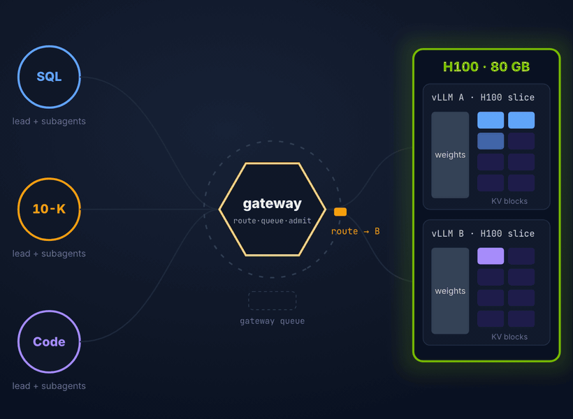
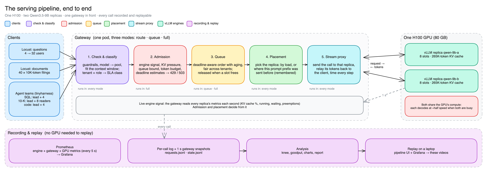
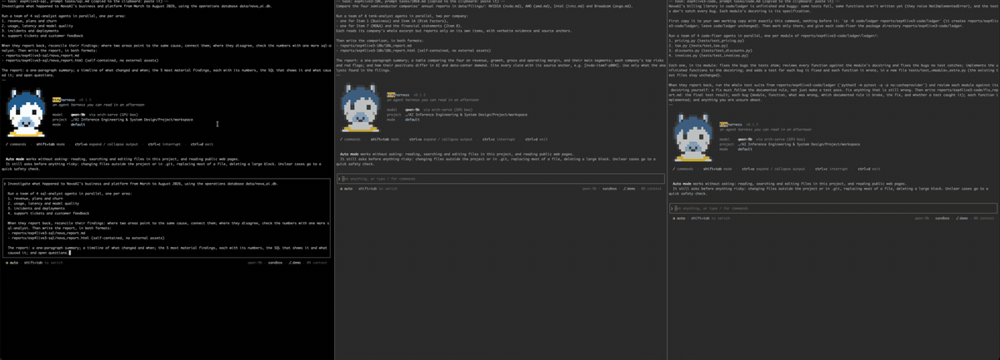
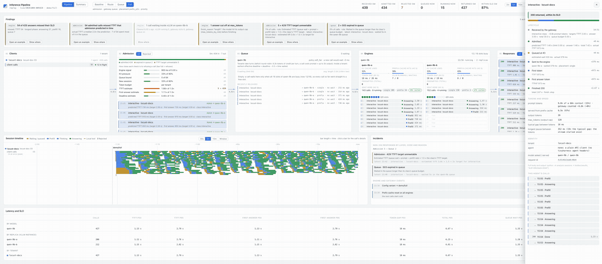
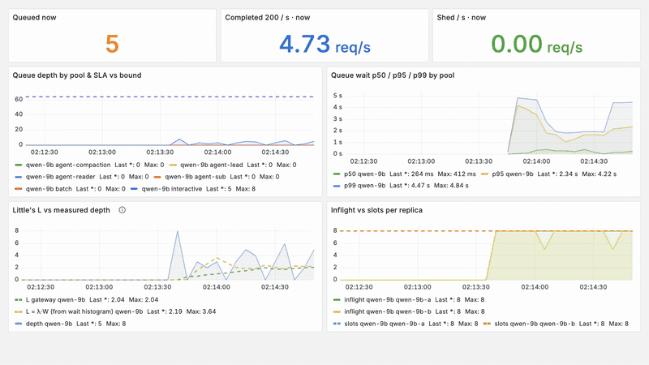
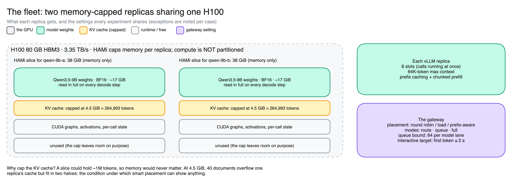
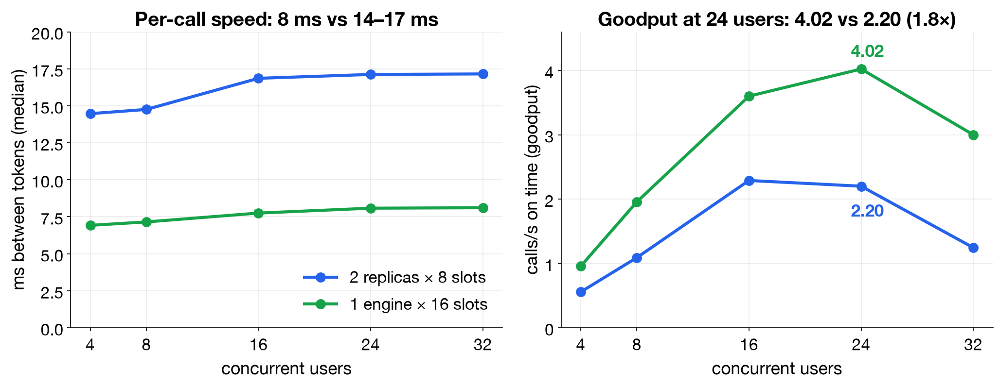
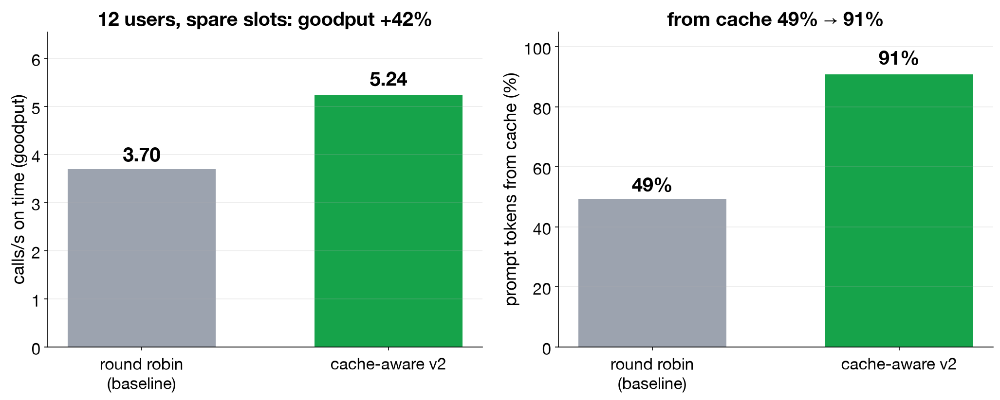
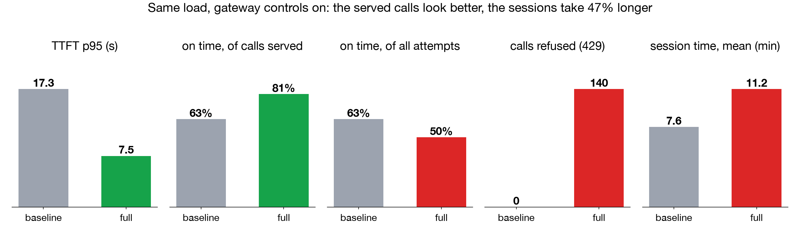
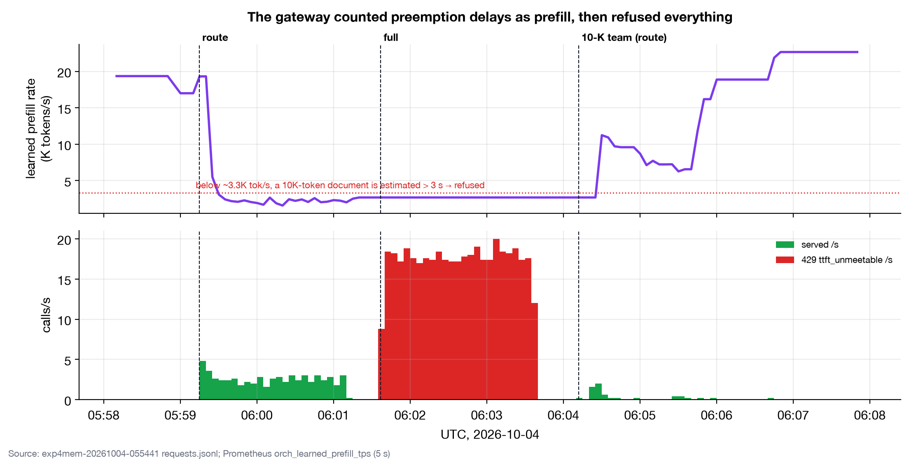

# Serving multi-tenant AI agents on one H100

[](https://github.com/anujdutt9/LLM_Inference_Engineering/actions/workflows/tests.yml)

<p align="center"></p>

I designed, built and benchmarked **orch-serve**, an inference gateway in front of vLLM on a single NVIDIA H100,
together with everything needed to test it honestly: an agent harness to generate real agent traffic, three
agent workloads with graded outputs, a GPU cluster with memory-sliced engines, a per-call pipeline UI, Grafana
dashboards, and an experiment framework that writes down each prediction and decision rule before the run. Then
I ran **21 experiments** on the H100 (7 with a 27B + 9B fleet, 14 with two 9B replicas) and wrote up every one,
including what went wrong, plus a failure analysis across them.

## Contents

1. [What the project is about](#1-what-the-project-is-about)
2. [What I did](#2-what-i-did)
3. [What I built](#3-what-i-built): [gateway](#31-the-gateway-orch-serve) · [agent harness](#32-the-agent-harness-tinyharness) · [UI and observability](#33-the-pipeline-ui-and-observability) · [workloads and data](#34-workloads-and-datasets) · [GPU platform](#35-the-gpu-platform) · [experiment framework](#36-the-experiment-framework)
4. [The experiments I ran](#4-the-experiments-i-ran)
5. [What I found](#5-what-i-found)
6. [What I learned](#6-what-i-learned)
7. [Limits and next steps](#7-limits-and-next-steps)

Reference: [Quick start on a laptop](#quick-start-on-a-laptop-no-gpu) · [Reproduce the experiments](#reproduce-the-experiments) ([runbook](docs/RUNBOOK.md)) · [Run on Lambda](#run-the-experiments-on-lambda) · [Every experiment, with its script](#experiments) · [Analyse, grade, replay](#analyse-grade-replay) · [Recordings and run data](#recordings-and-run-data) · [Repository layout](#repository-layout) · [Reproducibility notes](#reproducibility-notes) · [Acknowledgments](#acknowledgments)

## 1. What the project is about

LLM serving is usually tuned for chat: one user, one short prompt, one answer. **Agent traffic is different.** A
lead agent plans, then starts 4–8 subagents in parallel; every turn resends the whole history, so prompts grow
from ~4K to ~35K tokens; calls arrive in bursts; and a refused call does not go away, it comes back. Several teams
(tenants) share the same GPU.

The project asks one question about serving that traffic on **one H100**: **where does the waiting go, and who pays
for it?** Inside vLLM, where nothing can reorder it? In a gateway queue, where a deadline and fairness can decide?
At the door, as refusals? And what do replicas, cache-aware placement, admission control and KV-cache size each
do to latency, goodput, reliability and the quality of what the agents produce?

## 2. What I did

1. **Built a control plane** for vLLM: a streaming gateway with admission, a deadline-aware fair queue and
   prefix-aware placement, switchable live between four modes so each control can be measured on its own.
2. **Built the traffic**: my own agent harness (tinyharness) drives three agent teams (SQL analysis, 10-K
   comparison, coding), each with data and a grader; Locust drives question and document loads.
3. **Built the platform**: k3s and HAMi on a Lambda H100, two vLLM engines in GPU-memory slices, Prometheus,
   Grafana and DCGM; one command from an empty box to a serving fleet (~15 min).
4. **Worked out the memory and bandwidth math first** (weights, KV bytes per token, max concurrency, decode-step
   floor) from the model configs, and checked it against vLLM's boot logs ([MODELS_AND_MEMORY.md](docs/MODELS_AND_MEMORY.md)).
5. **Ran 21 experiments** on two fleets: a pre-flight gate before every run, a prediction and a pass/fail rule
   written down before each measurement, and every call recorded.
6. **Fixed what broke and re-measured each fix** (a dead replica that kept getting traffic: 188 → 8 failed calls; a
   placement policy that ignored a second cache holder: +36%; agent-harness limits sized for the wrong context
   window: fact recall 40% → 64%), and **documented what is still open** (session-aware admission, an admission
   estimator that locked itself out).
7. **Made it replayable**: every run can be replayed on a laptop in the UI and in Grafana, without a GPU.

## 3. What I built

### 3.1 The gateway (orch-serve)

An async, OpenAI-compatible streaming proxy (Starlette). Every call goes: edge guardrails → classify (model →
pool, tenant + agent role → SLA class) → **admission** (engine signal, KV pressure, queue bound, tenant token
bucket, predicted TTFT / first answer / whole call → 429 or 503 with `Retry-After`) → **queue** (per-model lanes;
earliest deadline first with aging inside a tenant, deficit round-robin across tenants) → **placement**
(round_robin, least_loaded, p2c, prefix_p2c, prefix_p2c_v2) → **stream** (SSE relayed as it arrives, every token
timed). Four modes, switchable live: `baseline`, `route`, `queue`, `full`. Configs: [`gateway/config.yaml`](gateway/config.yaml), [`gateway/config-27b-9b.yaml`](gateway/config-27b-9b.yaml).



| Area | What is implemented | Start here |
|---|---|---|
| Async serving | OpenAI-compatible streaming proxy, cancellation propagation, per-token timing, exact token counts with each engine's chat-template cost | [`gateway/serve.py`](gateway/serve.py) |
| Admission control | KV-pressure, queue-bound, token-bucket and deadline checks with explicit 429/503 reason codes; rates learned live from served calls | [`gateway/admission.py`](gateway/admission.py) |
| Fair scheduling | Per-model lanes, deficit round robin across tenants, EDF with aging within a tenant, five policies to compare | [`gateway/queue.py`](gateway/queue.py) |
| Placement | Round robin, least-loaded, power-of-two choices and two generations of prefix-aware routing | [`router/router.py`](router/router.py) |
| Intent routing | Per agent role: model, thinking budget, max_tokens fitted to the 64K window, SLA class | [`gateway/config-27b-9b.yaml`](gateway/config-27b-9b.yaml) |
| Reliability | Replica health freshness, failover, cache-state invalidation, client-disconnect cleanup | [`docs/experiments/c06.md`](docs/experiments/c06.md) |
| Overflow | A gate that can send no-capacity refusals to an external provider, with a budget and a dry run | [`gateway/overflow.py`](gateway/overflow.py) |
| Verification | 90 no-GPU tests (admission, queues, routing, cancellation, both fleets' configs, dashboards, the UI's event contract, analysis), run in CI | [`tests/`](tests/) |

### 3.2 The agent harness (tinyharness)

The application in this project is **tinyharness**, a terminal agent harness I wrote as a separate project (a
small, Claude Code-like CLI). It is what turns the gateway's clients into realistic agent traffic:

- a **lead agent** plans the task, then its Team tool starts **subagents in parallel** (SQL analysts, 10-K readers,
  code fixers, defined in [`workspace/.tinyharness/agents/`](workspace/.tinyharness/agents/));
- every call carries **tenant, session, agent and role headers**, so the gateway knows who is asking and can apply
  per-role models, thinking budgets and SLA classes;
- it **compacts** long histories into a summary, and **retries 429/503** after `Retry-After`;
- tools run locally in a sandbox; only model calls go over the network, to the gateway.

The recording below is a live run (c08): the three teams start in three terminals at once, the leads fan out
their subagents, and the gateway's pipeline UI shows the calls from every team. ([MP4, 43 s](docs/media/tinyharness-live.mp4))

[](docs/media/tinyharness-live.mp4)

tinyharness is not part of this repository (**link: _coming soon_**); the experiments use commit `07fd51e`,
pinned in [`workspace/tinyharness.pin`](workspace/tinyharness.pin). The project only configures it:
[`workspace/tinyharness.toml`](workspace/tinyharness.toml), the agent definitions, the task prompts in
[`workspace/tasks/`](workspace/tasks/) and the launcher [`workspace/th`](workspace/th). The gateway, the UI, the
Locust experiments and every replay work without it.

### 3.3 The pipeline UI and observability

**The pipeline UI** ([`ui/`](ui/)), served by the gateway at `/ui/`, shows every call's path live: clients,
admission decisions with their reasons, the queue in release order, each engine's slots, responses, incidents, a
session timeline per agent, and a drawer that explains what happened to any one call. It replays any recorded run.
Below, the full-mode demo (c04, 24 users, 40 documents): calls wait in the gateway queue in deadline order and go
to whichever replica frees a slot. ([MP4, 60 s](docs/media/c04-ui.mp4))

[](docs/media/c04-ui.mp4)

**Observability**: Prometheus every 5 s; eight Grafana dashboards generated from code
([`observability/dashboards.py`](observability/dashboards.py)) for the gateway, engines, tenants and SLAs, GPU
(DCGM) and each experiment; and a Docker stack that replays any run's Prometheus data on a laptop. The same seconds
as above, in Grafana: both replicas held at exactly 8 slots, the queue wait in seconds, and Little's law
(L = λW) tracking the measured queue depth. ([MP4, 60 s](docs/media/c04-grafana-queue.mp4))

[](docs/media/c04-grafana-queue.mp4)

### 3.4 Workloads and datasets

| Workload | Driven by | What it is | Data | Graded by |
|---|---|---|---|---|
| **SQL team** | tinyharness | a lead + 4 (or 8) analysts investigate six months of a fictional AI-API company's operations and write a report | **NovaAI**, a synthetic, seeded SQLite dataset I generated: 8 tables (2,000 customers, ~245K usage events, invoices, tickets, incidents, feedback, deployments, GPU metrics) with planted stories | 49 benchmark questions with expected facts and verification SQL |
| **10-K team** | tinyharness | a lead + 4 (or 8) readers compare NVIDIA, AMD, Intel and Broadcom, with citations | the latest 10-K of each, trimmed to ~10K tokens with citation anchors by [`app/agents/prep_10k.py`](app/agents/prep_10k.py) | citations checked against the anchor index |
| **Coding team** | tinyharness | a lead + 4 coders repair a billing library and add tests | a library with planted bugs and unfinished functions | hidden tests per planted bug |
| **Questions** | Locust | the 49 NovaAI questions, one streamed call each, a shared 2K-token prefix, five tenants | [`datasets/exp3/`](datasets/exp3/) | latency targets per SLA class |
| **Documents** | Locust | 40 distinct ~10K-token documents, one short question each, sized to overflow one replica's KV cache | the trimmed 10-Ks | latency targets |

Details: [datasets/README.md](datasets/README.md).

### 3.5 The GPU platform

One **H100 80 GB SXM5** (HBM3, 3.35 TB/s) on Lambda, k3s, and HAMi capping each vLLM pod's GPU memory (compute is
shared, not partitioned); **vLLM v0.30.0** with 64K context, FP8 KV cache, prefix caching and chunked prefill.
Two fleets, switchable with one variable:

| | Setup A (`FLEET=27b-9b`): Exp-0 to Exp-2 | Setup B (`FLEET=two-9b`, default): Exp-4 |
|---|---|---|
| Engines | **Qwen3.8-27B-FP8** (lead, analysts, coders) + **Qwen3.5-9B** BF16 (readers, fast roles) | two identical **Qwen3.5-9B** BF16 replicas, `qwen-9b-a` and `qwen-9b-b` |
| HAMi slices | 47,104 MiB + 31,232 MiB | 2 × 38,912 MiB |
| Slots (`--max-num-seqs`) | 8 + 8 | 8 + 8 (16 in c09) |
| KV cache | ~362K tokens (~37.7 KB/token) + ~585K tokens (~18.2 KB/token) | capped at 4.5 GiB = 264,993 tokens each (1.25 GiB in c14) |
| Routing | by intent: each agent role gets its model, thinking budget and SLA class | one pool, placement between the replicas |



Why these models and this GPU, how the slices were sized (weights vs KV vs runtime), and what the KV size means
for max concurrency and token limits, with the arithmetic: [docs/MODELS_AND_MEMORY.md](docs/MODELS_AND_MEMORY.md).

### 3.6 The experiment framework

- **A gate before every run** ([`experiments/exp0_check.py`](experiments/exp0_check.py)): 23 checks on Setup A, from "each
  model answers as itself" and streamed tool calls to a prefix-cache hit, cancellation freeing the engine, each pod
  seeing its HAMi slice and the KV size. Nothing runs until it passes.
- **Predictions and decision rules written before each run** (e.g. scale-out confirmed if S₂ ≥ 1.3 or the knee
  moves; placement adds value at > 15%; the kill fix works at ≤ 5% of the failures).
- **One script per experiment** ([`experiments/`](experiments/)): refuses to start while anything else uses the
  gateway, snapshots the stack before and after, collects the gateway's per-call logs and a Prometheus snapshot,
  and writes a report with the verdicts ([`analysis/scale.py`](analysis/scale.py)).
- **Graders** for the agents' work ([`analysis/grade.py`](analysis/grade.py), [`analysis/grade_code.py`](analysis/grade_code.py)),
  and **replay** of any run in the UI and in Grafana.
- **A fake vLLM engine** ([`router/fake_vllm.py`](router/fake_vllm.py)) so the whole stack runs on a laptop.

## 4. The experiments I ran

**21 experiments and a failure analysis**, each with its own page: setup, prediction, how to run it, the data,
what went wrong and how it was fixed, and what it taught. All the numbers: [docs/RESULTS.md](docs/RESULTS.md). The scripts:
[Experiments](#experiments).

| Theme | Setup A: 27B + 9B, agent teams | Setup B: two 9B replicas |
|---|---|---|
| Is the stack right? | [Exp-0](docs/experiments/exp0.md) the gate | |
| Can one team finish? | [Exp-1A](docs/experiments/exp1a.md) SQL · [Exp-1B](docs/experiments/exp1b.md) 10-K, 9B vs 27B lead · [Exp-1C](docs/experiments/exp1c.md) coding | |
| Sharing one GPU | [Exp-2](docs/experiments/exp2.md) two teams at once · [Exp-2M](docs/experiments/exp2m.md) three workloads | |
| Capacity | | [c01](docs/experiments/c01.md) one vs two replicas · [c09](docs/experiments/c09.md) one engine × 16 slots vs two × 8 |
| Placement | | [c02](docs/experiments/c02.md) four policies · [c10](docs/experiments/c10.md) with spare capacity · [c11](docs/experiments/c11.md) at saturation, v1 vs v2 |
| Gateway controls | [Exp-2c](docs/experiments/exp2c.md) admission on 20 agents | [c03](docs/experiments/c03.md) the four modes · [c04](docs/experiments/c04.md) everything on · [c05](docs/experiments/c05.md) queue depth |
| Reliability | | [c06](docs/experiments/c06.md) a replica dies, before and after the fix |
| Memory | | [c14](docs/experiments/c14.md) KV cache too small for the load |
| Disaggregation | | [c12](docs/experiments/c12.md) prefill → decode KV hand-off with NIXL · [c13](docs/experiments/c13.md) with Mooncake |
| Agents on Setup B | | [c07](docs/experiments/c07.md) headless · [c08](docs/experiments/c08.md) live |
| Retrospective | | [c15](docs/experiments/c15.md) every issue found, its fix and its status |

## 5. What I found

**1. On one GPU, a second replica adds slots, not speed. Batch before you replicate.** Two 9B replicas moved the
knee from 8 to 16 users, but tokens/s stayed at ~1,000: the replicas take turns on the same memory bandwidth, so
each call's token gap doubled (7 → 14–17 ms). One engine with 16 slots sustained 24 users at **1.8× the goodput**,
with an 8 ms token gap ([c01](docs/experiments/c01.md), [c09](docs/experiments/c09.md)).



**2. Cache-aware placement pays only with spare capacity and an accurate view of the cache.** With spare slots,
prefix-aware placement served **91% of prompt tokens from cache (vs 49%)** and **+42% goodput**
([c10](docs/experiments/c10.md)). At saturation, fixing two flaws in the first version gave **+36%**
([c11](docs/experiments/c11.md)). With a gateway queue in front, the queue usually decides placement: 1,016 of
1,129 calls had only one candidate ([c04](docs/experiments/c04.md)).



**3. Chat-style admission hurts agents.** With 20 agents on 8 slots, turning admission on made every dashboard
number better (TTFT p95 17.3 → 7.5 s, goodput +19%) while **38% of calls were refused, 14 agents died and the
sessions took 47% longer**: a refused agent step comes back ([Exp-2c](docs/experiments/exp2c.md)).



**4. A queue trades refusals for waiting; it adds no capacity.** Queue bounds of 0 / 2 / 8 / 64 served the same
~2.25 calls/s; refusals fell 481 → 0 while TTFT p99 rose 0.28 → 6.58 s ([c05](docs/experiments/c05.md)).

**5. Liveness has to be in the routing path.** Killing a replica mid-run failed **188 of 782 calls** until it came
back; routing only to replicas with a fresh health signal cut that to **8 of 675**, all already in flight on the
dead pod ([c06](docs/experiments/c06.md)).

**6. An estimator that learns only from what it admits can lock itself out.** With a KV cache too small for the load,
vLLM preempted 194 times and goodput fell 4.56 → 0.09/s. The gateway learned those delays as slow prefill
(19K → 2.7K tok/s), so in full mode it refused **all 2,158 calls**, with the GPU idle, and never re-learned
([c14](docs/experiments/c14.md)).



**7. KV hand-off between replicas works; the link decides whether it pays.** Prefill on one replica and decode
on the other recomputed 1 token of ~10K. Over NIXL (UCX on TCP, ~92 MB/s) it was 6× slower than recomputing;
Mooncake moved the same 214.5 MiB at 1,319 MB/s and gave the first token 25% sooner
([c12](docs/experiments/c12.md), [c13](docs/experiments/c13.md)).

**8. The model behind each agent role decides quality.** Serving held when every agent ran on the 9B (even split,
77% of prompt tokens from cache, no preemption), but the 9B leads found fewer facts and lost citations: SQL recall
12% vs 64% with a 27B lead ([c07](docs/experiments/c07.md), [c08](docs/experiments/c08.md), [Exp-1A](docs/experiments/exp1a.md)).

## 6. What I learned

The rules I would deploy with, and the run each one came from:

| # | Rule | Evidence |
|---|---|---|
| 1 | **Work out KV and bandwidth from the model config first.** Block size, KV capacity, transfer size and token gaps all matched the arithmetic exactly | [MODELS_AND_MEMORY.md](docs/MODELS_AND_MEMORY.md), [c12](docs/experiments/c12.md), [c14](docs/experiments/c14.md) |
| 2 | **Route by role**: model, thinking budget and latency targets per agent role | SQL fact recall 12% with a 9B lead vs 64% with a 27B lead ([c08](docs/experiments/c08.md), [Exp-1A](docs/experiments/exp1a.md)) |
| 3 | **Admit agents by session, not by call** | better latency numbers, 47% slower sessions ([Exp-2c](docs/experiments/exp2c.md)) |
| 4 | **On one GPU, batch before you replicate** | one 16-slot engine: 1.8× the goodput of two 8-slot replicas ([c09](docs/experiments/c09.md)) |
| 5 | **Cache-aware placement needs an accurate view of the cache** | +42% with spare slots, +36% from fixing v1 at saturation ([c10](docs/experiments/c10.md), [c11](docs/experiments/c11.md)) |
| 6 | **Size the queue from the latency target** | the same throughput at every depth; p99 0.28 → 6.6 s ([c05](docs/experiments/c05.md)) |
| 7 | **Route only to replicas with a fresh health signal** | failed calls during a replica kill: 188 → 8 ([c06](docs/experiments/c06.md)) |
| ! | **Don't let an estimator learn only from what it admits** | preemption poisoned it and it survived the mode switch: 2,158 / 2,158 refused ([c14](docs/experiments/c14.md)) |

## 7. Limits and next steps

- One shared H100: these results are about the serving layer, not hardware scaling. Capacity numbers come from
  synthetic load; agent runs vary from run to run. One run per variant, except c01 and c02, which were repeated
  (±5%). The P/D probes used 4 documents over TCP, without load.
- Next: **session-aware admission** (queue calls from running sessions, refuse only new ones) and re-run Exp-2c;
  an estimator that decays, probes and resets when the config changes; **two GPUs**, to see whether replicas then
  add speed and whether these rules still hold.

The talk that presents all of this: [docs/presentation/deck/presentation.html](docs/presentation/deck/presentation.html)
(how to open it with its videos: [Recordings and run data](#recordings-and-run-data)).

## Reference

### Quick start on a laptop (no GPU)

Needs Python 3.11+, and Docker for the Grafana replay only. Everything here runs against recorded data or against
fake engines (`router/fake_vllm.py`: the OpenAI streaming API, vLLM-shaped `/metrics`, slots, a prefix cache and
engine-like timing).

| Step | Command | What to expect |
|---|---|---|
| 1. Clone and install | `git clone https://github.com/anujdutt9/LLM_Inference_Engineering.git`<br>`cd LLM_Inference_Engineering && make setup` | `.venv/` with everything in `requirements.txt` |
| 2. Unpack the data | `make data` | `datasets/exp1a/nova_ai.db unpacked (84 MiB), sha256 verified` |
| 3. Run the tests | `make test` | every test passes (admission, queue, placement, cancellation, both fleets' configs, dashboards, the UI's event contract, analysis) |
| 4. Replay a real run in the UI | `make replay` | the browser opens the pipeline UI replaying the full-mode demo recorded on the H100 (1,160 calls, 4 min). The replay bar plays, changes speed (1–30×) and scrubs; click any call to see its whole life |
| 5. Replay its Grafana | `make grafana` (Docker running) | Grafana on http://127.0.0.1:3000 (no login) with Prometheus serving that run's 10-minute window; open the printed `Pipeline` or `Exp-4` link. `make grafana-stop` when done |
| 6. Run the gateway live | `make local` (keep it running) | the real gateway on :8080 in front of two fake 9B replicas; open http://127.0.0.1:8080/ui/ |
| 7. Put load on it | in a new terminal:<br>`.venv/bin/locust -f app/locustfile.py NovaUser --headless -u 12 -r 4 -t 60s --host http://127.0.0.1:8080` | ~6 calls/s, 0 failures, the UI moving. `bash experiments/mode.sh route` / `queue` / `full` switches the gateway's mode live |
| 8. Try Setup A | Ctrl-C step 6, then `make local-27b` | the same with a fake 27B and 9B: two pools, routing by agent role |

### Reproduce the experiments

Start with the one-command functional rehearsal—no GPU, cloud account or model download required:

```bash
bash experiments/smoke_local.sh
```

It starts two accelerated fake vLLM engines, exercises all three scale-out variants through the real gateway,
and writes Locust CSV, HTML, configuration and timing metadata under `results/exp4/smoke-local-*/locust/`.
This validates the experiment machinery; its numbers are deliberately **not** comparable with the H100 results.

The complete [reproduction runbook](docs/RUNBOOK.md) then walks through the same lifecycle on the GPU: machine
setup, the preflight gate, a short paid-resource smoke run, every full experiment driver, expected runtime
and output, artifact collection, analysis, replay and teardown. Each experiment page adds its predeclared
prediction, success rule and interpretation.

### Run the experiments on Lambda

You need a [Lambda](https://lambda.ai) **1× H100 80 GB SXM5** instance (Lambda's Ubuntu image; NVIDIA driver
≥ 580 for vLLM's CUDA 13 image), its IP and SSH key, and steps 1–3 above on the laptop. The box cost ~$4.29/hr
when these runs were made: terminate it when you are done. Lambda's firewall only allows SSH, so everything is
reached through the SSH tunnel on `127.0.0.1`.

| Step | Where | Command | What to expect |
|---|---|---|---|
| 1. Point at the box | laptop | `cp .env.example .env`, then set `LAMBDA=ubuntu@<ip>` and `LAMBDA_SSH_KEY=<path to key>` | |
| 2. Copy the code | laptop | [`make sync`](setup/sync_to_lambda.sh) | the repo in `~/llm-inference` on the box |
| 3. Open the tunnel | laptop, keep it open | [`make ssh`](setup/ssh.sh) | a shell on the box in `~/llm-inference`; forwards the gateway :8080, vLLM :8000–8002, Grafana :31495, Prometheus :31490 |
| 4. Build everything | box (the step-3 shell) | [`bash setup/demo_cluster.sh`](setup/demo_cluster.sh) (Setup B)<br>[`FLEET=27b-9b bash setup/demo_cluster.sh`](setup/demo_cluster.sh) (Setup A) | about 15 min: model download, k3s + HAMi, Prometheus + Grafana + DCGM + dashboards, the engines one at a time, then the gateway. Ends with each engine's boot numbers (KV tokens, max concurrency) and Grafana's password |
| 5. Size the KV cache as measured | box | Setup B: [`KV_GIB=4.5 bash setup/demo_apply.sh`](setup/demo_apply.sh) | both replicas restarted with 264,993 KV tokens each, as in every Setup B run |
| 6. The gate | laptop | [`make gate`](experiments/exp0_check.py) | one line per check, `PASS` / `FAIL`, ending `ALL PASS`: models answer as themselves, tool calls, reasoning, a prefix-cache hit, cancellation frees the engine, each pod sees its HAMi slice, KV size. Run nothing until it passes |
| 7. Look at it | browser | UI http://127.0.0.1:8080/ui/ · Grafana http://127.0.0.1:31495 (dashboards `Demo / …`) | |
| 8. Run an experiment | laptop | see [Experiments](#experiments) | each script refuses to start while anything else is using the gateway, runs the gate, snapshots the stack before and after, and files everything under `results/` |
| 9. Collect before teardown | laptop | [`bash experiments/collect.sh`](experiments/collect.sh) | the gateway's logs, a Prometheus snapshot, Grafana markers, agent transcripts and reports, pulled into `results/` |

Switch fleets without rebuilding: `FLEET=27b-9b bash experiments/redeploy.sh fleet` (or `FLEET=two-9b`). Restart
only the gateway after a config change: `bash experiments/redeploy.sh gateway`. The agent-team runs also need
tinyharness in `.venv` at the pinned commit: `.venv/bin/pip install -e "<tinyharness checkout>[tokens]"`.

### Experiments

Every experiment has a page: the setup, the prediction written before it ran, how to run it, the data, what went
wrong and how it was fixed, and what we learned. All the numbers in one table: [docs/RESULTS.md](docs/RESULTS.md).

#### Setup A: 27B + 9B with intent-aware routing (`FLEET=27b-9b`)

Agent teams in tinyharness, one terminal per team: [`cd workspace && ./th <task> <label>`](workspace/th) (it prints the task and
copies it to the clipboard; `TH_HEADLESS=1` runs it unattended). After each run: [`bash experiments/finish.sh <label>`](experiments/finish.sh).

| Exp | Question | Run it | Time | Result | Page |
|---|---|---|---:|---|---|
| Exp-0 | Is the stack right before anything is measured? | [`make gate`](experiments/exp0_check.py) | | ALL PASS 23 / 23; prefix cache cut TTFT 0.685 → 0.185 s (27B) | [exp0](docs/experiments/exp0.md) |
| Exp-1A | Can a SQL team on the 27B finish inside a 64K window? | [`mode.sh full`](experiments/mode.sh), [`./th sql exp1a`](workspace/th) | ~18 min | after four attempts and four fixes: fact recall 40% → 64% | [exp1a](docs/experiments/exp1a.md) |
| Exp-1B | 10-K team: 9B lead vs 27B lead | `./th 10k exp1b --model gw:qwen-9b`, `./th 10k exp1b-27b` | 3–9 min | 9B lead 3.1 min with 3 table errors; 27B lead 9.0 min, none | [exp1b](docs/experiments/exp1b.md) |
| Exp-1C | Coding team alone | [`./th code exp1c`](workspace/th) | ~4 min | 16 / 16 hidden tests in 3.7 min | [exp1c](docs/experiments/exp1c.md) |
| Exp-2 | Two teams at once: who pays? | [`mode.sh baseline`](experiments/mode.sh), then `./th sql …` and `./th 10k …` in two terminals | ~14 min | the 9B's token gap 8.6 → 17.8 ms from sharing compute; nothing refused | [exp2](docs/experiments/exp2.md) |
| Exp-2c | 4 coding sessions (20 agents, 8 slots): baseline vs full | four terminals `./th code exp2c-n4-<mode>-<i>`, per mode | ~10 min per mode | full: TTFT p95 17.3 → 7.5 s, goodput +19%, but 38% refused and sessions 47% longer | [exp2c](docs/experiments/exp2c.md) |
| Exp-2M | All three workloads, larger teams | `./th sql8 …`, `./th 10k8 …`, `./th code …` | ~30 min | partial record; refusals hit the 9B readers | [exp2m](docs/experiments/exp2m.md) |

#### Setup B: two 9B replicas (`FLEET=two-9b`, Exp-4)

Each script runs unattended and files its run under `results/exp4/<run>/`, with a `report.md`.

| # | Question | Run it | Time | Result | Page |
|---|---|---|---:|---|---|
| c01 | Does a second replica move the knee? | [`bash experiments/exp4_scale.sh`](experiments/exp4_scale.sh) (part 1) | ~70 min for parts 1–4 | knee 8 → 16 users; tokens/s unchanged: slots, not speed | [c01](docs/experiments/c01.md) |
| c02 | Which placement policy, under load? | [`exp4_scale.sh`](experiments/exp4_scale.sh) (part 2), [`exp4_more.sh`](experiments/exp4_more.sh) (A) | | every load-aware policy +11–18% over round robin; prefix-aware +12–23% | [c02](docs/experiments/c02.md) |
| c03 | What do the gateway's modes do? | [`exp4_scale.sh`](experiments/exp4_scale.sh) (part 3) | | the queue takes the waiting out of vLLM; full puts interactive first (76% on time) | [c03](docs/experiments/c03.md) |
| c04 | Everything on at once | [`bash experiments/exp4_demo.sh`](experiments/exp4_demo.sh) | ~6 min | the queue decides placement (1,016 of 1,129 `single`) | [c04](docs/experiments/c04.md) |
| c05 | How deep should the queue be? | [`bash experiments/exp4_more.sh`](experiments/exp4_more.sh) (B) | ~60 min for A–E | served/s flat; depth trades refusals (481 → 0) for waiting (p99 0.28 → 6.58 s) | [c05](docs/experiments/c05.md) |
| c06 | A replica dies | [`exp4_more.sh`](experiments/exp4_more.sh) (D before the fix, E after) | | failures 188 → 8 | [c06](docs/experiments/c06.md) |
| c07 | Agent teams, headless | [`exp4_scale.sh`](experiments/exp4_scale.sh) (part 4) or [`bash experiments/exp4_agents.sh`](experiments/exp4_agents.sh) | ≤ 30 min | even split, 77% from cache, no preemption | [c07](docs/experiments/c07.md) |
| c08 | Agent teams, live | [`bash experiments/exp4_live_agents.sh prepare <name>`](experiments/exp4_live_agents.sh), run the three printed commands, then `… finish <name>` | ~15 min | serving held; quality low with a 9B lead | [c08](docs/experiments/c08.md) |
| c09 | One engine × 16 slots vs two × 8 | [`PARTS=H1 bash experiments/exp4_h2h.sh`](experiments/exp4_h2h.sh) | | knee 24, 1.8× goodput: batch before replicas | [c09](docs/experiments/c09.md) |
| c10 | Placement with spare capacity | [`PARTS=H2 bash experiments/exp4_h2h.sh`](experiments/exp4_h2h.sh) | | +42% goodput, 91% from cache | [c10](docs/experiments/c10.md) |
| c11 | Placement at saturation, v1 vs v2 | [`PARTS=H3 bash experiments/exp4_h2h.sh`](experiments/exp4_h2h.sh) | ~45 min for H1–H3 | +36% from fixing v1 | [c11](docs/experiments/c11.md) |
| c12 | Prefill → decode KV hand-off, NIXL | [`bash experiments/exp4_pd.sh`](experiments/exp4_pd.sh) | ~20 min | works; 2.2–2.5 s vs 0.35–0.40 s to recompute | [c12](docs/experiments/c12.md) |
| c13 | The same with Mooncake | [`CONNECTOR=mooncake bash experiments/exp4_pd.sh`](experiments/exp4_pd.sh) | ~20 min | 1,319 MB/s, 14× NIXL; first token 25% sooner than recomputing | [c13](docs/experiments/c13.md) |
| c14 | Memory pressure (KV 1.25 GiB) | [`bash experiments/exp4_mem.sh`](experiments/exp4_mem.sh) | ~20 min | 194 preemptions, goodput 4.56 → 0.09/s; full mode refused everything | [c14](docs/experiments/c14.md) |
| c15 | What went wrong, and what we learned from it | | | every issue found during Exp-4, its fix and status | [c15](docs/experiments/c15.md) |

Every script explains its parts, options and timings in its header comment. Pieces, for one part at a time: `experiments/exp4_locust.sh` (one Locust part over a group of
`experiments/variants.yaml`), `experiments/variant.sh <group>/<name>` (apply one variant by hand),
`experiments/mode.sh <mode>`, `experiments/redeploy.sh fleet|gateway` (with `KV_GIB`, `MAX_SEQS`, `FLEET`).

### Analyse, grade, replay

| Command | Does |
|---|---|
| `.venv/bin/python -m analysis.scale results/exp4/<run>` | knee, goodput, S₂ and the verdicts → `report.md` / `report.json` |
| `.venv/bin/python -m analysis.grade results` | SQL and 10-K report quality against ground truth → `results/analysis/quality.md` |
| `.venv/bin/python -m analysis.grade_code <label>` | the coding team's work against the hidden tests |
| `.venv/bin/python -m analysis.knee` | Exp-2c's knee table from the agent runs |
| `bash experiments/replay.sh <run>/replay.jsonl` | the pipeline UI replaying a run (several files merge) |
| `bash observability/local/replay.sh <prometheus snapshot dir>` | Grafana on :3000 over a run's Prometheus data (Docker) |
| `make charts` | re-draw `docs/presentation/charts/` from the run folders |

### Recordings and run data

The full raw artifacts are kept out of git (Prometheus snapshots, per-call logs, agent transcripts and screen
recordings from every H100 run) and are in the project's shared Drive folder: **link: _coming soon_**. The
repository carries one complete, compact run, the charts and the short clips used in this README.

| Drive folder | What | Put it at |
|---|---|---|
| `video/` | every UI and Grafana replay clip used by the experiment pages and the deck | `docs/presentation/video/` |
| `results/` | every run: per-call logs, 1 s gateway state, Locust CSVs, Prometheus snapshots, before/after stack snapshots, reports, agent outputs and transcripts | `results/` |
| `recordings/` | the raw screen recordings of the live runs | anywhere |

With `results/` in place, every `analysis.*` command, `make charts` and both replays work on the real runs. The
repo itself carries one complete small run to try things on: [samples/exp4-demo-full/](samples/exp4-demo-full/window.md).

**The talk**: [docs/presentation/deck/presentation.html](docs/presentation/deck/presentation.html). Open the file
in a browser from your clone (no server needed); ← / → move between slides, `F` goes full screen, `A` jumps to the
appendix. Every chart, diagram and number is in the repository. The UI and Grafana clips are not: each video slide
shows a frame of its clip, and clicking it opens the shared Drive folder. To play them inside the deck, download
the Drive folder's `video/` into `docs/presentation/video/`.

### Repository layout

```
gateway/        orch-serve: serve.py (HTTP + streaming), admission.py, queue.py, config*.yaml, metrics, codes
router/         model pools and replicas (pools.py), placement policies (router.py), event log (trace.py),
                fake_vllm.py (a vLLM stand-in for the laptop)
app/            guardrails (the edge), locustfile.py + locust_ramp.py (load), agents/prep_10k.py (10-K trimming)
ui/             the pipeline UI (served at /ui/; also the replay viewer)
experiments/    one script per experiment, the gate (exp0_check), snapshot / collect / finish / replay helpers
analysis/       scale (knee, verdicts), grade, grade_code, knee, sessions, replays, charts
setup/          cluster bring-up (k3s + HAMi, observability, models, fleet), SSH tunnel, sync, local fleet
k8s-config/     vLLM manifests for both fleets (hami/), the gateway, Prometheus / Grafana / DCGM, dashboards
observability/  dashboard generator; local/: the Prometheus + Grafana replay stack (Docker)
workspace/      what the agent teams see: tasks/, data/, code/, agent definitions, tinyharness configs, th
datasets/       the NovaAI database (compressed), 10-K filings, questions, coding ground truth
samples/        one recorded run (UI replay + Prometheus window) for the laptop
docs/           RESULTS.md, MODELS_AND_MEMORY.md, experiments/ (one page each), presentation/ (deck, charts,
                diagrams, images), media/ (this README's clips)
tests/          pytest suite (no GPU, no network)
```

### Reproducibility notes

- Versions as run (2026-10-03/04): vLLM `vllm/vllm-openai:v0.30.0`, HAMi 2.9.0, k3s v1.36, Qwen/Qwen3.5-9B BF16,
  Qwen/Qwen3.8-27B-FP8, tinyharness `07fd51e` (Setup A's agent runs used an earlier tinyharness build). Python
  packages: `requirements.txt` (minimum versions).
- The Locust experiments repeat within about ±5% (c01 and c02 were each run twice to measure this). Agent runs
  are not deterministic (sampling, tool choices): expect different call counts and session times.
- The overflow gate (send no-capacity refusals to an external provider) is built and tested but was off in every
  Setup B run; set `OVERFLOW_API_KEY` in `.env` and run `bash setup/overflow_secret.sh` to try it.
- The NovaAI data is synthetic (a fictional company, seeded); the 10-Ks are each company's published annual
  report, trimmed (sources in `datasets/exp1b/filings/manifest.json`).

## Acknowledgments

Thank you to [Superlinked](https://superlinked.com/) and [Lambda](https://lambda.ai/) for providing the credits
that made the H100 experiments possible. Their support provided the infrastructure; the experiment design,
gateway implementation, measurements, analysis and conclusions are my own.
