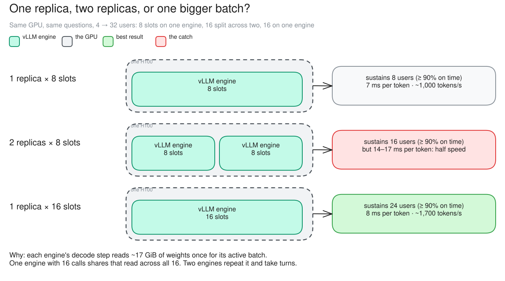
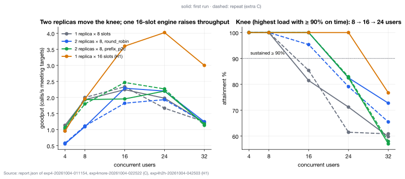
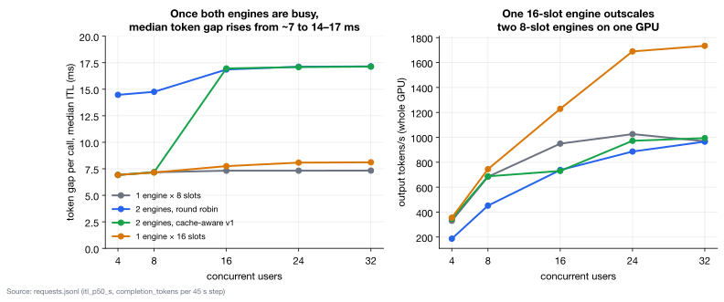

# c01 · One replica vs two (Part 1, repeat C)

[← all experiments](../../README.md#experiments) · all numbers: [RESULTS.md](../RESULTS.md) · how to run it: [README](../../README.md#run-the-experiments-on-lambda)

## What we're doing

Earlier Exp-1/2 runs already showed how a single 27B-model replica behaves as load rises, but that older result is not a fair speed comparison with the new 9B fleet. C01 therefore begins with a matching 9B control: replica a handles the load while replica b stays deployed but receives no calls. We then enable replica b with the same model and the same eight request slots, and repeat the identical user ramp to see whether two serving processes on one shared H100 move the point where requests begin missing their latency targets.

## Why

The earlier 27B run establishes the broad single-replica problem—one engine eventually saturates—but model size and setup also affect performance. The one-replica step inside C01 supplies the apples-to-apples baseline needed to isolate replica count. Comparing that control with two active 9B replicas tells us what replication itself adds on this machine and whether sharing one GPU prevents it from adding actual token-generation throughput.

## At a glance

| | Plain-language summary |
|---|---|
| **Changed** | one active replica versus two active replicas |
| **Baseline** | one 8-slot vLLM engine; replica b stayed deployed but idle |
| **Success rule** | the sustained-load knee moves at least one user step right, or maximum goodput improves by at least 30% |
| **Result** | the knee moved 8 → 16 users, but two engines did not increase total token throughput on the shared GPU |

## Setup

| Setting | This experiment |
|---|---|
| Model | Qwen3.5-9B, BF16 (~17 GiB of weights), on every replica |
| GPU | one NVIDIA H100 80 GB, shared by all replicas |
| Replicas | **1 (`one`: replica b deployed but idle, the control), then 2** (changed) |
| HAMi memory per vLLM | 38 GiB (a memory cap only: compute is shared, not partitioned) |
| Slots per replica | 8 (calls generating at once; more wait) |
| KV cache per replica | 4.5 GiB = 264,993 tokens (capped on purpose) |
| Max context | 64K tokens |
| KV connector | none (each replica keeps its own cache) |
| Placement | round robin; cache-aware v1 |
| Gateway mode | route (no queue, no admission) |
| Load | Locust: 49 chat questions (shared 2K-token context, 400–1,500-token answers) |
| Users | 4 → 8 → 16 → 24 → 32, 45 s per step |
| Runs | main run (01:12) and repeat C (02:52) |

## What to expect, and what to look at

- The test: the same chat questions, ramped 4 → 8 → 16 → 24 → 32 users (45 s per step), on one replica, then on two (round robin, cache-aware). Run twice.
- Look at: the Engines card's slots and "waiting inside vLLM", and the token gap per replica.
- Expect: one replica fills its 8 slots by ~8 users and calls start waiting; two replicas hold out to ~16.

**Prediction, written before the run:** A second replica moves the knee from ~8 to ~14–18 users; S2 ≈ 1.3–1.7.

## How to read the numbers

- Knee: the highest user step where at least 90% of attempts met both latency targets and none failed; every lower step must also pass.
- Goodput: completed calls per second that met their targets. S₂ compares the best two-replica goodput with the best one-replica goodput.
- Token gap / ITL: time between output tokens for one call; lower feels faster to the user.
- Measurement layer: the UI call drawer measures gaps between chunks observed by the client (~7 ms with one engine), while the Grafana latency view uses vLLM's engine-side ITL histogram (~5 ms). Compare values within the same view; both show the two-engine slowdown.

## How it works

A replica has 8 slots: 8 calls generate at once and the rest wait. A second replica adds 8 more slots, so the point where calls start missing their target (the knee) should move from ~8 to ~16 users. But both replicas share one GPU. Each engine's decode step reads the ~17 GiB of weights once and advances its active batch by one token per call. Two independent engines repeat that weight read and take turns on the shared bandwidth, so each call streams at about half speed. The second replica adds slots, not speed.

**How to read this diagram:** Read left to right as three ways to arrange capacity on the same H100. The boxes are vLLM processes, the small cells are concurrent-request slots, and the arrows into one GPU show that replicas add scheduling slots but not a second memory bus. The rightmost design is the H1 control tested in c09.

## Watch it

Each clip is replayed from the recorded run, never live. The UI video and its Grafana views show the same seconds. **The videos are in the project's shared Drive folder** (see the README, "Recordings and run data"): download its `video/` folder into `docs/presentation/video/` and these links play locally.

#### Clip `c01-one`: 01:13:10–01:15:10 UTC at 2× (60 s of video)
- **UI replay:** `video/ui/c01-one.mp4` (`../presentation/video/ui/c01-one.mp4`)
- **Grafana (same moment, side by side):** scale-out (`../presentation/video/grafana/c01-one/scale.mp4`) · latency (TTFT / ITL) (`../presentation/video/grafana/c01-one/latency.mp4`) · tokens and cache (`../presentation/video/grafana/c01-one/tokens.mp4`) · GPU (`../presentation/video/grafana/c01-one/gpu.mp4`) · SLOs and goodput (`../presentation/video/grafana/c01-one/slo.mp4`)
- **What to notice:** 8 → 16 → 24 users on one replica: qwen-9b-a fills its 8 slots and calls start waiting inside vLLM. (qwen-9b-b, the idle control, shows only in Grafana's scale view.)
- **What will happen:** Beyond 8 users new calls wait inside vLLM, so TTFT climbs. On screen, Within SLO (5 min) falls from 100% to 85%; per step the report gives 81% at 16 users and 71% at 24 (run figures).
- **Why:** One engine has 8 slots. Anything beyond them waits for a slot; there is no second replica to take it.
- **At 01:13:22 the clip opens a call's details:** the baseline: a healthy call, its phases and timings, in SLO
- **At 01:14:45 the clip opens a call's details:** at 24 users: a late call, TTFT 4.32 s against the 2 s target. The UI counts its wait inside vLLM as prefill (the engine card shows calls waiting)

#### Clip `c01-rr`: 01:17:58–01:19:55 UTC at 2× (58 s of video)
- **UI replay:** `video/ui/c01-rr.mp4` (`../presentation/video/ui/c01-rr.mp4`)
- **Grafana (same moment, side by side):** scale-out (`../presentation/video/grafana/c01-rr/scale.mp4`) · latency (TTFT / ITL) (`../presentation/video/grafana/c01-rr/latency.mp4`) · tokens and cache (`../presentation/video/grafana/c01-rr/tokens.mp4`) · GPU (`../presentation/video/grafana/c01-rr/gpu.mp4`) · SLOs and goodput (`../presentation/video/grafana/c01-rr/slo.mp4`)
- **What to notice:** Both replicas busy at 16 users (the first ~20 s; then 24 and 32 users), with almost no waiting. The engine cards show a token gap of 15–17 ms, against 7 ms in the one-engine clip.
- **What will happen:** 16 users fit in 2 × 8 slots, so the knee moves to 16. But each answer streams at half the speed.
- **Why:** Decode is limited by memory bandwidth. Each engine reads about 17 GiB of weights once for its active batch on every decode step. Two independent engines repeat that read and take turns on the same GPU memory bus.
- **At 01:18:12 the clip opens a call's details:** a call answering on one of two engines: its typical gap between tokens is ~17 ms, against ~7 ms on one engine
- **At 01:19:05 the clip opens a call's details:** at 24 users even two replicas run out of slots: a late call

## Results

### The data

| Fleet | knee (both runs) | goodput at 8 users | token gap per call | output tokens/s at 24 users |
|---|---:|---:|---:|---:|
| 1 engine × 8 slots | 8 users | 1.93 / 2.00 /s | 7 ms | ~1,030 |
| 2 engines, round robin | 16 users | 1.09 / 1.11 /s | 14–17 ms | ~890 |
| 2 engines, cache-aware v1 | 16 users | 1.93 / 1.80 /s | 7 ms, then 17 ms once both are busy | ~970 |

### What we observed

- The knee moved 8 → 16 users in both runs: serving-layer scale-out confirmed by the rule fixed before the run.
- But each call got twice as slow (7 → 14–17 ms per token), and total tokens/s stayed at what one engine produces.
- At low load, the cache-aware policy packed calls onto one engine and kept 7 ms: a side effect of its affinity.
- The control (H1, c09) settles it: one engine with 16 slots beats two with 8.

### Key moments (UTC, 2026-10-04)

- 01:12:18 one replica starts at 4 users; 01:13:48 reaches 16 users: replica a 8/8 slots, calls start waiting inside vLLM
- 01:15:18 one replica at 32 users: ~20 calls waiting, TTFT p50 7.7 s
- 01:17:55 two replicas (round robin) at 16 users: both busy, nothing waiting, but each token takes 15–17 ms

### Why it came out this way

Decode speed is set by memory bandwidth: each step reads all ~17 GiB of weights (≥ 5.5 ms at 3.35 TB/s; measured 7 ms). Two engines on one GPU take turns, so each step waits for the other's, and total tokens/s stays near one engine's. A second replica adds slots (calls that can run at once), which moves the knee, but not speed.

### What we learned

- On one shared GPU, a second replica adds slots, not speed: the knee moved 8 → 16 users, but each call's token gap roughly doubled (7 → 14–17 ms) and total output tokens/s stayed near one engine's.
- Decode here is bound by memory bandwidth. Each engine reads the ~17 GiB of weights on every step, so two engines on one H100 repeat that read and take turns.
- Judge scale-out on a shared GPU by the knee, not by the goodput ratio S₂, which swung from 1.18 to 0.91 between two runs.
- Cache-aware v1 kept 7 ms at low load only because it packed calls onto one engine; that is a side effect of affinity, not extra capacity.

### Errors and surprises: what, why, how to fix

| What happened | Why | How to fix |
|---|---|---|
| S₂ (max goodput ratio) came out 1.18, then 0.91, not the predicted 1.3–1.7 | both replicas share one GPU's bandwidth, so total throughput can't grow | judge scale-out by the knee (robust in both runs); add capacity with a bigger batch (c09) or a second GPU |

### What this result does and does not show

- It shows serving-layer scale-out in concurrency: a second 8-slot process moved the knee while both processes shared one GPU.
- It is not a test of horizontal GPU scale-out. Two replicas on separate GPUs would add compute and memory bandwidth, unlike the shared-H100 configuration here.

### Charts

**How to read this chart**

- **Axes and panels:** The horizontal axis is concurrent simulated users. The left panel shows goodput—calls per second that completed within their targets—so higher is better. The right panel shows attainment, the percentage of attempts meeting their targets.
- **How the knee is chosen:** The dotted 90% line on the right defines a sustained load step. The knee is the highest user count at or above that line, provided every smaller step also passed; it is not simply the point with the highest raw goodput.
- **What happened:** One 8-slot engine sustained 8 users, two 8-slot engines sustained 16, and the later one-engine/16-slot control sustained 24. Solid lines are the first run and dashed lines are the repeat, so the repeated 8 → 16 shift is visible rather than inferred from one sweep.
- **Why:** A second engine supplied eight more places for active calls, delaying the point at which requests waited. The one-engine/16-slot control went further because one vLLM process could continuously batch all 16 active calls without competing with a second model process for the same GPU bandwidth.
- **Case focus:** In c01, compare one engine × 8 with the two-engine lines. In c09, focus on the one engine × 16 line as the control that separates useful batching from model replication.

**How to read this chart**

- **Axes and panels:** The horizontal axis is concurrent users. The left panel shows median inter-token latency (ITL), or the gap between generated tokens for one call; lower is better. The right panel shows total output tokens per second across the whole H100; higher is better.
- **What happened to each call:** One 8-slot engine stayed near a 7 ms token gap. Two round-robin engines rose to roughly 14–17 ms because both model processes were active. Cache-aware v1 stayed near 7 ms only while it packed work onto one engine, then slowed once both engines became busy. One 16-slot engine stayed near 8 ms.
- **What happened to the GPU total:** At high load, the two-engine designs produced only about 890–970 output tokens/s, close to the one-engine/8-slot result. The one-engine/16-slot control reached roughly 1,690–1,730 tokens/s.
- **Why:** Each independent engine repeatedly reads the model weights for its own decode step and the two processes share one GPU memory bus. One larger engine reads the weights once for a larger active batch, so more calls advance per weight read.
- **Conclusion:** Replication on one GPU added scheduling slots but did not add hardware throughput. For this workload, increasing one engine's safe batch size used the H100 more efficiently; replicas still matter for failover and for scale-out across separate GPUs.

## Run data

- `results/exp4/exp4-20261004-011154/locust`
- `results/exp4/exp4more-20261004-022522/replicate`

Run folders are in the shared Drive folder (`results/`); `bash experiments/replay.sh <run>/replay.jsonl` replays one in the UI, `bash observability/local/replay.sh <run>/prometheus` in Grafana.
