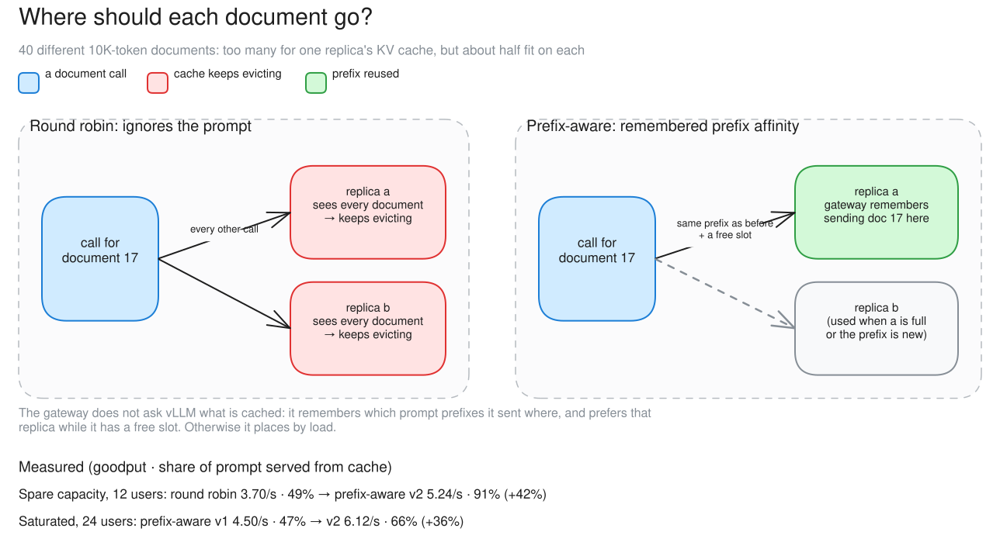
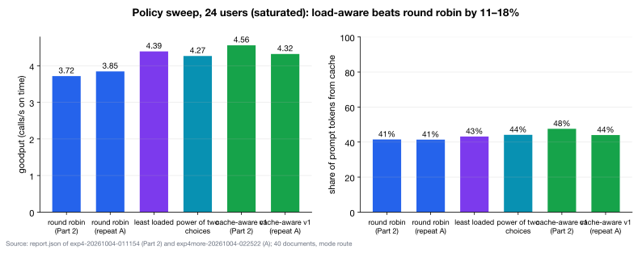

# c02 · Where to send each call (Part 2, extra A)

[← all experiments](../../README.md#experiments) · all numbers: [RESULTS.md](../RESULTS.md) · how to run it: [README](../../README.md#run-the-experiments-on-lambda)

## What we're doing

Now that two vLLM replicas are active, we compare four placement policies used by the gateway's router to decide which replica receives each incoming request. Round robin alternates between replicas without checking their state; least loaded chooses the replica currently doing less work; power of two choices compares two candidates using load; and cache-aware v1 tries to return each repeated annual-report document to a replica that processed it before. The gateway remains in route mode, so its queue and admission controller are off. We hold the model, GPU, 24-user load and 40 long documents constant, making the replica-placement rule the intended difference.

## Why

Reading a roughly 10,000-token document is expensive, but vLLM can reuse its cached prompt work when the same document returns to the same replica. If calls bounce between replicas, both engines repeatedly rebuild and evict those caches. This case tests whether remembering document location improves first-token latency and useful throughput when the total document set is deliberately too large for one replica's cache.

## At a glance

| | Plain-language summary |
|---|---|
| **Changed** | the rule used to choose replica a or b |
| **Baseline** | round robin, which alternates replicas and ignores cache state |
| **Success rule** | more than 15% better goodput or TTFT p99 than round robin at the same load |
| **Result** | v1 was borderline; saturation and two policy flaws prevented the expected cache reuse |

## Setup

| Setting | This experiment |
|---|---|
| Model | Qwen3.5-9B, BF16 (~17 GiB of weights), on every replica |
| GPU | one NVIDIA H100 80 GB, shared by all replicas |
| Replicas | 2 (qwen-9b-a, qwen-9b-b) |
| HAMi memory per vLLM | 38 GiB (a memory cap only: compute is shared, not partitioned) |
| Slots per replica | 8 (calls generating at once; more wait) |
| KV cache per replica | 4.5 GiB = 264,993 tokens (capped on purpose) |
| Max context | 64K tokens |
| KV connector | none (each replica keeps its own cache) |
| Placement | round robin, least loaded, power of two choices, cache-aware v1 |
| Gateway mode | route |
| Load | Locust: 40 different ~10K-token annual-report documents (one-sentence answers) |
| Users | 24 (both replicas full), 240 s per policy |
| Runs | Part 2 (01:24) and repeat A (02:25) |

## What to expect, and what to look at

- The test: 40 different ~10K-token documents (more than one replica's cache, about half on each), 24 users, four placement policies.
- Look at: the "Sent here" chips (why each call went where) and the cached % per replica.
- Expect: the cache-aware policy keeps each document on one replica, so more of each prompt comes from cache.

**Prediction, written before the run:** prefix_p2c keeps >90% of a document's calls on one replica, with >75% of the prompt from cache and TTFT p99 ≥30% lower than round_robin.

## How to read the numbers

- Prompt from cache: the share of input tokens vLLM reused instead of recomputing. Higher usually lowers time to first token for long repeated documents.
- Same document, same replica: an affinity check. Near 50% means documents bounce between replicas; a high value means each document stays with its cached copy.
- p50 is the typical call; p99 is a slow-tail call. A routing policy must help without making the tail much worse.

## How it works

If every call for a document goes to the replica that saw it before, that replica still has the document's KV cached and skips most of the prefill. Round robin sends each document to both replicas in turn, so both try to cache all 40 and keep evicting. The gateway can't see vLLM's cache: it remembers which prompt prefixes it sent where, and prefers that replica while it has a free slot.

**How to read this diagram:** Follow one document call. On the left, round robin alternates replicas, so both caches repeatedly load and evict the same 40 documents. On the right, remembered prefix affinity sends the document back to its previous replica while a slot is free. The measured rows at the bottom separate spare-capacity and saturated behavior.

## Watch it

Each clip is replayed from the recorded run, never live. The UI video and its Grafana views show the same seconds. **The videos are in the project's shared Drive folder** (see the README, "Recordings and run data"): download its `video/` folder into `docs/presentation/video/` and these links play locally.

#### Clip `c02-rr`: 01:26:00–01:28:00 UTC at 2× (60 s of video)
- **UI replay:** `video/ui/c02-rr.mp4` (`../presentation/video/ui/c02-rr.mp4`)
- **Grafana (same moment, side by side):** placement (`../presentation/video/grafana/c02-rr/routing.mp4`) · tokens and cache (`../presentation/video/grafana/c02-rr/tokens.mp4`) · vLLM engines (`../presentation/video/grafana/c02-rr/engines.mp4`) · latency (TTFT / ITL) (`../presentation/video/grafana/c02-rr/latency.mp4`) · SLOs and goodput (`../presentation/video/grafana/c02-rr/slo.mp4`)
- **What to notice:** "Sent here" shows only round_robin. The cached % per replica stays ~40%.
- **What will happen:** Each document lands on both replicas in turn, so both caches hold every document and evict each other's.
- **Why:** 40 documents × 10K tokens is 1.5× one replica's KV cache. Round robin makes each replica try to hold all of them.
- **At 01:26:20 the clip opens a call's details:** a document call under round_robin: how much of its ~10K-token prompt came from the prefix cache (this one: 0%; calls tend to hit all or nothing)

#### Clip `c02-pp`: 01:30:30–01:32:30 UTC at 2× (60 s of video)
- **UI replay:** `video/ui/c02-pp.mp4` (`../presentation/video/ui/c02-pp.mp4`)
- **Grafana (same moment, side by side):** placement (`../presentation/video/grafana/c02-pp/routing.mp4`) · tokens and cache (`../presentation/video/grafana/c02-pp/tokens.mp4`) · vLLM engines (`../presentation/video/grafana/c02-pp/engines.mp4`) · latency (TTFT / ITL) (`../presentation/video/grafana/c02-pp/latency.mp4`) · SLOs and goodput (`../presentation/video/grafana/c02-pp/slo.mp4`)
- **What to notice:** "Sent here" splits into prefix and p2c, with p2c much larger. qwen-9b-b gets almost no "prefix" calls.
- **What will happen:** Some affinity, but mostly fallback to load. On screen the cached % looks about the same as round_robin's (~40–50%); over the whole step the report gives 41% → 44–48% (run figures).
- **Why:** Both replicas are at 8/8, and v1 is sticky only while the holder has a free slot. A tie always went to qwen-9b-a.
- **At 01:30:45 the clip opens a call's details:** placed by load (p2c), not by prefix; 0% of its ~9.7K-token prompt came from cache
- **At 01:31:40 the clip opens a call's details:** a call placed by prefix, yet 0% from cache: likely v1's memory pointing at blocks vLLM had already evicted

## Results

### The data

| Policy (24 users) | goodput /s | TTFT p50 / p99 | prompt from cache | same document, same replica |
|---|---:|---|---:|---:|
| round robin (Part 2 / repeat) | 3.72 / 3.85 | 1.20 / 4.17 s | 41% | 56–57% |
| least loaded | 4.39 | 1.04 / 3.85 s | 43% | 57% |
| power of two choices | 4.27 | 1.01 / 3.77 s | 44% | 58% |
| cache-aware v1 (Part 2 / repeat) | 4.56 / 4.32 | 1.01 / 3.87 s | 44–48% | 60% |

### What we observed

- Every load-aware policy beat round robin by 11–18%; cache-aware vs round robin +12–23% (borderline against the 15% rule; repeat noise ±5%).
- The cache share barely moved: both replicas were full, so the cache-aware policy mostly fell back to load (912 p2c vs 294 prefix placements).
- Two flaws in v1 made it worse (c11). H2 (c10) and H3 (c11) test both causes.

### Key moments (UTC, 2026-10-04)

- 01:24:38 round robin: both replicas fill to 8/8; cached share settles ~40%
- 01:28:59 cache-aware v1: "Sent here" shows mostly p2c, prefix almost only on replica a

### Why it came out this way

At 24 users both replicas were full, and v1 only sticks to a remembered replica if it has a free slot, so most calls were placed by load. v1's tie-break always picked replica a and its memory represented ~800K tokens, about 3× the nominal 265K-token cache, so even "prefix" placements often missed.

### What we learned

- Any load-aware placement beat round robin (+11–18% goodput); remembering where a document went added little on top at 24 users.
- Under saturation, cache affinity mostly falls back to load: v1 sticks to a replica only while it has a free slot, so 912 placements were by load against 294 by prefix.
- A routing policy's view of the cache must match the real cache. v1 remembered ~3× more than the 265K-token cache holds and broke every tie toward replica a, so even prefix placements often missed.

### Errors and surprises: what, why, how to fix

| What happened | Why | How to fix |
|---|---|---|
| cache-aware placement gained only 41% → 44–48% cache share (predicted > 75%) | saturation, plus v1's biased tie-break and oversized memory | v2: least-busy matching replica with a free slot, memory sized to the cache (tested in c10, c11) |

### What this result does and does not show

- It shows that cache-aware v1 provided only a borderline gain at this saturated load.
- It does not show that prefix-aware routing is ineffective in general: c10 separates spare capacity and c11 tests the corrected v2 policy.

### Charts

**How to read this chart**

- **Axes and bars:** Every bar uses the same saturated 24-user, 40-document workload. The left panel is goodput in calls/s; the right panel is the share of prompt tokens served from vLLM's cache. Higher is better in both panels.
- **What happened:** Round robin produced 3.72–3.85 good calls/s with 41% cached input. Least loaded, power of two choices and cache-aware v1 reached 4.27–4.56 good calls/s, but cached input rose only modestly to 43–48%.
- **Why load-aware policies helped:** Avoiding the busier replica reduced uneven waiting, so all three load-aware policies beat blind alternation even when cache affinity was weak.
- **Why cache-aware v1 did not reach the expected reuse:** At 24 users both replicas were commonly full, leaving no free preferred replica. Version 1 also favored replica a in a tie and remembered more prefixes than the real KV cache could retain, so many apparent cache matches were stale.
- **How to judge the repeats:** Part 2 and repeat A appear separately for round robin and v1. Their spread shows roughly ±5% run variation, which is why the v1 improvement is described as borderline rather than a clean cache-affinity win.

## Run data

- `results/exp4/exp4-20261004-011154/placement`
- `results/exp4/exp4more-20261004-022522/routing`

Run folders are in the shared Drive folder (`results/`); `bash experiments/replay.sh <run>/replay.jsonl` replays one in the UI, `bash observability/local/replay.sh <run>/prometheus` in Grafana.
