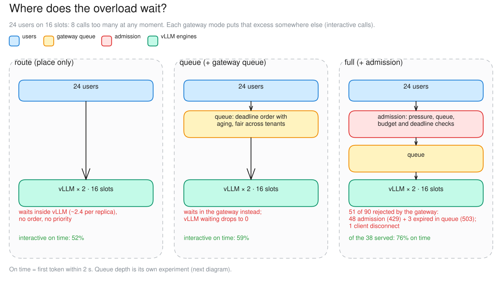
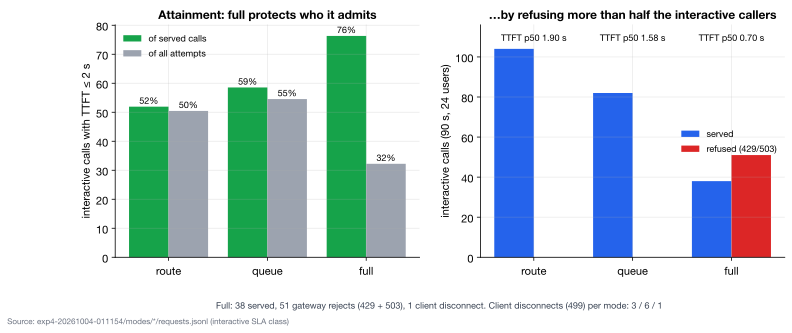

# c03 · What the gateway's controls do (Part 3, modes)

[← all experiments](../../README.md#experiments) · all numbers: [RESULTS.md](../RESULTS.md) · how to run it: [README](../../README.md#run-the-experiments-on-lambda)

## What we're doing

We deliberately send 24 simulated users to two vLLM replicas that provide only 16 active request slots in total—eight slots per replica. We then run the same workload in three gateway modes. In route mode the gateway immediately forwards every call, so overflow waits inside vLLM. In queue mode the gateway holds overflow in its own ordered waiting line. In full mode the gateway also applies admission control and refuses calls it predicts cannot meet their deadline. We compare who receives service, which component holds the waiting calls and how long accepted users wait for their first token.

## Why

Overload cannot be removed by moving a queue—the extra work must wait somewhere or be rejected. Where it waits determines whether the system can prioritize interactive work, enforce tenant fairness and give callers an early retry signal instead of a very late answer. This case makes the cost and benefit of each overload policy visible on exactly the same capacity.

## At a glance

| | Plain-language summary |
|---|---|
| **Changed** | gateway mode—route, queue, then full |
| **Baseline** | route, where overflow waits inside vLLM |
| **Success rule** | queue moves waiting to the gateway; full improves admitted-call latency by refusing work predicted to miss |
| **Result** | queue prioritized interactive work; full made admitted calls faster but rejected more than half the interactive attempts |

## Setup

| Setting | This experiment |
|---|---|
| Model | Qwen3.5-9B, BF16 (~17 GiB of weights), on every replica |
| GPU | one NVIDIA H100 80 GB, shared by all replicas |
| Replicas | 2 (qwen-9b-a, qwen-9b-b) |
| HAMi memory per vLLM | 38 GiB (a memory cap only: compute is shared, not partitioned) |
| Slots per replica | 8 (calls generating at once; more wait) |
| KV cache per replica | 4.5 GiB = 264,993 tokens (capped on purpose) |
| Max context | 64K tokens |
| KV connector | none (each replica keeps its own cache) |
| Placement | cache-aware v1 |
| Gateway mode | route, then queue, then full (90 s each) |
| Load | Locust: 49 chat questions (shared 2K-token context, 400–1,500-token answers) |
| Users | 24 (8 more than the 16 slots) |
| Targets | interactive: first token ≤ 2 s; batch: ≤ 30 s |

## What to expect, and what to look at

- The test: the same overload (24 users on 16 slots), 90 s in each mode: route, queue, full.
- Look at: where the excess waits. Red bars inside vLLM (route), gateway queue rows (queue), 429s in Responses and the Admission checklist (full).
- Expect: queue moves the waiting out of vLLM; full refuses some interactive calls up front.

**Prediction, written before the run:** route: waiting inside vLLM. queue: the waiting moves to the gateway with the same attainment. full: refuses some LIGHT calls with 429, and the served calls have the best goodput.

## How to read the numbers

- Of served counts only successful responses; of attempts also counts refusals and disconnects. Full therefore shows 76% on time among calls it served, but only 32% on time among everyone who tried.
- 429 means the call itself was predicted to miss its terms; 503 means the fleet or queue could not safely serve it.
- Moving a wait from vLLM to the gateway does not add capacity; it makes the waiting visible and lets the gateway choose the order.

## How it works

Route only places calls, so the 8 extra calls wait inside vLLM with no order. Queue holds them in the gateway instead and releases them as slots free up, in deadline order with aging and fair across tenants, so interactive calls go first. Full adds admission: before queueing, it checks engine signal, KV pressure, queue bound, token budget and deadline estimates, and refuses a call it predicts will miss its target (429) rather than serve it late.

**How to read this diagram:** Read each row as the same eight excess calls moving to a different layer. Route leaves them inside vLLM, queue holds and orders them in the gateway, and full may refuse them before they consume a slot. The percentages use the interactive two-second first-token target.

## Watch it

Each clip is replayed from the recorded run, never live. The UI video and its Grafana views show the same seconds. **The videos are in the project's shared Drive folder** (see the README, "Recordings and run data"): download its `video/` folder into `docs/presentation/video/` and these links play locally.

#### Clip `c03-route`: 01:33:24–01:34:51 UTC at 2× (44 s of video)
- **UI replay:** `video/ui/c03-route.mp4` (`../presentation/video/ui/c03-route.mp4`)
- **Grafana (same moment, side by side):** gateway queue (`../presentation/video/grafana/c03-route/queue.mp4`) · gateway admission (`../presentation/video/grafana/c03-route/gateway.mp4`) · vLLM engines (`../presentation/video/grafana/c03-route/engines.mp4`) · SLOs and goodput (`../presentation/video/grafana/c03-route/slo.mp4`) · latency (TTFT / ITL) (`../presentation/video/grafana/c03-route/latency.mp4`)
- **What to notice:** Red "waiting inside vLLM" bars on both replicas. The gateway queue is empty.
- **What will happen:** About 2.4 calls wait per replica, in arrival order, with no priority.
- **Why:** Mode route only places calls, so the overflow beyond 16 slots queues inside the engines.
- **At 01:33:50 the clip opens a call's details:** a late interactive call in route: TTFT 2.86 s on a 97%-cached prompt. The UI counts the wait inside vLLM as prefill

#### Clip `c03-queue`: 01:35:16–01:36:43 UTC at 2× (44 s of video)
- **UI replay:** `video/ui/c03-queue.mp4` (`../presentation/video/ui/c03-queue.mp4`)
- **Grafana (same moment, side by side):** gateway queue (`../presentation/video/grafana/c03-queue/queue.mp4`) · gateway admission (`../presentation/video/grafana/c03-queue/gateway.mp4`) · vLLM engines (`../presentation/video/grafana/c03-queue/engines.mp4`) · SLOs and goodput (`../presentation/video/grafana/c03-queue/slo.mp4`) · latency (TTFT / ITL) (`../presentation/video/grafana/c03-queue/latency.mp4`)
- **What to notice:** The waiting moves into the gateway's queue rows. vLLM waiting is 0, and interactive calls jump ahead of batch.
- **What will happen:** The same work gets done, but in a different order. Interactive attainment rises and batch pays.
- **Why:** The gateway releases a call only when a slot is free, and picks by class priority.
- **At 01:35:40 the clip opens a call's details:** a call that has just left the gateway queue: estimated wait 2.65 s, it waited 705 ms, placed "single"

#### Clip `c03-full`: 01:37:08–01:38:35 UTC at 2× (44 s of video)
- **UI replay:** `video/ui/c03-full.mp4` (`../presentation/video/ui/c03-full.mp4`)
- **Grafana (same moment, side by side):** gateway queue (`../presentation/video/grafana/c03-full/queue.mp4`) · gateway admission (`../presentation/video/grafana/c03-full/gateway.mp4`) · vLLM engines (`../presentation/video/grafana/c03-full/engines.mp4`) · SLOs and goodput (`../presentation/video/grafana/c03-full/slo.mp4`) · latency (TTFT / ITL) (`../presentation/video/grafana/c03-full/latency.mp4`)
- **What to notice:** 429s in Responses, and the Admission checklist's TTFT line refusing.
- **What will happen:** 51 refusals (48 × 429 + 3 × 503), all interactive. Over the whole step, admitted interactive calls started in 0.70 s (median; a run figure, not on screen).
- **Why:** Admission estimates the wait plus prefill. If that is more than 1.5 × the 2 s target, the call is refused up front rather than served late.
- **At 01:37:25 the clip opens a call's details:** a refused interactive call: admission's estimate and the target it would miss
- **At 01:38:00 the clip opens a call's details:** the same kind of decision for another call, in the Admission log

## Results

### The data

| Mode | interactive on time (of served / of attempts) | interactive TTFT p50 | gateway rejects | vLLM waiting |
|---|---|---:|---|---|
| route | 52% / 50% | 1.90 s | 0 | ~2.4 per replica |
| queue | 59% / 55% | 1.58 s | 0 | 0 |
| full | 76% / 32% | 0.70 s | 51 of 90 (48 × 429, 3 × 503) + 1 disconnect | 0 |

### What we observed

- queue takes the waiting out of vLLM and serves interactive first (+7 points); batch calls pay (TTFT p50 1.49 → 2.17 s).
- full makes admitted calls fast by rejecting more than half the interactive callers: worth it only if they can go elsewhere (overflow was off).
- Its estimate was conservative: in route 52% would have made it, but full admitted 43%.

### Key moments (UTC, 2026-10-04)

- 01:33:21 route: ~2.4 calls waiting inside each vLLM
- 01:35:13 queue: vLLM waiting drops to 0; the gateway queue holds the excess (p95 wait 4.9 s)
- 01:37:05 full: 429 ttft_unmeetable starts at once for interactive calls

### Why it came out this way

The excess has to wait somewhere. Route leaves it in vLLM (first come, first served). Queue moves it to the gateway, where interactive calls jump ahead of batch. Full predicts each call's wait plus prefill and refuses the ones that would miss 1.5 × their target, so the ones it admits are fast.

### What we learned

- Overload has to wait somewhere. The mode decides where (inside vLLM or in the gateway) and who goes first; it does not add capacity.
- Queue mode moved all waiting out of vLLM and served interactive calls first (+7 points on time), paid for by batch calls (TTFT p50 1.49 → 2.17 s).
- Full mode made admitted calls fast (TTFT p50 0.70 s) by refusing 51 of 90 interactive callers, more than needed: its estimate admitted 43% where 52% would have made it in route.
- Admission refusals help only when the caller has somewhere else to go; with overflow off, they meant no answer.

### Errors and surprises: what, why, how to fix

| What happened | Why | How to fix |
|---|---|---|
| full rejected 51 of 90 interactive calls (more than expected) | the TTFT estimate was conservative: in route, 52% would have made it, but full admitted 43% | calibrate the estimate (or slack), and give rejected callers somewhere to go (overflow was off: no credits) |
| 3 × 503 expired_in_queue in full | calls waited past their queue budget (5 s for interactive) | expected behaviour; a larger budget trades this for later answers |

### What this result does and does not show

- It compares where overload is handled and who receives service; all three modes use the same underlying GPU capacity.
- A 429 is useful only when the caller can retry later or go elsewhere. With overflow disabled here, higher admitted-call attainment came at the cost of many users receiving no answer.

### Charts

**How to read this chart**

- **Left panel:** Green is the percentage of served interactive calls that met the two-second TTFT target. Gray uses all attempts as the denominator, so refusals and disconnects count as misses. A policy can therefore look good among admitted users while serving a small share of everyone who tried.
- **Right panel:** Each bar divides the 90-second run into served and gateway-refused interactive calls. The TTFT label above each bar is the median only for served calls; refused callers have no TTFT because no model response began.
- **What happened:** Route achieved 52% on time among served calls and 50% among attempts. Queue improved those values to 59% and 55%. Full reached 76% among served calls but only 32% among attempts because it rejected 51 of 90 interactive attempts and one caller disconnected.
- **Why queue helped:** Moving overflow from vLLM into the gateway allowed deadline ordering and interactive priority, so more interactive calls received their first token on time without changing GPU capacity.
- **Why full splits the two percentages:** Admission protected the calls it accepted by refusing work predicted to be late. With no overflow destination enabled, that improved admitted-call latency at the cost of many users receiving no answer.

## Run data

- `results/exp4/exp4-20261004-011154/modes`

Run folders are in the shared Drive folder (`results/`); `bash experiments/replay.sh <run>/replay.jsonl` replays one in the UI, `bash observability/local/replay.sh <run>/prometheus` in Grafana.
