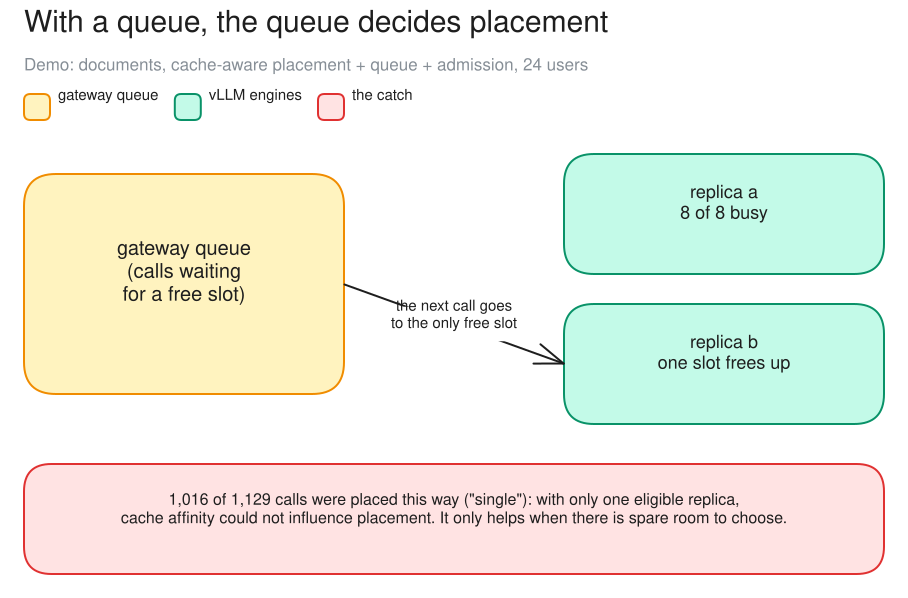

# c04 · Full-mode demo (documents, prefix_p2c, full)

[← all experiments](../../README.md#experiments) · all numbers: [RESULTS.md](../RESULTS.md) · how to run it: [README](../../README.md#run-the-experiments-on-lambda)

## What we're doing

We run the long-document workload with the gateway's three controls enabled together. First, admission control decides whether a request may enter. Next, the gateway queue decides which accepted waiting request goes next. Finally, the gateway router's cache-aware placement policy tries to choose the vLLM replica that has already processed that document. This is an integration demonstration rather than a clean A/B test; the goal is to follow the decisions made as one request passes through the complete serving path.

## Why

Controls that work alone can interfere when combined. In this implementation, a queued call is released as soon as one replica frees a slot, which may leave the placement policy only that one replica to choose from. We want to see whether cache affinity still has a real choice, or whether the queue silently makes the routing decision first.

## At a glance

| | Plain-language summary |
|---|---|
| **Changed** | nothing isolated; queue, admission and cache-aware placement were enabled together |
| **Baseline** | no formal control—this is an interaction demonstration |
| **Success rule** | none declared in advance |
| **Result** | 90% of served calls were placed as `single`, so the queue usually left the router only one eligible replica |

## Setup

| Setting | This experiment |
|---|---|
| Model | Qwen3.5-9B, BF16 (~17 GiB of weights), on every replica |
| GPU | one NVIDIA H100 80 GB, shared by all replicas |
| Replicas | 2 (qwen-9b-a, qwen-9b-b) |
| HAMi memory per vLLM | 38 GiB (a memory cap only: compute is shared, not partitioned) |
| Slots per replica | 8 (calls generating at once; more wait) |
| KV cache per replica | 4.5 GiB = 264,993 tokens (capped on purpose) |
| Max context | 64K tokens |
| KV connector | none (each replica keeps its own cache) |
| Placement | cache-aware v1 |
| Gateway mode | full |
| Load | Locust: 40 different ~10K-token annual-report documents (one-sentence answers) |
| Users | 24, 240 s |
| Run | demo (02:13) |

## What to expect, and what to look at

- The demo: the document load with everything on: cache-aware placement, gateway queue, admission.
- Look at: the "Sent here" chips and the Queue panel's "recently released".
- Expect: the controls to interact. In particular, check whether a queued call still gives the placement policy more than one free replica to choose from.

**Prediction, written before the run:** None; this was a demonstration, not a hypothesis test. The post-run explanation is kept separate from what was known beforehand.

## How to read the numbers

- `single` does not mean the fleet had one replica. It means that, at the instant a queued call was released, only one replica had a free slot and placement had no choice.
- The 429 and 503 columns count refusals; served and goodput describe successful calls, with goodput counting only those that also met their latency targets.

## How it works

With the gateway queue on, a waiting call is released the moment a slot frees, to the replica that freed it. That replica is the only candidate, so placement has nothing to choose between and the cache can't influence it.

**How to read this diagram:** Read the busy/free state from left to right. When replica b frees the first slot, the queued call has exactly one eligible destination, so the router records `single`; no cache comparison is possible at that instant.

## Watch it

Each clip is replayed from the recorded run, never live. The UI video and its Grafana views show the same seconds. **The videos are in the project's shared Drive folder** (see the README, "Recordings and run data"): download its `video/` folder into `docs/presentation/video/` and these links play locally.

#### Clip `c04-demo`: 02:14:30–02:16:30 UTC at 2× (60 s of video)
- **UI replay:** `video/ui/c04-demo.mp4` (`../presentation/video/ui/c04-demo.mp4`)
- **Grafana (same moment, side by side):** placement (`../presentation/video/grafana/c04-demo/routing.mp4`) · gateway queue (`../presentation/video/grafana/c04-demo/queue.mp4`) · gateway admission (`../presentation/video/grafana/c04-demo/gateway.mp4`) · SLOs and goodput (`../presentation/video/grafana/c04-demo/slo.mp4`)
- **What to notice:** "Sent here" is almost all "single". Calls leave the gateway queue to whichever replica frees a slot.
- **What will happen:** The cache-aware policy hardly ever gets to choose.
- **Why:** With a queue, a waiting call goes to the first free slot: there is one candidate, so placement can't weigh the cache.
- **At 02:14:50 the clip opens a call's details:** a call released from the queue: placed "single", meaning there was only one candidate
- **At 02:15:40 the clip opens a call's details:** a served document call: its queue wait and cache share

## Results

### The data

| Served | 429 | 503 | placed "single" (one candidate) | goodput /s |
|---:|---:|---:|---:|---:|
| 1,129 | 5 | 2 | 1,016 of 1,129 | 4.20 |

### What we observed

- With only one eligible replica, cache affinity could not influence placement: the queue decided.
- Cache-aware placement needs spare capacity to choose between (c10).

### Key moments (UTC, 2026-10-04)

- 02:13:34 demo starts; queue fills within seconds
- throughout: "Sent here" chips almost all "single"

### Why it came out this way

With the gateway queue on, a waiting call is released when a slot frees, to the replica that freed it: one candidate. Placement can only weigh the cache when it has a choice.

### What we learned

- When the gateway queue holds the overflow, a waiting call goes to whichever replica frees a slot first, so placement had one candidate for 1,016 of 1,129 calls.
- Cache-aware placement can only act when there is a choice: it needs spare capacity, or a queue that releases a call to the best of several free replicas.
- Turning on all three controls together is not additive: the queue overrode the router's cache preference.

### Errors and surprises: what, why, how to fix

| What happened | Why | How to fix |
|---|---|---|
| cache-aware placement made 100 prefix placements out of 1,129 | the queue decides placement | release a waiting call to the best of the replicas with free slots, or keep headroom |

### What this result does and does not show

- It shows that this queue implementation usually removes the router's choice at dispatch time, so cache-aware placement cannot express its preference.
- It does not show that gateway queues and cache affinity are fundamentally incompatible. A queue could wait for, or select among, several eligible replicas; that is a different design and needs its own measurement.

## Run data

- `results/exp4/exp4-20261004-011154-demo/demo`

Run folders are in the shared Drive folder (`results/`); `bash experiments/replay.sh <run>/replay.jsonl` replays one in the UI, `bash observability/local/replay.sh <run>/prometheus` in Grafana.
