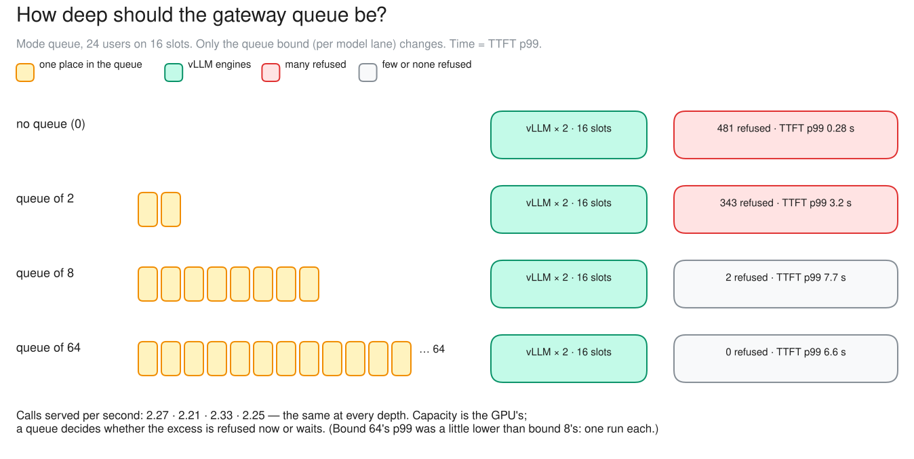
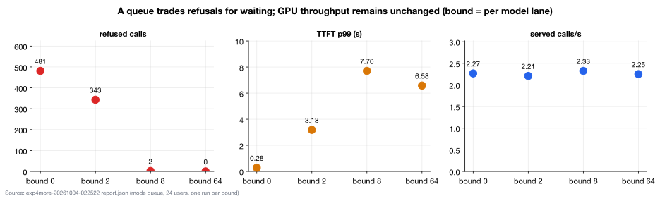

# c05 · How deep should the queue be? (extra B)

[← all experiments](../../README.md#experiments) · all numbers: [RESULTS.md](../RESULTS.md) · how to run it: [README](../../README.md#run-the-experiments-on-lambda)

## What we're doing

We keep the overloaded 24-user workload and the 16 engine slots unchanged, but vary how many additional calls the gateway may hold for this model: 0, 2, 8 or 64. The configuration calls this per-model waiting line a “model lane.” For each limit we measure completed calls per second, refusals, goodput—the calls that finish within their latency targets—and the slow end of time-to-first-token. The queue limit changes the size of the waiting room; it does not change GPU capacity.

## Why

A queue that is too short turns temporary bursts into immediate errors, while a queue that is too long can hide overload by making users wait for answers that arrive too late to be useful. This experiment shows that trade-off directly and checks whether deeper queues increase real service rate or merely convert fast refusals into longer waits.

## At a glance

| | Plain-language summary |
|---|---|
| **Changed** | maximum gateway queue length—0, 2, 8 or 64 calls per model lane |
| **Baseline** | depth 0, which refuses overflow immediately |
| **Success rule** | served calls/s stays within 10% while deeper queues raise slow-tail TTFT |
| **Result** | confirmed; throughput stayed ~2.2–2.3 calls/s while refusals became waiting |

## Setup

| Setting | This experiment |
|---|---|
| Model | Qwen3.5-9B, BF16 (~17 GiB of weights), on every replica |
| GPU | one NVIDIA H100 80 GB, shared by all replicas |
| Replicas | 2 (qwen-9b-a, qwen-9b-b) |
| HAMi memory per vLLM | 38 GiB (a memory cap only: compute is shared, not partitioned) |
| Slots per replica | 8 (calls generating at once; more wait) |
| KV cache per replica | 4.5 GiB = 264,993 tokens (capped on purpose) |
| Max context | 64K tokens |
| KV connector | none (each replica keeps its own cache) |
| Placement | cache-aware v1 |
| Gateway mode | queue (no admission) |
| Queue bound (per model lane) | 0, 2, 8, 64 |
| Load | Locust: 49 chat questions (shared 2K-token context, 400–1,500-token answers) |
| Users | 24, 120 s per bound |

## What to expect, and what to look at

- The test: mode queue, 24 users on 16 slots; only the queue bound per model lane changes: 0, 2, 8, 64.
- Look at: refusals (503 queue_full) and how long calls wait before their first token.
- Expect: the same calls served per second at every bound; a deeper queue trades refusals for waiting.

**Prediction, written before the run:** The same served/s at every depth. Depth 0 refuses most and has the lowest p99; a deeper queue means fewer refusals and a higher p99.

## How to read the numbers

- Served/s counts every successful response. Goodput/s counts only successful responses that also met their latency targets; a deep queue can keep served/s flat while lowering goodput.
- Queue bound is waiting-room capacity, not GPU capacity. Depth 0 still uses all 16 engine slots; it simply stores no extra calls at the gateway.
- TTFT p99 is the slowest 1% tail estimate. With one 120-second run per setting, small non-monotonic differences should be treated as noise.

## How it works

The GPU finishes calls at its own rate. A queue can't change that rate; it only decides what happens to the excess. With no queue it is refused immediately (fast answers for those let in); with a deep queue it waits, and everyone's first token comes later.

**How to read this diagram:** The engine capacity at the bottom of every column is identical. Moving right only enlarges the gateway waiting room: red refusals fall, while the TTFT labels show the wait growing. The small reversal between bounds 8 and 64 is run noise, not extra capacity.

## Watch it

Each clip is replayed from the recorded run, never live. The UI video and its Grafana views show the same seconds. **The videos are in the project's shared Drive folder** (see the README, "Recordings and run data"): download its `video/` folder into `docs/presentation/video/` and these links play locally.

#### Clip `c05-d0`: 02:43:45–02:44:45 UTC at 1× (60 s of video)
- **UI replay:** `video/ui/c05-d0.mp4` (`../presentation/video/ui/c05-d0.mp4`)
- **Grafana (same moment, side by side):** gateway queue (`../presentation/video/grafana/c05-d0/queue.mp4`) · gateway admission (`../presentation/video/grafana/c05-d0/gateway.mp4`) · SLOs and goodput (`../presentation/video/grafana/c05-d0/slo.mp4`) · latency (TTFT / ITL) (`../presentation/video/grafana/c05-d0/latency.mp4`)
- **What to notice:** A steady stream of 503 queue_full, while the calls that get in start almost at once.
- **What will happen:** About 4 refusals a second, and the admitted calls start in under 0.25 s (p99 0.28 s over the whole step).
- **Why:** With no queue, anything beyond the 16 slots is refused immediately.
- **At 02:44:00 the clip opens a call's details:** a refused call: 503 queue_full, 2 ms after it arrived (the drawer's "waiting" counter keeps running after the refusal: a display bug in the UI)

#### Clip `c05-d64`: 02:50:45–02:51:45 UTC at 1× (60 s of video)
- **UI replay:** `video/ui/c05-d64.mp4` (`../presentation/video/ui/c05-d64.mp4`)
- **Grafana (same moment, side by side):** gateway queue (`../presentation/video/grafana/c05-d64/queue.mp4`) · gateway admission (`../presentation/video/grafana/c05-d64/gateway.mp4`) · SLOs and goodput (`../presentation/video/grafana/c05-d64/slo.mp4`) · latency (TTFT / ITL) (`../presentation/video/grafana/c05-d64/latency.mp4`)
- **What to notice:** A gateway queue of about 5–7 calls (bound 64), no refusals, and TTFT in seconds.
- **What will happen:** About the same served calls per second as depth 0 (141 vs 135 served in the two 60 s windows). Only the waiting changed.
- **Why:** Capacity is the GPU's. A queue trades refusals for waiting.
- **At 02:51:00 the clip opens a call's details:** a call waiting in the deep queue: seconds of waiting instead of a refusal

## Results

### The data

| Bound | served /s | refused | TTFT p99 | goodput /s |
|---:|---:|---:|---:|---:|
| 0 | 2.27 | 481 | 0.28 s | 2.27 |
| 2 | 2.21 | 343 | 3.18 s | 2.17 |
| 8 | 2.33 | 2 | 7.70 s | 1.98 |
| 64 | 2.25 | 0 | 6.58 s | 1.85 |

### What we observed

- Confirmed: served calls/s within 5% at every bound; refusals fall and waiting rises with depth.
- Bound 64's p99 was a little lower than bound 8's (one run each): the trend, not monotonic.

### Key moments (UTC, 2026-10-04)

- 02:43:14 bound 0: ~4 refusals per second, fast answers
- 02:50:19 bound 64: no refusals, a long gateway queue, first tokens after seconds

### Why it came out this way

Little's Law states that the average number of calls in a stable system is throughput × average time in the system (L = λW). The GPU's service rate is fixed (~2.2–2.3 calls/s here), so admitting a larger backlog increases the number waiting and their delay; it does not make the GPU finish more calls per second.

### What we learned

- Queue depth sets the size of the waiting room, not the service rate: served calls/s stayed at ~2.2–2.3 at every bound from 0 to 64.
- A deeper queue trades refusals for waiting: refusals fell from 481 to 0 while TTFT p99 rose from 0.28 s to several seconds, and goodput fell from 2.27 to 1.85/s.
- Little's Law (L = λW) predicts this: with a fixed throughput, a larger backlog only means longer time in the system.

### Errors and surprises: what, why, how to fix

| What happened | Why | How to fix |
|---|---|---|
| bound 64's TTFT p99 (6.6 s) below bound 8's (7.7 s) | one 120 s run per bound: run-to-run noise | repeat runs; the trend holds either way |

### What this result does and does not show

- It demonstrates the queue-capacity trade-off for this closed-loop workload: depth changed waiting and refusals, not service rate.
- It does not identify a universal best depth. Arrival bursts, retry behavior, abandonment and business value determine whether refusing early is preferable to waiting.

### Charts

**How to read this chart**

- **How to scan it:** Move left to right through queue bounds 0, 2, 8 and 64. These are capacities of the gateway's waiting line for this model, not times and not extra vLLM slots.
- **Top panel—refusals:** Immediate queue overflow fell from 481 calls at bound 0 to 343 at bound 2, 2 at bound 8 and 0 at bound 64. A deeper waiting room therefore converted rejected work into accepted work that waited.
- **Middle panel—tail latency:** TTFT p99 rose from 0.28 s with no waiting room to 3.18 s, 7.70 s and 6.58 s. The small drop from bound 8 to 64 comes from one run per setting and should be treated as noise, not an advantage of the deepest queue.
- **Bottom panel—service rate:** Served throughput stayed approximately 2.21–2.33 calls/s at every bound because the same GPU and 16 engine slots did the work.
- **Conclusion:** Queue depth controls whether overload appears as a fast refusal or a slow answer; it does not create inference capacity. The useful bound depends on retry behavior and how late an answer can still be valuable.

## Run data

- `results/exp4/exp4more-20261004-022522/queue_depth`

Run folders are in the shared Drive folder (`results/`); `bash experiments/replay.sh <run>/replay.jsonl` replays one in the UI, `bash observability/local/replay.sh <run>/prometheus` in Grafana.
