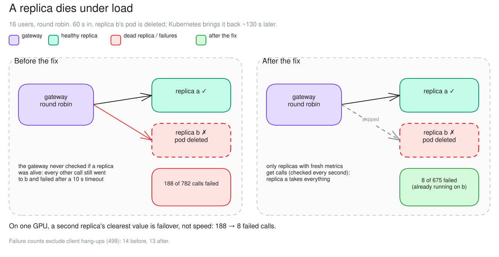
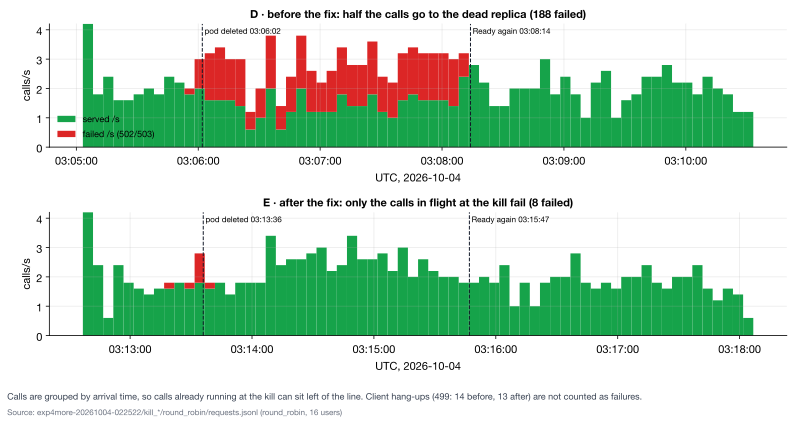

# c06 · A replica dies (extra D before the fix, E after)

[← all experiments](../../README.md#experiments) · all numbers: [RESULTS.md](../RESULTS.md) · how to run it: [README](../../README.md#run-the-experiments-on-lambda)

## What we're doing

While 16 users are sending requests to two replicas, we deliberately delete replica b's pod and let Kubernetes rebuild it. We perform the failure once with the original gateway, which continued round-robin routing, and again after adding fresh health-signal checks. After the fix, the gateway polls each replica's metrics every second, routes only to replicas with a recent successful response and immediately marks one unavailable if its connection is refused. We count failed new calls, streams cut off mid-answer, gateway detection time and the time until Kubernetes' replacement safely receives traffic.

## Why

Extra replicas are valuable for availability even when they do not make one shared GPU faster. That benefit exists only if the gateway quickly stops selecting a dead replica and later recognizes a healthy replacement. The before/after run separates gateway failure detection from Kubernetes restart time and shows which in-flight failures routing alone cannot save.

## At a glance

| | Plain-language summary |
|---|---|
| **Changed** | gateway liveness-aware routing, before versus after the fix |
| **Baseline** | round robin continued choosing a dead replica |
| **Success rule** | failures after the fix are no more than 5% of the before-fix count |
| **Result** | failures fell from 188 to 8 (4.3%); the remaining calls were already streaming when the pod died |

## Setup

| Setting | This experiment |
|---|---|
| Model | Qwen3.5-9B, BF16 (~17 GiB of weights), on every replica |
| GPU | one NVIDIA H100 80 GB, shared by all replicas |
| Replicas | 2 (qwen-9b-a, qwen-9b-b) |
| HAMi memory per vLLM | 38 GiB (a memory cap only: compute is shared, not partitioned) |
| Slots per replica | 8 (calls generating at once; more wait) |
| KV cache per replica | 4.5 GiB = 264,993 tokens (capped on purpose) |
| Max context | 64K tokens |
| KV connector | none (each replica keeps its own cache) |
| Placement | round robin |
| Gateway mode | route |
| Load | Locust: 49 chat questions (shared 2K-token context, 400–1,500-token answers) |
| Users | 16, 330 s |
| The fault | replica b's pod deleted 60 s in; Kubernetes restarts it (~130 s) |
| Runs | D before the fix (03:05), E after (03:12) |

## What to expect, and what to look at

- The test: 16 users, round robin; 60 s in, replica b's pod is deleted and Kubernetes restarts it (~130 s). Then again after the fix.
- Look at: Responses (503s), the Engines card, the Incidents panel.
- Expect: before the fix, about half the calls fail until b is back; after, almost none.

**Prediction, written before the run:** D: about half the calls fail until qwen-9b-b is back (~100 s). E: ≤5 failures, and qwen-9b-a carries all 16 users.

## How to read the numbers

- 503 unreachable means a new call was sent to a replica that could not accept a connection. 502 stream dropped means a response had already started and the engine vanished mid-answer.
- The 132/131-second recovery is Kubernetes reload time, not gateway detection time. After the fix the gateway stopped routing to b in about one second, while Kubernetes rebuilt it in the background.
- Client 499s are callers hanging up when the load test stops; they are reported separately and excluded from the fix verdict.

## How it works

Before the fix the gateway never checked whether a replica was alive, so round robin kept sending b every other call. About half of those failed at once (connection refused), the rest only after the 10 s connect timeout. The fix sends calls only to replicas with fresh metrics (checked every second): b drops out 2 s after the kill, a carries all 16 users, and b gets calls again as soon as it answers.

**How to read this diagram:** Compare the two rows at the moment replica b is deleted. Before the fix, round robin keeps an arrow to the dead replica; after the fix, that arrow is removed and a takes all new work. The eight remaining failures were streams already on b.

## Watch it

Each clip is replayed from the recorded run, never live. The UI video and its Grafana views show the same seconds. **The videos are in the project's shared Drive folder** (see the README, "Recordings and run data"): download its `video/` folder into `docs/presentation/video/` and these links play locally.

#### Clip `c06-before`: 03:05:50–03:06:50 UTC at 1× (60 s of video)
- **UI replay:** `video/ui/c06-before.mp4` (`../presentation/video/ui/c06-before.mp4`)
- **Grafana (same moment, side by side):** failover (`../presentation/video/grafana/c06-before/failover.mp4`) · vLLM engines (`../presentation/video/grafana/c06-before/engines.mp4`) · SLOs and goodput (`../presentation/video/grafana/c06-before/slo.mp4`)
- **What to notice:** At 03:06:02 the qwen-9b-b pod dies and its metrics stop updating, but the stale replica remains listed. Round robin keeps sending it every other call, and Responses fills with 503 engine unreachable.
- **What will happen:** In the 48 s after the kill: 60 failures (53 × 503 + 7 × 502). Half the calls keep failing for ~2 min; b is back at 03:08:14 (next clip).
- **Why:** The gateway never checked whether a replica was alive, so round robin kept sending it every other call.
- **At 03:06:22 the clip opens a call's details:** a call sent to the dead replica: 503 engine unreachable after 2 ms (connection refused); other calls failed only after the 10 s connect timeout

#### Clip `c06-recover`: 03:07:55–03:08:35 UTC at 1× (40 s of video)
- **UI replay:** `video/ui/c06-recover.mp4` (`../presentation/video/ui/c06-recover.mp4`)
- **Grafana (same moment, side by side):** failover (`../presentation/video/grafana/c06-recover/failover.mp4`) · vLLM engines (`../presentation/video/grafana/c06-recover/engines.mp4`) · SLOs and goodput (`../presentation/video/grafana/c06-recover/slo.mp4`)
- **What to notice:** qwen-9b-b is Ready again at 03:08:14: the failures stop. Its first calls are slow because they were sent before the pod was Ready and waited ~4 s for it to start serving (97% of their prompt was cached).
- **What will happen:** The failures stop and service returns to normal. The outage's total, 188 failed calls, is a run figure.
- **Why:** Kubernetes restarted the pod (weights + CUDA graphs, ~130 s); the gateway never stopped sending to it.
- **At 03:08:05 the clip opens a call's details:** the Incidents group's latest example: a call cut mid-stream (502) when qwen-9b-b went down

#### Clip `c06-after`: 03:13:25–03:14:25 UTC at 1× (60 s of video)
- **UI replay:** `video/ui/c06-after.mp4` (`../presentation/video/ui/c06-after.mp4`)
- **Grafana (same moment, side by side):** failover (`../presentation/video/grafana/c06-after/failover.mp4`) · vLLM engines (`../presentation/video/grafana/c06-after/engines.mp4`) · SLOs and goodput (`../presentation/video/grafana/c06-after/slo.mp4`)
- **What to notice:** At 03:13:36 qwen-9b-b goes down; the gateway marks it stale at 03:13:38 and sends every new call to qwen-9b-a. At 03:14:07 the 8 streams that were running on b fail with 502 and their clients re-send, so a briefly shows waiting. No newly routed call fails.
- **What will happen:** 8 failures (the calls in flight at the kill), then none.
- **Why:** The gateway routes only to replicas that answer their metrics scrape.
- **At 03:14:10 the clip opens a call's details:** one of the 8 calls in flight at the kill: its stream hung until the old pod's termination grace ended (03:14:07), then 502; nothing else fails

## Results

### The data

| | failed calls | of which | b back after | first call back |
|---|---:|---|---:|---:|
| before the fix | 188 of 782 | 181 × 503 unreachable, 7 × 502 cut mid-stream | 132 s | 4.21 s (sent before b was Ready) |
| after the fix | 8 of 675 | 8 × 502: running on b at the kill | 131 s | 0.22 s |

### What we observed

- Fix confirmed: 8 / 188 = 4.3% (rule: ≤ 5%). Client hang-ups (499: 14 and 13) are not counted.
- The 8 calls in flight hung until the old pod's termination grace ended (03:14:07), then failed: unavoidable without retries.
- On one GPU, the clearest value of a second replica is failover, not speed.

### Key moments (UTC, 2026-10-04)

- 03:06:02 replica b's pod deleted (before the fix): 503 engine unreachable on every other call
- 03:08:14 b Ready again. Its first calls (4.21 s) were sent just before, and waited for it to start serving: 97% of their prompt was cached, so not a cold cache
- 03:13:36 b deleted again (after the fix): the gateway marks it stale at 03:13:38
- 03:14:07 the 8 calls running on b at the kill fail (502) when the old pod finally exits
- 03:15:47 b Ready; first call 0.22 s

### Why it came out this way

Before the fix, placement never checked liveness: round robin kept choosing b, and each call sent there either failed at once (connection refused) or waited up to the 10 s connect timeout. After the fix, a replica whose metrics go stale (or that refuses a connection) is skipped at once.

### What we learned

- Placement must check liveness. Without it, round robin kept sending a dead replica about half the new calls: 188 of 782 failed.
- Routing only to replicas with fresh metrics, and marking one down on a refused connection, cut failures to 8 of 675, all calls already streaming on the replica when it died.
- Saving streams already in flight needs retries; fast detection alone cannot do it.
- On one GPU, the clearest value of a second replica is failover, not speed.

### Errors and surprises: what, why, how to fix

| What happened | Why | How to fix |
|---|---|---|
| 181 × 503 engine unreachable (before the fix) | calls sent to a dead replica | route only to replicas with fresh metrics; mark down on connection refused (fixed) |
| 8 × 502 stream_dropped (after the fix) | calls already running on b when it died | only retries could save these (not implemented) |
| the kill script stopped early (E) | `kubectl wait` watched the terminating pod, which vanished | wait for the replacement pod by name (fixed) |

### What this result does and does not show

- It verifies fast removal of one abruptly deleted pod and automatic re-entry after fresh metrics.
- It does not cover correlated failure of the shared GPU/node, slow but still responsive replicas, or saving streams already in flight; those require different detection and retry mechanisms.

### Charts

**How to read this chart**

- **Panels and axes:** The upper timeline is the run before liveness-aware routing; the lower timeline is after the fix. Time is UTC on the horizontal axis, while green shows served calls/s and red shows 502/503 failures/s.
- **Event markers:** The first dashed line is when replica b's pod was deleted; the second is when Kubernetes reported the replacement Ready. The roughly 131–132-second gap is pod replacement time, not gateway detection time.
- **Before the fix:** Round robin continued sending about every other new call toward dead replica b, producing 188 failures while the pod was unavailable.
- **After the fix:** The gateway removed b from routing in about one second and sent new work to replica a. Only eight streams that were already running on b at deletion later failed when the old pod exited.
- **Timing caveat:** Calls are plotted by arrival time. A request that began before deletion but failed afterward can therefore appear to the left of the deletion line. Client-side 499 hang-ups are excluded from the red failure series and from the verdict.

## Run data

- `results/exp4/exp4more-20261004-022522/kill_before`
- `results/exp4/exp4more-20261004-022522/kill_after`

Run folders are in the shared Drive folder (`results/`); `bash experiments/replay.sh <run>/replay.jsonl` replays one in the UI, `bash observability/local/replay.sh <run>/prometheus` in Grafana.
