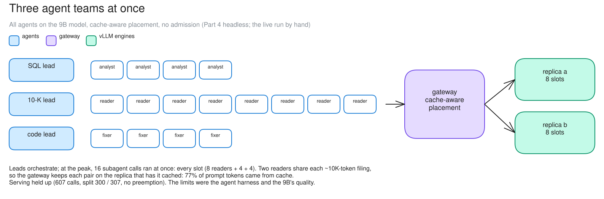
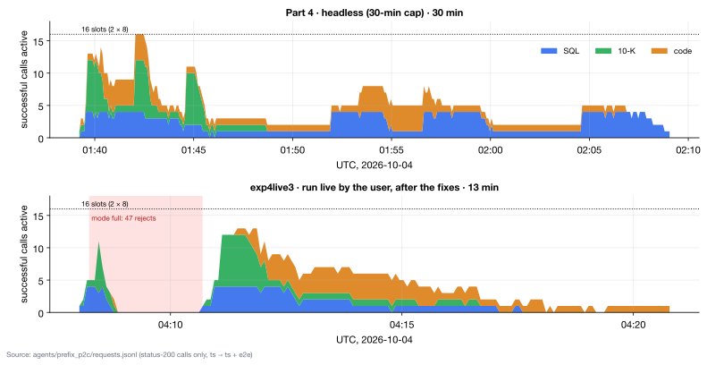

# c07 · Agent teams, headless (Part 4)

[← all experiments](../../README.md#experiments) · all numbers: [RESULTS.md](../RESULTS.md) · how to run it: [README](../../README.md#run-the-experiments-on-lambda)

## What we're doing

We replace Locust's regular, automated simulated users with three real agent workflows running at the same time: a SQL analysis team, an eight-reader 10-K research team and a code-repair team. Their lead agents plan work, launch subagents, call tools and return for more model generations, producing irregular bursts that can fill all 16 slots across the two replicas. We observe how calls divide between replicas, whether repeated prompts reuse cache, whether KV memory becomes pressured and whether each team finishes within the 30-minute cap.

## Why

Synthetic users are useful for controlled capacity measurements, but they do not reproduce the stop-and-start behavior, shared long documents or orchestration mistakes of real agents. This case checks whether the serving system remains healthy under that workload and also distinguishes an inference failure from an agent or harness failure when a task does not finish.

## At a glance

| | Plain-language summary |
|---|---|
| **Changed** | workload realism—three concurrent agent teams instead of synthetic Locust users |
| **Baseline** | the same two-replica serving fleet used in the earlier cases |
| **Success rule** | all teams finish within 30 minutes, calls split evenly, and repeated filing prefixes are reused |
| **Result** | the fleet stayed healthy, but two sessions hit the cap because the 9B-led agent harness misbehaved |

## Setup

| Setting | This experiment |
|---|---|
| Model | Qwen3.5-9B, BF16 (~17 GiB of weights), on every replica |
| GPU | one NVIDIA H100 80 GB, shared by all replicas |
| Replicas | 2 (qwen-9b-a, qwen-9b-b) |
| HAMi memory per vLLM | 38 GiB (a memory cap only: compute is shared, not partitioned) |
| Slots per replica | 8 (calls generating at once; more wait) |
| KV cache per replica | 4.5 GiB = 264,993 tokens (capped on purpose) |
| Max context | 64K tokens |
| KV connector | none (each replica keeps its own cache) |
| Placement | cache-aware v1 |
| Gateway mode | route |
| Load | tinyharness agent teams: SQL (lead + 4), 10-K (lead + 8 readers), code (lead + 4) |
| Agent model | all agents on the 9B (lead and subagents) |
| Cap | 30 min, headless |

## What to expect, and what to look at

- The test: three tinyharness agent teams at once, all on the 9B: SQL (lead + 4), 10-K (lead + 8 readers, two per filing), code (lead + 4). Headless, 30-min cap.
- Look at: the Clients panel filling with agents; both replicas busy; the timeline's thinking and answering bars.
- Expect: all three finish in 30 min, calls split evenly, readers placed by prefix.

**Prediction, written before the run:** All three sessions finish in 30 min, the calls split evenly, the 10-K readers are placed by prefix with a high cache share, and quality is lower than the 27B's.

## How to read the numbers

- Fleet health and task success are separate. Even balance, 77% cache reuse and zero preemptions show the serving layer worked; a timed-out team can still indicate an agent-orchestration failure.
- Lead + N means one coordinator model plus N worker agents. Their calls are bursty because the lead plans, fans out, waits for tools, then synthesizes.
- KV peak is the highest fraction of the token cache in use. Preemption would mean vLLM discarded and later recomputed a running call's cache; none occurred here.

## How it works

Agent calls are bursty: a lead plans, then fans out to its subagents, which call tools between model calls. The leads orchestrate; at the peak, 16 subagent calls ran at once, filling every slot. Two readers share each ~10K-token filing, so prefix affinity keeps each pair on one replica.

**How to read this diagram:** Read from teams to gateway to engines. Each lead fans out to its workers; the 8 + 4 + 4 worker layout explains the 16-slot peak. Paired 10-K readers share filing prefixes, which is why cache-aware placement can reuse their long inputs.

## Watch it

Each clip is replayed from the recorded run, never live. The UI video and its Grafana views show the same seconds. **The videos are in the project's shared Drive folder** (see the README, "Recordings and run data"): download its `video/` folder into `docs/presentation/video/` and these links play locally.

#### Clip `c07-fanout`: 01:41:00–01:43:00 UTC at 2× (60 s of video)
- **UI replay:** `video/ui/c07-fanout.mp4` (`../presentation/video/ui/c07-fanout.mp4`)
- **Grafana (same moment, side by side):** agents and tenants (`../presentation/video/grafana/c07-fanout/agents.mp4`) · latency (TTFT / ITL) (`../presentation/video/grafana/c07-fanout/latency.mp4`) · vLLM engines (`../presentation/video/grafana/c07-fanout/engines.mp4`) · tokens and cache (`../presentation/video/grafana/c07-fanout/tokens.mp4`)
- **What to notice:** The Clients panel fills to 16 agents (8 10-K readers, 4 SQL, 4 code) at 01:41:59, and both replicas reach 8/8.
- **What will happen:** Every slot is used. The readers spread over both replicas: 3 of 8 were placed by prefix.
- **Why:** The three leads fan out at once. prefix_p2c keeps each pair of readers with the replica that holds their filing.
- **At 01:41:20 the clip opens a call's details:** a 10-K reader's call from just before the fan-out: first answer in 1.96 s (met its 3 s target), but late on total time, 50.3 s against 35 s
- **At 01:42:10 the clip opens a call's details:** an agent call in an engine slot: which agent, which phase

#### Clip `c07-overview`: 01:39:10–02:09:25 UTC at 30× (60 s of video)
- **UI replay:** `video/ui/c07-overview.mp4` (`../presentation/video/ui/c07-overview.mp4`)
- **Grafana (same moment, side by side):** agents and tenants (`../presentation/video/grafana/c07-overview/agents.mp4`) · latency (TTFT / ITL) (`../presentation/video/grafana/c07-overview/latency.mp4`) · vLLM engines (`../presentation/video/grafana/c07-overview/engines.mp4`) · tokens and cache (`../presentation/video/grafana/c07-overview/tokens.mp4`)
- **What to notice:** The whole 30 min: the 10-K team's last call is at ~01:48:40 (~0:19 into the clip), while SQL and code run to the cap.
- **What will happen:** Load is high at first and thins out as teams finish.
- **Why:** Agent sessions are bursty, with fan-outs between long single-agent stretches.

## Results

### The data

| Team | session | calls | ended |
|---|---:|---:|---|
| SQL | 30 min (cap) | 304 | timeout |
| 10-K | 9.4 min | 83 | done (but ran its team 3 times) |
| code | 30 min (cap) | 220 | timeout (fixers asked to leave the sandbox) |
| fleet | | 607 (300 / 307 per replica) | 77% of prompt tokens from cache, KV peak ~62%, 0 preemptions |

### What we observed

- The serving layer held up: an even split, high cache reuse, no preemption.
- The failures were the agent harness with a 9B lead, fixed and re-run live (c08).

### Key moments (UTC, 2026-10-04)

- 01:39:10 three leads start
- 01:41:59 peak: 16 subagent calls running (8 readers, 4 SQL, 4 code)
- 01:48:44 10-K team done (9.4 min)
- 02:09:25 SQL and code stopped at the 30-min cap

### Why it came out this way

The serving layer kept up (even split, 77% from cache). The sessions ran long because of the agent harness with a 9B lead, not the GPU.

### What we learned

- Real agent fan-out (up to 16 subagent calls at once) fit the fleet: an even 300 / 307 split, 77% of prompt tokens from cache, KV peak ~62%, no preemptions.
- The long sessions came from the agent harness with a 9B lead, not from the GPU: the coding team kept trying to leave the sandbox and the 10-K lead re-ran its finished team after a context summary.
- Agent load is bursty (plan, fan out, wait on tools, synthesize), so it stresses a fleet differently from a steady load test.

### Errors and surprises: what, why, how to fix

| What happened | Why | How to fix |
|---|---|---|
| the coding team kept asking to leave the sandbox for a plain copy | the 9B set sandbox: false and read the refusal as a block | explicit sandbox rules in the project's agent files (fixed) |
| the 10-K lead ran its team 3 times | after a context summary, the harness repeated the original request and the 9B took it as new | harness fix: the request is framed as reference (fixed) |

### What this result does and does not show

- It shows the serving fleet could sustain the real fan-out without imbalance, KV exhaustion or preemption.
- It does not validate task quality or clean completion because two harness failures changed agent behavior; c08 is the corrected rerun.

### Charts

**How to read this chart**

- **Axes and colors:** Time is on the horizontal axis and the vertical axis counts successful model calls active at that moment. The colored areas are stacked by SQL, 10-K and code team; the dotted line marks the fleet's 16 total vLLM slots.
- **Top panel—c07 headless run:** Bursty agent fan-out sometimes filled all 16 slots. The 10-K team completed, while SQL and code continued until the 30-minute cap. The chart shows the fleet serving their calls; it does not by itself prove that the agents completed their tasks correctly.
- **Bottom panel—c08 live rerun:** After the harness fixes, all three teams completed in roughly 8.5–12.6 minutes. The shaded interval marks the accidental switch to full mode, during which 47 calls were refused before the gateway returned to route mode.
- **Why the shapes are bursty:** Lead agents alternate between planning, launching subagents, waiting for tool work and synthesizing results. The fleet therefore sees waves of parallel calls rather than the steady concurrency produced by a conventional load test.
- **Important counting rule:** Only successful status-200 calls are stacked. The 47 rejected calls are indicated by the shaded annotation but do not appear as active work. On c07 use the upper panel to discuss the original harness problems; on c08 use the lower panel to verify the rerun.

## Run data

- `results/exp4/exp4-20261004-011154/agents`

Run folders are in the shared Drive folder (`results/`); `bash experiments/replay.sh <run>/replay.jsonl` replays one in the UI, `bash observability/local/replay.sh <run>/prometheus` in Grafana.
