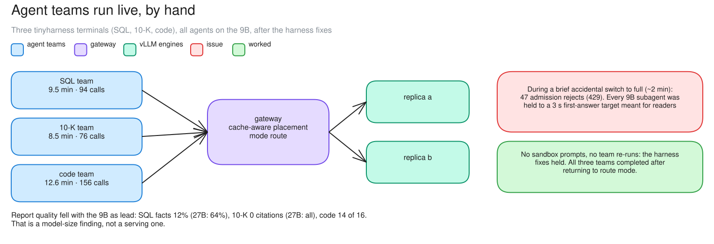

# c08 · Agent teams, live by the user (exp4live3)

[← all experiments](../../README.md#experiments) · all numbers: [RESULTS.md](../RESULTS.md) · how to run it: [README](../../README.md#run-the-experiments-on-lambda)

## What we're doing

We rerun the same SQL, 10-K and code teams interactively in three terminals after tightening the sandbox instructions and preventing completed teams from being launched again after context compaction—the point where the harness shortens an old conversation so it fits in the model's context window. Unlike the unattended c07 run, this live run lets us watch requests and agent progress as a user would. A brief accidental switch from route mode, which forwards every call, to full mode, which can reject predicted misses, also exposes how the admission controller classifies these agent calls.

## Why

c07 showed that the GPU fleet stayed healthy, but two teams did not complete cleanly because of harness behavior. A rerun is needed to verify those fixes rather than blaming the serving layer. It also checks the complete user experience: whether all teams finish, whether the earlier mistakes disappear and whether admission rules designed for fast readers fit slower, tool-using agents.

## At a glance

| | Plain-language summary |
|---|---|
| **Changed** | corrected agent harness and an interactive, user-run execution |
| **Baseline** | c07, where sandbox prompts and repeated teams prevented clean completion |
| **Success rule** | no sandbox prompts, no team reruns, and all three teams finish |
| **Result** | harness fix confirmed; 47 unrelated admission refusals occurred during an accidental switch to full |

## Setup

| Setting | This experiment |
|---|---|
| Model | Qwen3.5-9B, BF16 (~17 GiB of weights), on every replica |
| GPU | one NVIDIA H100 80 GB, shared by all replicas |
| Replicas | 2 (qwen-9b-a, qwen-9b-b) |
| HAMi memory per vLLM | 38 GiB (a memory cap only: compute is shared, not partitioned) |
| Slots per replica | 8 (calls generating at once; more wait) |
| KV cache per replica | 4.5 GiB = 264,993 tokens (capped on purpose) |
| Max context | 64K tokens |
| KV connector | none (each replica keeps its own cache) |
| Placement | cache-aware v1 |
| Gateway mode | route (briefly full by accident, 04:08–04:10) |
| Load | tinyharness agent teams: SQL (lead + 4), 10-K (lead + 8 readers), code (lead + 4) |
| Run | exp4live3 (04:08) |

## What to expect, and what to look at

- The run: the same three teams, run by the user in three tinyharness terminals after the harness fixes.
- Look at: the brief accidental switch to full (429s for agent calls), then the three teams in route.
- Expect: no sandbox prompts, no team re-runs, all three finish.

**Prediction, written before the run:** After the fixes, no sandbox prompts and no team re-runs, and all three finish.

## How to read the numbers

- The 429 column is not evidence that the GPU was full. These calls were rejected because the wrong 3-second SLA class was applied to thinking agents.
- Report quality evaluates the model's work product, while session time and serving metrics evaluate the inference system. The 9B-versus-27B comparison is directional because the lead model also changed.
- Retry-After let tinyharness retry the refused calls; returning to route removed admission, so all calls were eventually served.

## How it works

Admission maps every 9B subagent to the agent-reader class (first answer within 3 s), set for fast no-thinking readers. Thinking SQL analysts and code fixers can't meet that, so in full mode admission refused them. Back in route, everything was served.

**How to read this diagram:** The center shows the normal route-mode path used for completion. The red callout is a temporary configuration incident—full mode applied the reader SLA to thinking agents—while the green callout records the harness fixes that actually held.

## Watch it

Each clip is replayed from the recorded run, never live. The UI video and its Grafana views show the same seconds. **The videos are in the project's shared Drive folder** (see the README, "Recordings and run data"): download its `video/` folder into `docs/presentation/video/` and these links play locally.

#### Clip `c08-full`: 04:08:17–04:10:15 UTC at 2× (59 s of video)
- **UI replay:** `video/ui/c08-full.mp4` (`../presentation/video/ui/c08-full.mp4`)
- **Grafana (same moment, side by side):** agents and tenants (`../presentation/video/grafana/c08-full/agents.mp4`) · gateway admission (`../presentation/video/grafana/c08-full/gateway.mp4`) · latency (TTFT / ITL) (`../presentation/video/grafana/c08-full/latency.mp4`) · vLLM engines (`../presentation/video/grafana/c08-full/engines.mp4`) · tokens and cache (`../presentation/video/grafana/c08-full/tokens.mp4`)
- **What to notice:** With Full on, agent calls are refused: first 8 × 429 deadline unmeetable, then 39 × 429 answer target unmeetable. The last call is at 04:09:06; nothing new after that.
- **What will happen:** Refusals that come from the config, not from overload.
- **Why:** Every 9B subagent maps to agent-reader (3 s to the first answer), so the thinking subagents are predicted to miss it.
- **At 04:08:35 the clip opens a call's details:** an agent call refused under Full: 429, with its SLA class and admission's estimate
- **At 04:09:20 the clip opens a call's details:** the admission decision: agent-reader's 3 s first-answer target applied to a thinking subagent

#### Clip `c08-fanout`: 04:10:50–04:12:50 UTC at 2× (60 s of video)
- **UI replay:** `video/ui/c08-fanout.mp4` (`../presentation/video/ui/c08-fanout.mp4`)
- **Grafana (same moment, side by side):** agents and tenants (`../presentation/video/grafana/c08-fanout/agents.mp4`) · gateway admission (`../presentation/video/grafana/c08-fanout/gateway.mp4`) · latency (TTFT / ITL) (`../presentation/video/grafana/c08-fanout/latency.mp4`) · vLLM engines (`../presentation/video/grafana/c08-fanout/engines.mp4`) · tokens and cache (`../presentation/video/grafana/c08-fanout/tokens.mp4`)
- **What to notice:** 15 calls in flight at 04:11:44, across both replicas, back in route mode.
- **What will happen:** All three teams are served together, with no new refusals (the 47 on screen are left over from the Full step).
- **Why:** In route every call is placed and nothing is refused, and 16 slots hold all three teams.
- **At 04:11:10 the clip opens a call's details:** a reader agent in the live run
- **At 04:12:00 the clip opens a call's details:** a finished agent call: late against its class target, with its phases

## Results

### The data

| Team | session | calls | 429s (during full) | report quality |
|---|---:|---:|---:|---|
| SQL | 9.5 min | 94 | 15 | fact recall 12% (27B lead earlier: 64%) |
| 10-K | 8.5 min | 76 | 24 | 0 citations (27B: 82 of 82) |
| code | 12.6 min | 156 | 8 | 14 of 16 bugs + features (27B: 16 of 16) |

### What we observed

- The harness fixes held: no sandbox prompts, no team re-runs. All three teams completed after returning to route mode.
- The 47 admission rejects came from the SLA class mapping, not overload; fix: SLA classes per agent kind.
- Report quality fell sharply with the 9B as lead: a model-size finding, not a serving one.

### Key moments (UTC, 2026-10-04)

- 04:08:01 the three teams start, mode route
- 04:08:15–04:10:41 mode switched to full by accident: 47 × 429 for agent calls
- 04:11:43 peak: 15 calls running
- 04:17–04:20 the three teams finish (8.5–12.6 min)

### Why it came out this way

Admission maps every 9B subagent to one SLA class (first answer within 3 s), set for fast no-thinking readers. Thinking analysts and fixers are predicted to miss it, so full refused them; tinyharness retried after Retry-After.

### What we learned

- The two harness fixes held in a live run: no sandbox prompts and no team re-runs, and all three teams completed.
- Admission classes must match the workload: mapping every 9B subagent to one 3 s first-answer class caused 47 refusals of thinking analysts and fixers, not overload.
- Until there are SLA classes per agent kind, agent runs belong in route mode.
- Answer quality with a 9B lead (12% fact recall, 0 citations, 14 of 16 fixes) was a model-size limit, not a serving one.

### Errors and surprises: what, why, how to fix

| What happened | Why | How to fix |
|---|---|---|
| 47 × 429 ttfat_unmeetable / deadline_unmeetable | SLA class by role and model, not by agent kind | SLA classes per agent kind (future work); keep agent runs in route until then |
| report quality: SQL 12% recall, 10-K 0 citations, code 14/16 | a 9B model leading the teams (the 27B led them earlier) | a larger lead model; not a serving issue |

### What this result does and does not show

- It verifies the two harness fixes and shows that all three teams can complete together on the fleet.
- The quality comparison with earlier 27B-led runs is not a controlled model benchmark: model size, execution history and the brief admission incident differ, so it supports a capacity concern rather than an exact causal effect size.

### Charts

**How to read this chart**

- **Axes and colors:** Time is on the horizontal axis and the vertical axis counts successful model calls active at that moment. The colored areas are stacked by SQL, 10-K and code team; the dotted line marks the fleet's 16 total vLLM slots.
- **Top panel—c07 headless run:** Bursty agent fan-out sometimes filled all 16 slots. The 10-K team completed, while SQL and code continued until the 30-minute cap. The chart shows the fleet serving their calls; it does not by itself prove that the agents completed their tasks correctly.
- **Bottom panel—c08 live rerun:** After the harness fixes, all three teams completed in roughly 8.5–12.6 minutes. The shaded interval marks the accidental switch to full mode, during which 47 calls were refused before the gateway returned to route mode.
- **Why the shapes are bursty:** Lead agents alternate between planning, launching subagents, waiting for tool work and synthesizing results. The fleet therefore sees waves of parallel calls rather than the steady concurrency produced by a conventional load test.
- **Important counting rule:** Only successful status-200 calls are stacked. The 47 rejected calls are indicated by the shaded annotation but do not appear as active work. On c07 use the upper panel to discuss the original harness problems; on c08 use the lower panel to verify the rerun.

## Run data

- `results/exp4/exp4live3/agents`

Run folders are in the shared Drive folder (`results/`); `bash experiments/replay.sh <run>/replay.jsonl` replays one in the UI, `bash observability/local/replay.sh <run>/prometheus` in Grafana.
