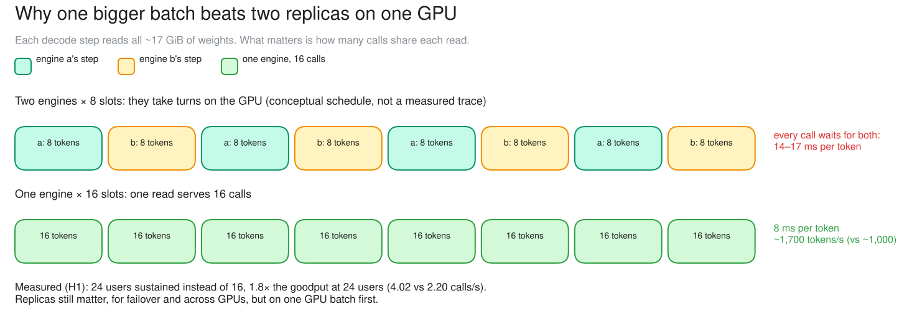

# c09 · H1: one engine × 16 slots vs two × 8

[← all experiments](../../README.md#experiments) · all numbers: [RESULTS.md](../RESULTS.md) · how to run it: [README](../../README.md#run-the-experiments-on-lambda)

## What we're doing

We keep 16 total request slots—places where calls may generate tokens at the same time—but change how those slots are arranged on the H100. Instead of two independent vLLM replicas with eight slots each, we run one replica with 16 slots and repeat c01's user ramp. The single engine can combine all active calls into one larger continuous batch, meaning one model step advances many calls together, while total slot count, model and physical GPU remain constant.

## Why

c01 showed that a second engine added slots but made each call decode more slowly because both processes competed for the same GPU bandwidth. This control asks whether one larger batch can provide the same 16-call concurrency more efficiently by reading the model weights once per engine step. The answer gives a practical deployment rule for throughput on one GPU: enlarge a safe batch before duplicating the model process.

## At a glance

| | Plain-language summary |
|---|---|
| **Changed** | the same 16 total slots arranged as one engine × 16 instead of two engines × 8 |
| **Baseline** | c01's two 8-slot replicas sharing the same H100 |
| **Success rule** | sustain at least 16 users with 7–10 ms token gaps and no lower goodput |
| **Result** | one engine sustained 24 users and delivered 1.8× the 24-user goodput |

## Setup

| Setting | This experiment |
|---|---|
| Model | Qwen3.5-9B, BF16 (~17 GiB of weights), on every replica |
| GPU | one NVIDIA H100 80 GB, shared by all replicas |
| Replicas | **1 (replica a), with 16 slots** (changed) |
| HAMi memory per vLLM | 38 GiB (a memory cap only: compute is shared, not partitioned) |
| Slots per replica | **16 (redeployed for this test, then back to 8)** (changed) |
| KV cache per replica | 4.5 GiB = 264,993 tokens (capped on purpose) |
| Max context | 64K tokens |
| KV connector | none (each replica keeps its own cache) |
| Placement | single replica |
| Gateway mode | route |
| Load | Locust: 49 chat questions (shared 2K-token context, 400–1,500-token answers) |
| Users | 4 → 32, as c01 |

## What to expect, and what to look at

- The test (H1): the fleet redeployed with 16 slots per engine; one engine × 16 slots, the same ramp as c01.
- Look at: the token gap and waiting at 16 → 24 users; compare with c01-rr (two engines × 8).
- Expect: the same knee as two replicas, with ~7–10 ms per token.

**Prediction, written before the run:** One16 sustains the same 16 users with ITL ~7–10 ms and at least the same goodput.

## How to read the numbers

- The values in the 16/24/32-user columns are goodput in calls/s; percentages in parentheses are the share meeting the targets.
- This is continuous batching, not model replication: one engine reads the weights once for a batch of active sequences.
- Measurement layer: the UI call drawer reports client-observed streamed-token gaps (~8 ms); Grafana shows vLLM's engine-side ITL (~5 ms). The two-engine comparison is slower in both measurements.
- A 16-slot setting also raises worst-case KV demand. The memory-pressure case (c14) shows why batch size cannot be raised without checking cache capacity.

## How it works

The same 16 slots, arranged as one engine instead of two. One engine reads the weights once per step for all 16 calls, so the GPU produces far more tokens per second. Two engines each read them and take turns.

**How to read this diagram:** Compare the timelines. Two engines alternate weight-reading decode steps, so each eight-call batch waits for the other engine. One 16-call engine performs one weight read per step for the larger batch. The schedule is conceptual; the latency and throughput labels are measured.

## Watch it

Each clip is replayed from the recorded run, never live. The UI video and its Grafana views show the same seconds. **The videos are in the project's shared Drive folder** (see the README, "Recordings and run data"): download its `video/` folder into `docs/presentation/video/` and these links play locally.

#### Clip `c09-one16`: 04:52:15–04:54:15 UTC at 2× (60 s of video)
- **UI replay:** `video/ui/c09-one16.mp4` (`../presentation/video/ui/c09-one16.mp4`)
- **Grafana (same moment, side by side):** scale-out (`../presentation/video/grafana/c09-one16/scale.mp4`) · latency (TTFT / ITL) (`../presentation/video/grafana/c09-one16/latency.mp4`) · tokens and cache (`../presentation/video/grafana/c09-one16/tokens.mp4`) · GPU (`../presentation/video/grafana/c09-one16/gpu.mp4`) · SLOs and goodput (`../presentation/video/grafana/c09-one16/slo.mp4`)
- **What to notice:** One replica with 16 slots as the ramp goes 16 → 24 → 32 users (32 from ~0:48). The call details show a token gap of ~8 ms. Compare with c01-rr, the same users on 2 × 8.
- **What will happen:** The same slots as two replicas, but twice the speed per call.
- **Why:** One engine reads the weights once per step for all 16 calls. Two engines each read them and take turns.
- **At 04:52:40 the clip opens a call's details:** a call on the 16-slot engine: token gap ~8 ms with 12 of 16 running
- **At 04:53:30 the clip opens a call's details:** at 24 users still in SLO

## Results

### The data

| Fleet | goodput /s at 16 users | goodput /s at 24 users | goodput /s at 32 users | knee | token gap | output tokens/s (24–32 users) |
|---|---:|---:|---:|---:|---:|---:|
| 1 engine × 8 | 2.24 (81%) | 1.98 (71%) | 1.22 (60%) | 8 | 7 ms | ~970–1,030 |
| 2 engines × 8, round robin | 1.82–2.29 | 1.93–2.20 (79–82%) | 1.22–1.24 | 16 | 14–17 ms | ~890–965 |
| 1 engine × 16 | 3.60 (100%) | 4.02 (100%) | 3.00 (77%) | 24 | 8 ms | ~1,690–1,730 |

### What we observed

- Batch before replicas: one 16-slot engine sustains 24 users (two engines: 16), with 1.8× the goodput at 24 users.
- Stronger than predicted. Replicas still earn their place for failover (c06) and across GPUs.

### Key moments (UTC, 2026-10-04)

- 04:50:52 one engine × 16 slots starts at 4 users
- 04:52:22 16 users: no waiting, 8 ms per token
- 04:53:07 24 users: still 100% on time (two engines: 82%)

### Why it came out this way

One engine reads the weights once per step for all 16 calls; the extra KV reads for a bigger batch cost only ~1 ms per token (7 → 8 ms). Two engines read them twice and take turns.

### What we learned

- Batch before replicas: with the same 16 slots, one engine sustained 24 users against two engines' 16, with 1.8× the goodput at 24 users.
- One engine reads the weights once per step for its whole batch; the larger batch cost only ~1 ms per token (7 → 8 ms), and output reached ~1,690–1,730 tokens/s against ~890–1,030.
- On one GPU, raise a single engine's safe batch size first; use replicas for failover or when each has its own GPU.

### Errors and surprises: what, why, how to fix

| What happened | Why | How to fix |
|---|---|---|
| one engine sustained 24 users, one ramp step beyond the prediction | continuous batching let one engine reuse each weight read across a larger batch; two separate engines duplicated that work | on one GPU, increase a single engine's safe batch size before adding another engine for throughput; still use replicas for failover or when each has its own GPU |

### What this result does and does not show

- It shows that, for this model and workload on one shared H100, one 16-slot engine was faster than two 8-slot engines.
- It does not prove that 16 is universally optimal. Larger batches can raise KV demand and per-request latency, and replicas on separate GPUs do add compute and bandwidth.

### Charts

**How to read this chart**

- **Axes and panels:** The horizontal axis is concurrent simulated users. The left panel shows goodput—calls per second that completed within their targets—so higher is better. The right panel shows attainment, the percentage of attempts meeting their targets.
- **How the knee is chosen:** The dotted 90% line on the right defines a sustained load step. The knee is the highest user count at or above that line, provided every smaller step also passed; it is not simply the point with the highest raw goodput.
- **What happened:** One 8-slot engine sustained 8 users, two 8-slot engines sustained 16, and the later one-engine/16-slot control sustained 24. Solid lines are the first run and dashed lines are the repeat, so the repeated 8 → 16 shift is visible rather than inferred from one sweep.
- **Why:** A second engine supplied eight more places for active calls, delaying the point at which requests waited. The one-engine/16-slot control went further because one vLLM process could continuously batch all 16 active calls without competing with a second model process for the same GPU bandwidth.
- **Case focus:** In c01, compare one engine × 8 with the two-engine lines. In c09, focus on the one engine × 16 line as the control that separates useful batching from model replication.

**How to read this chart**

- **Axes and panels:** The horizontal axis is concurrent users. The left panel shows median inter-token latency (ITL), or the gap between generated tokens for one call; lower is better. The right panel shows total output tokens per second across the whole H100; higher is better.
- **What happened to each call:** One 8-slot engine stayed near a 7 ms token gap. Two round-robin engines rose to roughly 14–17 ms because both model processes were active. Cache-aware v1 stayed near 7 ms only while it packed work onto one engine, then slowed once both engines became busy. One 16-slot engine stayed near 8 ms.
- **What happened to the GPU total:** At high load, the two-engine designs produced only about 890–970 output tokens/s, close to the one-engine/8-slot result. The one-engine/16-slot control reached roughly 1,690–1,730 tokens/s.
- **Why:** Each independent engine repeatedly reads the model weights for its own decode step and the two processes share one GPU memory bus. One larger engine reads the weights once for a larger active batch, so more calls advance per weight read.
- **Conclusion:** Replication on one GPU added scheduling slots but did not add hardware throughput. For this workload, increasing one engine's safe batch size used the H100 more efficiently; replicas still matter for failover and for scale-out across separate GPUs.

## Run data

- `results/exp4/exp4h2h-20261004-042503/batch16`

Run folders are in the shared Drive folder (`results/`); `bash experiments/replay.sh <run>/replay.jsonl` replays one in the UI, `bash observability/local/replay.sh <run>/prometheus` in Grafana.
