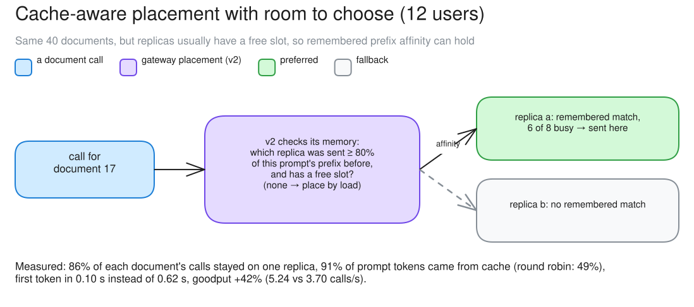
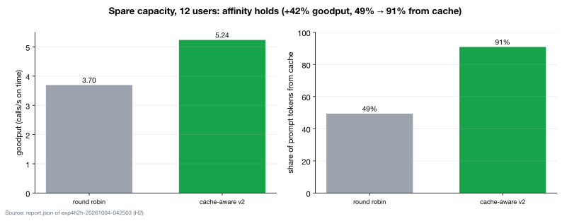

# c10 · H2: placement with spare capacity (12 users)

[← all experiments](../../README.md#experiments) · all numbers: [RESULTS.md](../RESULTS.md) · how to run it: [README](../../README.md#run-the-experiments-on-lambda)

## What we're doing

We repeat c02's gateway-routing comparison with the same 40 documents but reduce the load from 24 users to 12, so the two vLLM replicas usually have unused slots. We compare round robin, which alternates replicas, with cache-aware v2, which prefers the least-busy available replica that the gateway remembers receiving most of the same prompt. We measure whether each document stays on one replica, how much prompt input vLLM reuses from cache and how quickly the first token arrives.

## Why

Cache-aware routing can help only when the preferred replica has room to accept the call. In c02 both replicas were usually full, so the router often had to abandon affinity and choose by load. Reducing concurrency isolates the headroom question: if placement works here, the earlier weak result was partly a lack of choice rather than proof that caching was unhelpful.

## At a glance

| | Plain-language summary |
|---|---|
| **Changed** | round robin versus cache-aware v2 at a lower, 12-user load |
| **Baseline** | round robin with the same documents and spare slots |
| **Success rule** | more than 85% document affinity, clearly higher cache reuse, and TTFT p50 at least 15% lower |
| **Result** | confirmed—86% affinity, 91% cached input and 0.10-second median TTFT |

## Setup

| Setting | This experiment |
|---|---|
| Model | Qwen3.5-9B, BF16 (~17 GiB of weights), on every replica |
| GPU | one NVIDIA H100 80 GB, shared by all replicas |
| Replicas | 2 (qwen-9b-a, qwen-9b-b) |
| HAMi memory per vLLM | 38 GiB (a memory cap only: compute is shared, not partitioned) |
| Slots per replica | 8 (calls generating at once; more wait) |
| KV cache per replica | 4.5 GiB = 264,993 tokens (capped on purpose) |
| Max context | 64K tokens |
| KV connector | none (each replica keeps its own cache) |
| Placement | round robin vs cache-aware v2 |
| Gateway mode | route |
| Load | Locust: 40 different ~10K-token annual-report documents (one-sentence answers) |
| Users | 12 (usually below the 16 slots), 240 s |

## What to expect, and what to look at

- The test (H2): the documents load at 12 users (replicas usually have a free slot): round robin vs cache-aware v2.
- Look at: "Sent here" (prefix on both replicas), cached %, TTFT.
- Expect: with room to choose, affinity holds.

**Prediction, written before the run:** With free slots, prefix_p2c_v2 places most calls by prefix: >85% stay on the same replica, the cache share is well above round_robin's, and TTFT p50 is >15% lower.

## How to read the numbers

- Spare capacity means fewer than 16 calls are usually active, so the router can choose between replicas instead of taking whichever slot becomes free first.
- A six-times-lower median TTFT (0.62 → 0.10 s) comes from reusing the ~10K-token document prefix, not from faster decode.
- The +42% goodput is relative to round robin in this 12-user run; it should not be compared directly with a different concurrency or workload.

## How it works

v2 prefers the least busy replica that the gateway remembers sending at least 80% of this prompt's prefix to, as long as it has a free slot; otherwise it places by load. With spare slots that condition is usually met, so each document keeps going to the same replica, and each replica ends up holding about half the documents.

**How to read this diagram:** Follow document 17 through v2's decision. A remembered ≥80% prefix match plus a free slot makes replica a preferred; replica b is only the load-based fallback. The result line shows the measured effect of that repeated choice.

## Watch it

Each clip is replayed from the recorded run, never live. The UI video and its Grafana views show the same seconds. **The videos are in the project's shared Drive folder** (see the README, "Recordings and run data"): download its `video/` folder into `docs/presentation/video/` and these links play locally.

#### Clip `c10-rr`: 04:27:00–04:29:00 UTC at 2× (60 s of video)
- **UI replay:** `video/ui/c10-rr.mp4` (`../presentation/video/ui/c10-rr.mp4`)
- **Grafana (same moment, side by side):** placement (`../presentation/video/grafana/c10-rr/routing.mp4`) · tokens and cache (`../presentation/video/grafana/c10-rr/tokens.mp4`) · vLLM engines (`../presentation/video/grafana/c10-rr/engines.mp4`) · latency (TTFT / ITL) (`../presentation/video/grafana/c10-rr/latency.mp4`) · SLOs and goodput (`../presentation/video/grafana/c10-rr/slo.mp4`)
- **What to notice:** The cached % is ~50% even with free slots.
- **What will happen:** Round robin wastes the spare capacity's chance to keep each document on one replica.
- **Why:** Round robin ignores the cache.
- **At 04:27:20 the clip opens a call's details:** a document call under round_robin with spare slots: this one 0% from cache; calls tend to hit all or nothing, and the replica average is ~50%

#### Clip `c10-v2`: 04:31:20–04:33:20 UTC at 2× (60 s of video)
- **UI replay:** `video/ui/c10-v2.mp4` (`../presentation/video/ui/c10-v2.mp4`)
- **Grafana (same moment, side by side):** placement (`../presentation/video/grafana/c10-v2/routing.mp4`) · tokens and cache (`../presentation/video/grafana/c10-v2/tokens.mp4`) · vLLM engines (`../presentation/video/grafana/c10-v2/engines.mp4`) · latency (TTFT / ITL) (`../presentation/video/grafana/c10-v2/latency.mp4`) · SLOs and goodput (`../presentation/video/grafana/c10-v2/slo.mp4`)
- **What to notice:** "Sent here" is almost all prefix, on both replicas. The cached % is ~90%, and TTFT is tiny.
- **What will happen:** Each replica keeps about half the 40 documents (from the data: 19 / 21, and 94% of calls go to their usual replica; the UI doesn't show this).
- **Why:** The least-loaded holder with a free slot wins, and its memory is sized to the real cache, so the gateway's view matches what vLLM holds.
- **At 04:31:40 the clip opens a call's details:** placed by prefix: sent to the replica that already holds this document
- **At 04:32:30 the clip opens a call's details:** the result: most of the prompt served from cache, TTFT ~0.1 s

## Results

### The data

| 12 users | goodput /s | TTFT p50 / p99 | prompt from cache | same document, same replica |
|---|---:|---|---:|---:|
| round robin | 3.70 | 0.62 / 2.02 s | 49% | 58% |
| cache-aware v2 | 5.24 (+42%) | 0.10 / 1.71 s | 91% | 86% |

### What we observed

- Confirmed: affinity holds with spare capacity. TTFT p50 is six times lower.
- Deployment rule: if you rely on cache affinity, keep headroom.

### Key moments (UTC, 2026-10-04)

- 04:25:30 round robin at 12 users: ~50% from cache
- 04:29:51 cache-aware v2: almost every call placed by prefix, on both replicas; TTFT ~0.1 s

### Why it came out this way

With free slots, the replica the gateway remembers is usually available, so each document keeps going back to it, and each replica's cache holds its half.

### What we learned

- Cache affinity works when there is spare capacity: with 12 users, v2 lifted cached prompt share from 49% to 91% and goodput by 42%.
- Keeping each document on the replica that holds it cut TTFT p50 from 0.62 s to 0.10 s.
- If a capacity plan relies on prefix reuse, it must reserve headroom; otherwise placement falls back to load.

### Errors and surprises: what, why, how to fix

| What happened | Why | How to fix |
|---|---|---|
| no run-time error; the gain was larger than the >15% success rule | spare slots let the router honor affinity, and v2's memory was sized to the real KV cache | reserve headroom if prefix locality is part of the capacity plan; otherwise the policy must fall back to load |

### What this result does and does not show

- It isolates the useful condition for affinity: repeated large prefixes, accurate cache memory and at least one suitable replica with a free slot.
- It does not mean spare capacity is free. The 12-user run trades some possible utilization for much better cache reuse; c11 separately tests the saturated case.

### Charts

**How to read this chart**

- **Axes and comparison:** Both policies see the same 12-user, 40-document load. The left pair is goodput in calls/s and the right pair is cached prompt-token share; higher is better for both.
- **What happened:** Cache-aware v2 increased goodput from 3.70 to 5.24 calls/s (+42%) and cached input from 49% to 91%. Median time to first token, reported in the table above, also fell from 0.62 s to 0.10 s.
- **Why:** With only 12 users and 16 total engine slots, at least one suitable replica usually had room. Version 2 could therefore return a document to a replica that already held its prefix instead of falling back to a load-only choice.
- **Connection between the panels:** The simultaneous rise in cache reuse and goodput is expected: reusing a roughly 10K-token prefix removes most repeated prefill work, allowing more calls to finish within their target.
- **Scope:** This demonstrates the value of affinity when headroom exists. It does not say that 12 users is universally optimal or that the same gain persists once every replica is full.

## Run data

- `results/exp4/exp4h2h-20261004-042503/spare`

Run folders are in the shared Drive folder (`results/`); `bash experiments/replay.sh <run>/replay.jsonl` replays one in the UI, `bash observability/local/replay.sh <run>/prometheus` in Grafana.
