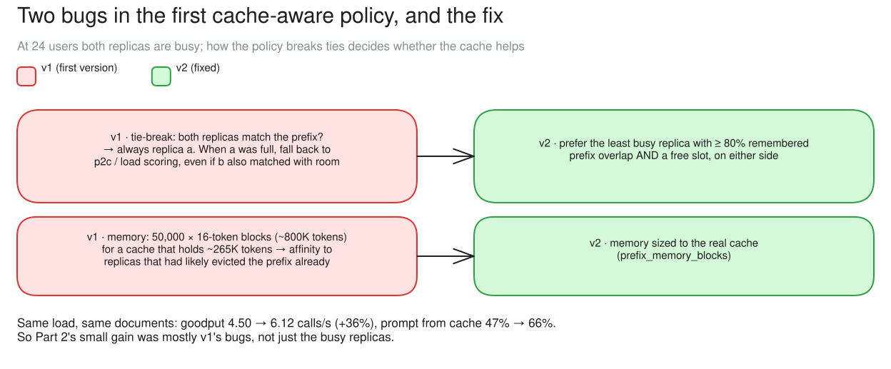
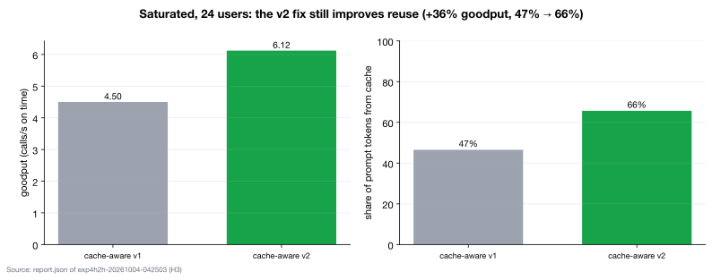

# c11 · H3: placement at saturation, v1 vs v2 (24 users)

[← all experiments](../../README.md#experiments) · all numbers: [RESULTS.md](../RESULTS.md) · how to run it: [README](../../README.md#run-the-experiments-on-lambda)

## What we're doing

We return to c02's saturated 24-user document workload and compare cache-aware policy v1 with v2. Version 2 makes two targeted corrections. A “matching” replica is one that the gateway remembers receiving at least 80% of the same prompt prefix; v2 considers every matching replica with a free slot instead of favoring replica a. It also limits the gateway's prefix-location records to roughly what the real vLLM KV cache can hold, reducing stale memories of already-evicted documents. The model, GPU, documents, load and gateway mode stay the same.

## Why

In c02, cache-aware v1 raised cached input only from about 41% to 44–48%, so the improvement was smaller than expected. That result could have come from saturation, defects in v1, or both. c10 tests the headroom explanation; this case tests the policy-implementation explanation under the original full load. It tells us whether accurate records of likely cache contents and an unbiased choice among matching replicas still matter when free slots appear only briefly as requests finish.

## At a glance

| | Plain-language summary |
|---|---|
| **Changed** | cache-aware policy implementation, v1 versus v2 |
| **Baseline** | v1 at the same 24-user saturated document load |
| **Success rule** | the pre-run expectation was a small gain below 15%; the general placement-value rule is more than 15% |
| **Result** | v2 improved goodput by 36% and cached input from 47% to 66% |

## Setup

| Setting | This experiment |
|---|---|
| Model | Qwen3.5-9B, BF16 (~17 GiB of weights), on every replica |
| GPU | one NVIDIA H100 80 GB, shared by all replicas |
| Replicas | 2 (qwen-9b-a, qwen-9b-b) |
| HAMi memory per vLLM | 38 GiB (a memory cap only: compute is shared, not partitioned) |
| Slots per replica | 8 (calls generating at once; more wait) |
| KV cache per replica | 4.5 GiB = 264,993 tokens (capped on purpose) |
| Max context | 64K tokens |
| KV connector | none (each replica keeps its own cache) |
| Placement | cache-aware v1 vs v2 |
| Gateway mode | route |
| Load | Locust: 40 different ~10K-token annual-report documents (one-sentence answers) |
| Users | 24 (saturated), 240 s |

## What to expect, and what to look at

- The test (H3): the documents load at 24 users (saturated): cache-aware v1 vs v2.
- Look at: which replica gets "prefix" placements (only a in v1; both in v2), cached %.
- Expect: a small gain (< 15%): at saturation both still fall back to load.

**Prediction, written before the run:** v2 uses both holders and gains a little (<15%).

## How to read the numbers

- `prefix` means the router chose a replica because it remembered that prompt; `p2c` means affinity could not be honored and placement fell back to load scoring.
- The placement columns count routing decisions by reason; goodput is a rate of completed, in-target calls. They measure different things and should not be added or compared as totals.
- At saturation, “has room” changes moment by moment as calls finish. v2 helps by considering every matching holder, not by creating extra slots.

## How it works

v1 had two flaws. When both replicas matched the prefix it always chose replica a, and when a was full it fell back to p2c / load scoring even if b also matched with room. And it remembered 50,000 × 16-token blocks (~800K tokens) per replica for a cache that holds ~265K tokens, so it sent calls to replicas that had likely evicted the prefix. v2 fixes both.

**How to read this diagram:** The left side lists the two v1 failure modes: a first-replica tie bias and routing memory larger than the real cache. The right side shows both v2 corrections. Because both change together, the diagram explains the combined 36% gain, not each fix's individual contribution.

## Watch it

Each clip is replayed from the recorded run, never live. The UI video and its Grafana views show the same seconds. **The videos are in the project's shared Drive folder** (see the README, "Recordings and run data"): download its `video/` folder into `docs/presentation/video/` and these links play locally.

#### Clip `c11-v1`: 04:35:45–04:37:45 UTC at 2× (60 s of video)
- **UI replay:** `video/ui/c11-v1.mp4` (`../presentation/video/ui/c11-v1.mp4`)
- **Grafana (same moment, side by side):** placement (`../presentation/video/grafana/c11-v1/routing.mp4`) · tokens and cache (`../presentation/video/grafana/c11-v1/tokens.mp4`) · vLLM engines (`../presentation/video/grafana/c11-v1/engines.mp4`) · latency (TTFT / ITL) (`../presentation/video/grafana/c11-v1/latency.mp4`) · SLOs and goodput (`../presentation/video/grafana/c11-v1/slo.mp4`)
- **What to notice:** "prefix" placements go almost only to qwen-9b-a. Most calls are p2c.
- **What will happen:** About 47% of the prompt from cache.
- **Why:** v1 broke ties toward the first replica and remembered blocks vLLM had already evicted.
- **At 04:36:05 the clip opens a call's details:** v1 at saturation: placed by load (p2c), landed on qwen-9b-a (8/8), 0% from cache

#### Clip `c11-v2`: 04:40:05–04:42:05 UTC at 2× (60 s of video)
- **UI replay:** `video/ui/c11-v2.mp4` (`../presentation/video/ui/c11-v2.mp4`)
- **Grafana (same moment, side by side):** placement (`../presentation/video/grafana/c11-v2/routing.mp4`) · tokens and cache (`../presentation/video/grafana/c11-v2/tokens.mp4`) · vLLM engines (`../presentation/video/grafana/c11-v2/engines.mp4`) · latency (TTFT / ITL) (`../presentation/video/grafana/c11-v2/latency.mp4`) · SLOs and goodput (`../presentation/video/grafana/c11-v2/slo.mp4`)
- **What to notice:** "prefix" placements on both replicas, and the cached % higher.
- **What will happen:** More from cache and more goodput on the same load (over the whole step: 66% from cache, +36% goodput; run figures).
- **Why:** Even at saturation, choosing the right holder of two pays off.
- **At 04:40:25 the clip opens a call's details:** v2: placed by prefix on qwen-9b-a, the replica holding this document

## Results

### The data

| 24 users | goodput /s | TTFT p50 / p99 | prompt from cache | placements prefix / p2c |
|---|---:|---|---:|---|
| cache-aware v1 | 4.50 | 1.04 / 4.00 s | 47% | 298 / 894 |
| cache-aware v2 | 6.12 (+36%) | 0.64 / 2.82 s | 66% | 674 / 856 |

### What we observed

- Better than predicted: +36% from the fixes alone, at saturation. v1's flaws, not only saturation, held Part 2 back.
- v2 at 24 users (6.12/s) beats every policy in Part 2 / repeat A (3.7–4.6/s).

### Key moments (UTC, 2026-10-04)

- 04:34:14 v1 at 24 users: prefix placements only on replica a
- 04:38:35 v2: prefix placements on both replicas, cache share up

### Why it came out this way

v2 uses every replica that matches the prefix and has room, and its memory matches the real cache, so fewer calls go to replicas that already evicted the document.

### What we learned

- The policy's details matter even at saturation: v2's fixes alone raised goodput 36% (4.50 → 6.12/s) and cache share from 47% to 66% at 24 users.
- v1's small gain in c02 came from its own flaws (a tie-break biased toward replica a and a memory ~3× the real cache), not only from saturation.
- Routing memory should be sized to what the engine can actually keep, so the router does not send calls to replicas that have already evicted the document.

### Errors and surprises: what, why, how to fix

| What happened | Why | How to fix |
|---|---|---|
| v1's gains were small in Part 2 | biased tie-break; routing memory represented ~3× the nominal cache capacity | v2 (prefix_p2c_v2, routing.prefix_memory_blocks), +36% |

### What this result does and does not show

- It shows that the combined v2 corrections matter even at saturation.
- Because v2 changes both holder selection and memory sizing together, this run cannot assign a separate percentage of the gain to either fix.

### Charts

**How to read this chart**

- **Axes and control:** Both bars use the same 24-user saturated workload. The left panel shows goodput and the right shows cached prompt-token share, so the policy implementation is the intended change.
- **What happened:** Version 2 raised goodput from 4.50 to 6.12 calls/s (+36%) and cached input from 47% to 66%, despite keeping the replicas at the same high load.
- **Why:** Version 2 considers every matching replica with room instead of always favoring replica a, and it limits the gateway's prefix-location memory to approximately the real cache capacity. That produces more valid cache placements and fewer requests sent toward already-evicted documents.
- **What the paired movement means:** More genuine prefix reuse reduces repeated prefill, which explains why cache share and in-target completion rate rise together.
- **Caution:** Both v2 corrections were enabled at the same time. The chart measures their combined effect and cannot assign a separate part of the 36% gain to either correction.

## Run data

- `results/exp4/exp4h2h-20261004-042503/saturated`

Run folders are in the shared Drive folder (`results/`); `bash experiments/replay.sh <run>/replay.jsonl` replays one in the UI, `bash observability/local/replay.sh <run>/prometheus` in Grafana.
