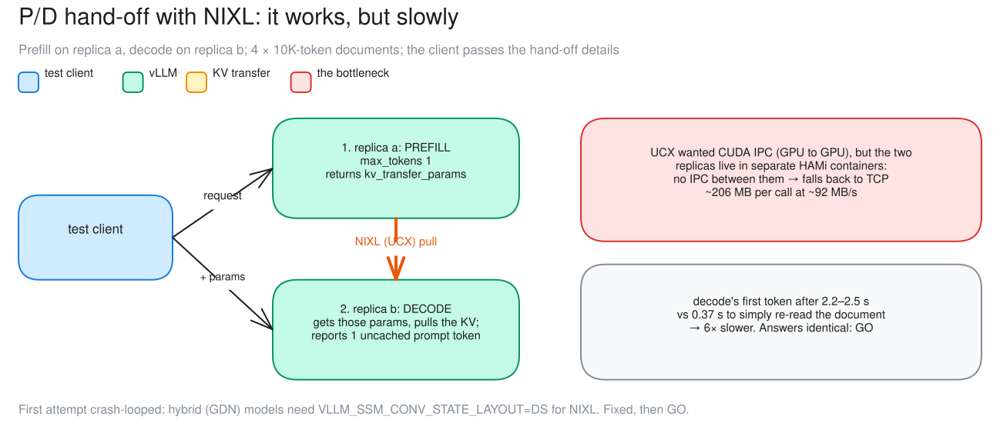

# c12 · P/D hand-off with NIXL

[← all experiments](../../README.md#experiments) · all numbers: [RESULTS.md](../RESULTS.md) · how to run it: [README](../../README.md#run-the-experiments-on-lambda)

## What we're doing

For four 9–10K-token documents, replica a performs prefill—it reads the prompt and builds the key/value (KV) state needed for generation. NIXL then transfers that state to replica b, which performs decode by generating the answer without reading the full prompt again. We bypass the gateway and run one document at a time, comparing the hand-off with a cold recompute, where replica b starts with no transferred state and processes the full prompt itself. We also check whether both paths produce exactly the same answer.

## Why

Long prompts and token generation stress different parts of an inference system, so production deployments sometimes give prefill and decode to different workers. Before such a design is useful, the hand-off must be correct and faster than simply repeating the prompt work. This probe tests both questions in the current constrained setup, where two HAMi containers share one GPU and NIXL may have to move the cache through host networking.

## At a glance

| | Plain-language summary |
|---|---|
| **Changed** | split prefill and decode across two roles and transfer KV with NIXL |
| **Baseline** | let the decode engine recompute the same 9–10K-token prompt locally |
| **Success rule** | decode recomputes no more than 5% of the prompt and all four answers match exactly |
| **Result** | functional GO, performance loss—only one prompt token recomputed, but first token arrived about 6× slower |

## Setup

| Setting | This experiment |
|---|---|
| Model | Qwen3.5-9B, BF16 (~17 GiB of weights), on every replica |
| GPU | one NVIDIA H100 80 GB, shared by all replicas |
| Replicas | 2 (qwen-9b-a, qwen-9b-b) |
| HAMi memory per vLLM | 38 GiB (a memory cap only: compute is shared, not partitioned) |
| Slots per replica | 8 (calls generating at once; more wait) |
| KV cache per replica | 4.5 GiB = 264,993 tokens (capped on purpose) |
| Max context | 64K tokens |
| KV connector | **NIXL (UCX transport, which fell back to TCP)** (changed) |
| Roles | replica a = prefill, replica b = decode |
| Gateway | bypassed: the probe calls the two engines directly |
| Load | 4 documents (~9–10K tokens each), one at a time, temperature 0 |
| Run | exp4pd (05:13; a first attempt at 05:03 crash-looped) |

## What to expect, and what to look at

- The probe: prefill on replica a (max_tokens 1) → decode on replica b with the transferred KV, NIXL connector; 4 documents, straight to the engines.
- Look at: Grafana's engine panels during the probe (no UI: the gateway is bypassed).
- Expect: decode reuses the KV (computes ≤ 5% of the prompt) and answers the same.

**Prediction, written before the run:** Decode reuses the transferred KV (≤5% of the prompt computed there), and the answers match.

## How to read the numbers

- Recompute TTFT is the cold baseline on the decode replica. P/D decode TTFT starts when decode is requested and includes waiting for the transferred KV.
- One uncached token out of ~10K is direct evidence that the remote KV was consumed; matching text checks that the hand-off preserved behavior.
- This serial four-document probe tests correctness and transfer cost, not throughput under concurrent load.

## How it works

Prefill/decode disaggregation runs the prompt on one engine and generation on another, shipping the KV cache between them. Here both engines share one GPU but sit in separate HAMi containers, so there is no direct GPU-to-GPU path: the KV leaves the GPU and comes back over TCP.

**How to read this diagram:** Follow the numbered hand-off: the client asks a to prefill, passes its transfer metadata to b, and b pulls the KV before decoding. The bottleneck callout shows why correctness passed but latency lost—the transfer used TCP instead of a direct GPU-memory path.

## Watch it

Each clip is replayed from the recorded run, never live. The UI video and its Grafana views show the same seconds. **The videos are in the project's shared Drive folder** (see the README, "Recordings and run data"): download its `video/` folder into `docs/presentation/video/` and these links play locally.

#### Clip `c12-nixl`: 05:17:50–05:18:20 UTC at 1× (30 s of video)
- **Grafana (same moment, side by side):** vLLM engines (`../presentation/video/grafana/c12-nixl/engines.mp4`) · latency (TTFT / ITL) (`../presentation/video/grafana/c12-nixl/latency.mp4`) · tokens and cache (`../presentation/video/grafana/c12-nixl/tokens.mp4`)
- **What to notice:** qwen-9b-b's TTFT p99 jumps to ~2.5 s, against ~0.5 s on qwen-9b-a. The hand-off itself can't be seen: the calls are shorter than Grafana's 5 s scrape.
- **What will happen:** The KV moves, but slowly.
- **Why:** There is no GPU-to-GPU path between two HAMi-isolated containers (CUDA IPC), so the transfer goes over TCP. (The gateway is bypassed, so there is no UI replay; the diagram and chart carry this case.)

## Results

### The data

| Document | recompute on decode (TTFT) | P/D decode TTFT | uncached prompt tokens on decode | identical answer |
|---|---:|---:|---:|:-:|
| amd | 0.40 s | 2.49 s | 1 of 9,814 | ✅ |
| avgo | 0.35 s | 2.23 s | 1 of 9,025 | ✅ |
| intc | 0.38 s | 2.46 s | 1 of 9,953 | ✅ |
| nvda | 0.37 s | 2.46 s | 1 of 9,675 | ✅ |

### What we observed

- GO by the rule fixed before the run: the KV moved and the answers were identical, on a hybrid model.
- But ~206 MB at ~92 MB/s (UCX over TCP) made decode's first token 6× slower than recomputing.
- The first attempt crash-looped until VLLM_SSM_CONV_STATE_LAYOUT=DS was set.

### Key moments (UTC, 2026-10-04)

- 05:03 first attempt: replica a crash-loops at start
- 05:17:55–05:18:15 the probe: four prefill → decode hand-offs, ~2.3 s each

### Why it came out this way

UCX prefers CUDA IPC (GPU memory to GPU memory), but two HAMi-isolated containers can't share GPU memory handles, so it falls back to TCP: ~206 MB per call at ~92 MB/s.

### What we learned

- Prefill/decode hand-off works on this hybrid model: for all four documents the decode replica recomputed 1 prompt token and gave an identical answer.
- Whether it pays depends on the transport. Without CUDA IPC across HAMi-isolated containers, UCX fell back to TCP (~92 MB/s), and decode's first token came ~6× later than recomputing.
- NIXL on a hybrid (GDN) model needs VLLM_SSM_CONV_STATE_LAYOUT=DS on both roles; a setup script should restore the fleet on any exit.

### Errors and surprises: what, why, how to fix

| What happened | Why | How to fix |
|---|---|---|
| vLLM asserted at start: "3-read Mamba conv transfer requires DS conv state layout" | NIXL on a hybrid (GDN) model needs a different conv-state layout | VLLM_SSM_CONV_STATE_LAYOUT=DS on both replicas (fixed); the script now restores the fleet on any exit |
| decode's first token 6× slower than recomputing | TCP transport between containers | a fast path: CUDA IPC across containers, NVLink, or RDMA; or Mooncake (c13) |

### What this result does and does not show

- It proves functional KV reuse for all four serial probes on this hybrid model and connector configuration.
- It does not show that NIXL is intrinsically slow: the measured path was UCX over TCP after CUDA IPC was unavailable across these HAMi-isolated containers.

### Charts

**How to read this chart**

- **Axes and groups:** Each document has three bars, and the vertical axis is time to first token measured on the decode replica. Lower is better. The gray bar makes the decode replica process the full prompt itself; blue uses a NIXL KV hand-off; green uses Mooncake.
- **Cold-recompute baseline:** Processing the roughly 9–10K-token prompts locally on the decode replica took 0.35–0.40 s before the first generated token.
- **NIXL result:** NIXL took 2.23–2.49 s because about 206 MB of KV state moved through UCX over TCP at roughly 92 MB/s. The decode replica recomputed only one prompt token, so reuse worked, but transfer cost dominated latency.
- **Mooncake result:** Mooncake reduced decode-side TTFT to 0.27–0.30 s by moving the same state at roughly 1,319 MB/s, fast enough to beat cold recomputation on these four documents.
- **Correctness and scope:** NIXL produced 4/4 exact answer matches; Mooncake produced 3/4, so its strict verdict remains NO-GO despite winning latency. This was a serial decode-side probe that bypassed the gateway, not an end-to-end concurrent throughput test. On c12 focus on NIXL; on c13 focus on Mooncake.

## Run data

- `results/exp4/exp4pd-20261004-051357`
- `results/exp4/exp4pd-20261004-050259`

Run folders are in the shared Drive folder (`results/`); `bash experiments/replay.sh <run>/replay.jsonl` replays one in the UI, `bash observability/local/replay.sh <run>/prometheus` in Grafana.
