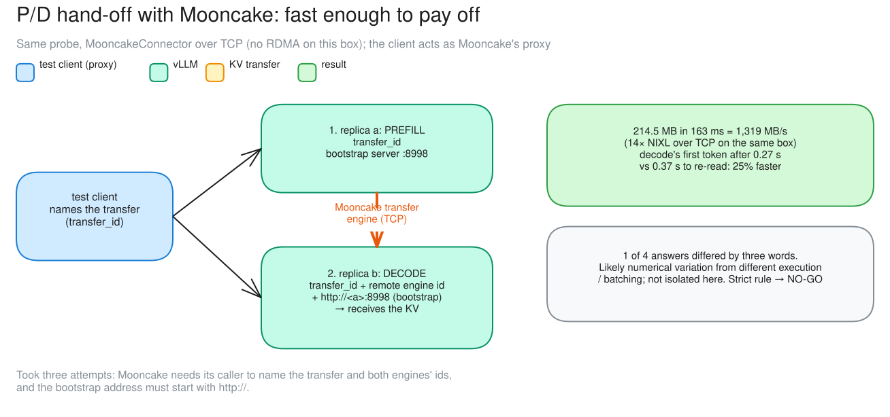
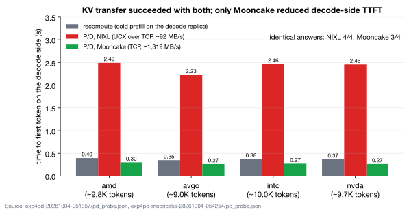

# c13 · P/D hand-off with Mooncake

[← all experiments](../../README.md#experiments) · all numbers: [RESULTS.md](../RESULTS.md) · how to run it: [README](../../README.md#run-the-experiments-on-lambda)

## What we're doing

We repeat c12's four-document prefill/decode hand-off, but replace NIXL with Mooncake while keeping the same model, shared H100, TCP network and one-at-a-time probe. The test client coordinates the transfer by giving both replicas the same transfer identifier and telling replica b where to find replica a. Replica a builds the KV state, and replica b receives it before generating. We compare transfer time, time to first token on replica b, prompt recomputation and exact answer equality with both cold recompute and the NIXL result.

## Why

NIXL proved that the state could move correctly, but its TCP path took much longer than recalculating the prompt. Changing only the connector helps identify whether that penalty is fundamental to this topology or specific to the transfer stack. The result also reminds us that speed is not enough: a faster connector must preserve the expected model output.

## At a glance

| | Plain-language summary |
|---|---|
| **Changed** | KV connector—Mooncake instead of NIXL, still over TCP |
| **Baseline** | cold recompute on decode and the NIXL probe in c12 |
| **Success rule** | no more than 5% recomputed and all four answers match exactly; no speed threshold was predeclared |
| **Result** | transfer was 14× faster and beat recompute, but one answer differed by three words, so the strict verdict is NO-GO |

## Setup

| Setting | This experiment |
|---|---|
| Model | Qwen3.5-9B, BF16 (~17 GiB of weights), on every replica |
| GPU | one NVIDIA H100 80 GB, shared by all replicas |
| Replicas | 2 (qwen-9b-a, qwen-9b-b) |
| HAMi memory per vLLM | 38 GiB (a memory cap only: compute is shared, not partitioned) |
| Slots per replica | 8 (calls generating at once; more wait) |
| KV cache per replica | 4.5 GiB = 264,993 tokens (capped on purpose) |
| Max context | 64K tokens |
| KV connector | **Mooncake (TCP; no RDMA network card on this box)** (changed) |
| Roles | replica a = prefill, replica b = decode |
| Gateway | bypassed |
| Load | the same 4 documents, temperature 0 |
| Run | exp4pd-mooncake (05:42; two earlier attempts) |

## What to expect, and what to look at

- The probe: the same as c12 with the MooncakeConnector (TCP; no RDMA on this box); the client acts as Mooncake's proxy.
- Look at: Grafana's engine panels during the probe.
- Expect: the same hand-off; is the transport faster?

**Prediction, written before the run:** As in c12: decode computes no more than 5% of the prompt from scratch and all four answers match exactly. Transfer speed was measured, but no speedup threshold was declared in advance.

## How to read the numbers

- The 25% speedup compares decode-side TTFT with cold recompute for these four documents; it is not an end-to-end fleet throughput result.
- Temperature 0 removes sampling randomness, but different batching/execution can still create small floating-point differences that change an early token.
- Exact-match NO-GO is deliberately stricter than semantic correctness; the page reports both rather than changing the rule after the run.

## How it works

Mooncake's transfer engine moves the KV directly between the engines once the caller names the transfer (transfer_id) and tells decode where prefill's bootstrap server is. Over the same TCP it was 14× faster than NIXL.

**How to read this diagram:** The numbered path is the same P/D split, but the client now acts as the proxy that names the transfer and both engines. The rightmost box compares transfer rate and decode TTFT with NIXL and cold recompute; the exact-answer note is a separate correctness verdict.

## Watch it

Each clip is replayed from the recorded run, never live. The UI video and its Grafana views show the same seconds. **The videos are in the project's shared Drive folder** (see the README, "Recordings and run data"): download its `video/` folder into `docs/presentation/video/` and these links play locally.

#### Clip `c13-mooncake`: 05:46:48–05:47:18 UTC at 1× (30 s of video)
- **Grafana (same moment, side by side):** vLLM engines (`../presentation/video/grafana/c13-mooncake/engines.mp4`) · latency (TTFT / ITL) (`../presentation/video/grafana/c13-mooncake/latency.mp4`) · tokens and cache (`../presentation/video/grafana/c13-mooncake/tokens.mp4`)
- **What to notice:** qwen-9b-b's TTFT stays under 0.5 s (against ~2.5 s with NIXL). The hand-off itself can't be seen; the transfer rate (1,319 MB/s) and 0.27 vs 0.37 s come from the probe's own results.
- **What will happen:** The hand-off is faster than recomputing (probe data).
- **Why:** Mooncake's TCP transfer engine moves the KV 14× faster than UCX over TCP did.

## Results

### The data

| Document | recompute on decode | P/D decode TTFT | uncached prompt tokens on decode | identical answer |
|---|---:|---:|---:|:-:|
| amd | 0.40 s | 0.30 s | 1 of 9,814 | three words differ |
| avgo | 0.35 s | 0.27 s | 1 of 9,025 | ✅ |
| intc | 0.37 s | 0.27 s | 1 of 9,953 | ✅ |
| nvda | 0.38 s | 0.27 s | 1 of 9,675 | ✅ |

### What we observed

- 214.5 MB in 163 ms (1,319 MB/s, 14× NIXL): decode's first token came 25% sooner than recomputing.
- NO-GO by the strict rule: 1 of 4 answers differed by three words. Likely numerical variation from different execution / batching; not isolated by this experiment.
- KV transfer succeeded with both connectors; only Mooncake reduced decode-side TTFT. Took three attempts.

### Key moments (UTC, 2026-10-04)

- 05:24 and 05:34 two failed attempts
- 05:46:53–05:47:05 the probe: four hand-offs, ~0.27 s each

### Why it came out this way

Mooncake's transfer engine moved the same KV over the same TCP 14× faster than UCX did (1,319 MB/s), fast enough to beat recomputing a 10K-token prompt.

### What we learned

- The connector mattered more than the network: over the same TCP, Mooncake moved 214.5 MB in 163 ms (14× NIXL), and decode's first token came 25% sooner than recomputing.
- Mooncake needs its caller to act as the proxy: send a transfer_id to both engines and give decode the prefill engine's id and an http:// bootstrap address.
- An exact-answer rule is strict: one of four answers differed by three words, likely numerical variation, so equivalence checks need care.

### Errors and surprises: what, why, how to fix

| What happened | Why | How to fix |
|---|---|---|
| attempt 1: prefill returned no kv_transfer_params | Mooncake expects its caller (a proxy) to name the transfer and both engines | the probe sends transfer_id to both, and decode the prefill engine's id and bootstrap address |
| attempt 2: "Request URL is missing an 'http://' protocol" | the bootstrap address needs a scheme | http://<prefill pod>:8998 (fixed) |
| 1 of 4 answers differed by three words | likely numerical variation from different execution / batching; not isolated | a looser rule (same facts), or isolate by repeating on one engine |

### What this result does and does not show

- It shows that connector implementation mattered more than the nominal network type on this box: both used TCP, but Mooncake moved this KV payload much faster.
- It does not establish production P/D capacity. The probe was serial, bypassed the gateway and ran both roles on one GPU; concurrency, backpressure and separate-GPU scaling remain unmeasured.

### Charts

**How to read this chart**

- **Axes and groups:** Each document has three bars, and the vertical axis is time to first token measured on the decode replica. Lower is better. The gray bar makes the decode replica process the full prompt itself; blue uses a NIXL KV hand-off; green uses Mooncake.
- **Cold-recompute baseline:** Processing the roughly 9–10K-token prompts locally on the decode replica took 0.35–0.40 s before the first generated token.
- **NIXL result:** NIXL took 2.23–2.49 s because about 206 MB of KV state moved through UCX over TCP at roughly 92 MB/s. The decode replica recomputed only one prompt token, so reuse worked, but transfer cost dominated latency.
- **Mooncake result:** Mooncake reduced decode-side TTFT to 0.27–0.30 s by moving the same state at roughly 1,319 MB/s, fast enough to beat cold recomputation on these four documents.
- **Correctness and scope:** NIXL produced 4/4 exact answer matches; Mooncake produced 3/4, so its strict verdict remains NO-GO despite winning latency. This was a serial decode-side probe that bypassed the gateway, not an end-to-end concurrent throughput test. On c12 focus on NIXL; on c13 focus on Mooncake.

## Run data

- `results/exp4/exp4pd-mooncake-20261004-054254`
- `results/exp4/exp4pd-mooncake-20261004-052401`
- `results/exp4/exp4pd-mooncake-20261004-053402`

Run folders are in the shared Drive folder (`results/`); `bash experiments/replay.sh <run>/replay.jsonl` replays one in the UI, `bash observability/local/replay.sh <run>/prometheus` in Grafana.
