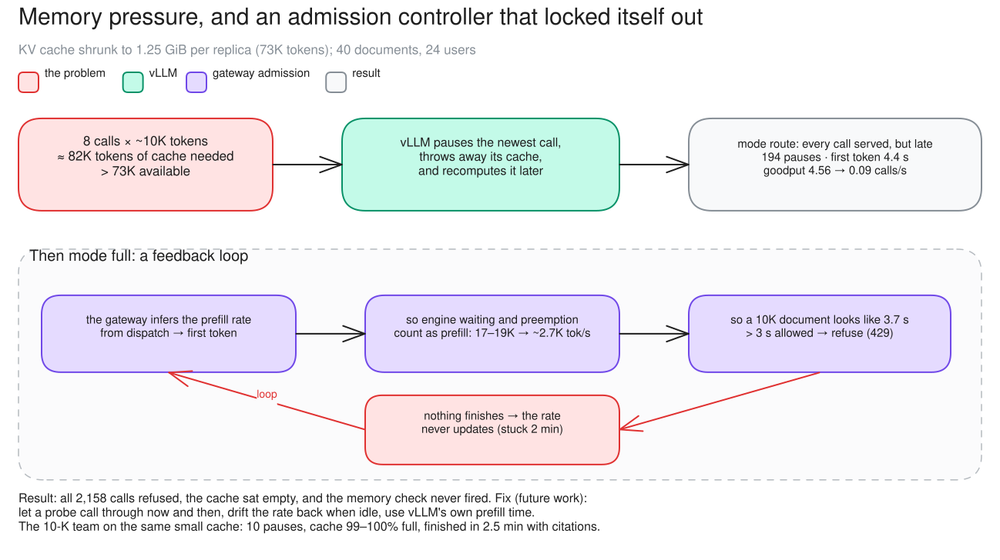
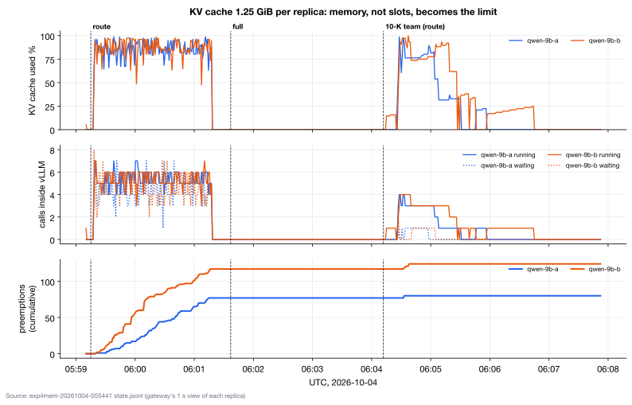
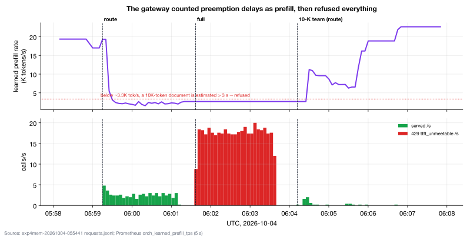

# c14 · Memory pressure (KV 1.25 GiB), route vs full, and the 10-K team on the small cache

[← all experiments](../../README.md#experiments) · all numbers: [RESULTS.md](../RESULTS.md) · how to run it: [README](../../README.md#run-the-experiments-on-lambda)

## What we're doing

We deliberately shrink each replica's KV cache from the normal 4.5 GiB to 1.25 GiB while leaving eight request slots and the long-document workload in place. Eight roughly 10K-token calls no longer fit, so we first observe how vLLM behaves in route mode, where every call is forwarded. We then enable full mode, where the gateway's admission controller may refuse work predicted to arrive too late or exceed safe capacity, and finally run the 10-K agent team to see whether useful work can still complete on the smaller cache.

## Why

In the normal cases, request slots became full before KV memory did, so memory failure behavior remained hidden. This stress test makes KV capacity the bottleneck on purpose, exposing preemption, recomputation and the admission controller's response. It also checks a critical recovery property: the admission controller estimates prompt-processing speed from earlier completed calls, so can that estimate recover after memory pressure and recomputation make the system temporarily slow?

## At a glance

| | Plain-language summary |
|---|---|
| **Changed** | KV cache per replica, 4.5 GiB normally versus 1.25 GiB here; route then full |
| **Baseline** | the same 24-user document workload on the normal cache |
| **Success rule** | route should expose preemption; full was expected to shed with 503 `kv_pressure`; the agent team should finish |
| **Result** | route thrashed as expected, but full entered a learned-rate lockout and returned 429 for every attempt |

## Setup

| Setting | This experiment |
|---|---|
| Model | Qwen3.5-9B, BF16 (~17 GiB of weights), on every replica |
| GPU | one NVIDIA H100 80 GB, shared by all replicas |
| Replicas | 2 (qwen-9b-a, qwen-9b-b) |
| HAMi memory per vLLM | 38 GiB (a memory cap only: compute is shared, not partitioned) |
| Slots per replica | 8 (calls generating at once; more wait) |
| KV cache per replica | **1.25 GiB = 73,134 tokens** (redeployed; normal is 4.5 GiB) (changed) |
| Max context | 64K tokens |
| KV connector | none (each replica keeps its own cache) |
| Placement | cache-aware v1 |
| Gateway mode | route, then full; then the 10-K team in route |
| Load | Locust: 40 different ~10K-token annual-report documents (one-sentence answers); then the 10-K agent team |
| Users | 24, 120 s per mode |

## What to expect, and what to look at

- The demo: both replicas redeployed with a 1.25 GiB KV cache (73K tokens); 40 documents, 24 users, route then full; then the 10-K team; then the fleet restored.
- Look at: KV %, "Preempted", running vs waiting (route); 429s and the learned prefill rate (full).
- Expect: preemption in route; 503 kv_pressure in full; the team finishes.

**Prediction, written before the run:** route: vLLM preempts, fewer than 8 calls run, long TTFT. full: 503 kv_pressure above 90% KV, and fewer preemptions. The 10-K team: preemptions, but it finishes.

## How to read the numbers

- Preemption here means vLLM pauses a running call, discards its KV and later recomputes the prompt. It is not a failed request, but it increases TTFT and consumes extra work.
- Running can stay below the configured eight slots when memory is the tighter limit. Waiting then includes calls that were preempted and put back in vLLM's queue.
- The full-mode row has no TTFT because no call was admitted. Zero preemptions there is not healthy capacity—it is a total admission lockout with an empty cache.

## How it works

8 calls × ~10K tokens need ~82K tokens of KV, more than 73K, so vLLM pauses the newest call, throws its cache away and recomputes it later. In full, admission estimates each call's time to first token from a prefill rate it learns from finished calls. The route step's preemption delays dragged that rate down 7×, so every document looked too slow and was refused; with nothing served, the rate never recovered.

**How to read this diagram:** Read the top row as a capacity chain: required KV exceeds available KV, so vLLM preempts and recomputes. Then follow the lower loop clockwise: delayed first tokens poison the learned prefill rate, admission refuses everything, and no completed probe exists to repair the estimate.

## Watch it

Each clip is replayed from the recorded run, never live. The UI video and its Grafana views show the same seconds. **The videos are in the project's shared Drive folder** (see the README, "Recordings and run data"): download its `video/` folder into `docs/presentation/video/` and these links play locally.

#### Clip `c14-route`: 05:59:18–06:01:16 UTC at 2× (59 s of video)
- **UI replay:** `video/ui/c14-route.mp4` (`../presentation/video/ui/c14-route.mp4`)
- **Grafana (same moment, side by side):** vLLM engines (`../presentation/video/grafana/c14-route/engines.mp4`) · gateway admission (`../presentation/video/grafana/c14-route/gateway.mp4`) · latency (TTFT / ITL) (`../presentation/video/grafana/c14-route/latency.mp4`) · tokens and cache (`../presentation/video/grafana/c14-route/tokens.mp4`) · GPU (`../presentation/video/grafana/c14-route/gpu.mp4`) · SLOs and goodput (`../presentation/video/grafana/c14-route/slo.mp4`)
- **What to notice:** KV hits ~100%, the "Preempted" counter climbs, only ~5 of 8 slots are running, and ~4.5 calls wait inside vLLM per replica.
- **What will happen:** Every call is served, but late. TTFT p50 is 4.4 s and the cache share falls to 6%.
- **Why:** 8 calls × ~10K tokens need ~82K tokens of KV, and each replica has 73K. vLLM evicts the newest running call and recomputes it later.
- **At 05:59:50 the clip opens a call's details:** a LATE call: TTFT 3.39 s against 2 s. The UI counts waiting inside vLLM and recompute after preemption as prefill
- **At 06:00:35 the clip opens a call's details:** a call in an engine slot, in prefill for ~4 s before it starts answering (TTFT 3.94 s)

#### Clip `c14-full`: 06:01:40–06:03:38 UTC at 2× (59 s of video)
- **UI replay:** `video/ui/c14-full.mp4` (`../presentation/video/ui/c14-full.mp4`)
- **Grafana (same moment, side by side):** gateway admission (`../presentation/video/grafana/c14-full/gateway.mp4`) · vLLM engines (`../presentation/video/grafana/c14-full/engines.mp4`) · SLOs and goodput (`../presentation/video/grafana/c14-full/slo.mp4`) · latency (TTFT / ITL) (`../presentation/video/grafana/c14-full/latency.mp4`)
- **What to notice:** No memory pressure in this step: KV is 0% and the Admission checklist's KV row says ok. Every call gets 429 ttft_unmeetable in ~3 ms (the TTFT estimate row: 1.86× against the 1.5× limit) and is never queued or sent to an engine. Grafana: the learned prefill rate is flat at 2,670 tok/s (from ~17–19K before the route step).
- **What will happen:** A total lockout, not 503 kv_pressure as predicted.
- **Why:** The rate is learned from dispatch to first token, which includes the route step's preemption delays. With nothing served, it never relearns. A ~10K-token document is estimated at 3.7 s, over the 3 s limit.
- **At 06:01:58 the clip opens a call's details:** a refused call: 429 TTFT target unmeetable, after 3 ms, with Retry-After
- **At 06:02:38 the clip opens a call's details:** the admission decision: estimated TTFT 3.7 s > 1.5 × 2 s
- **At 06:03:10 the clip opens a call's details:** the incident group's latest example: every refusal has the same cause

#### Clip `c14-team`: 06:04:15–06:06:15 UTC at 2× (60 s of video)
- **UI replay:** `video/ui/c14-team.mp4` (`../presentation/video/ui/c14-team.mp4`)
- **Grafana (same moment, side by side):** vLLM engines (`../presentation/video/grafana/c14-team/engines.mp4`) · agents and tenants (`../presentation/video/grafana/c14-team/agents.mp4`) · gateway admission (`../presentation/video/grafana/c14-team/gateway.mp4`) · latency (TTFT / ITL) (`../presentation/video/grafana/c14-team/latency.mp4`)
- **What to notice:** Eight readers in flight at 06:04:24 (UI: 8/8), KV peaks at 97–100%, the first preemption at 06:04:33, and the learned rate recovering.
- **What will happen:** 10 preemptions. All 8 readers finish in the clip; the lead's final call ends at 06:06:43, 28 s after the clip (its report has citations).
- **Why:** A preempted call is recomputed inside vLLM, so the agents never see it.
- **At 06:04:35 the clip opens a call's details:** one reader agent's call in flight (a ~18K-token prompt: filing plus context), and the list of its calls
- **At 06:05:28 the clip opens a call's details:** a LATE reader call: TTFT 24.5 s (shown as prefill; the replica was preempting)

## Results

### The data

| 24 users, documents | goodput /s | TTFT p50 / p99 | running / waiting per replica | from cache | preemptions | refused |
|---|---:|---|---|---:|---:|---|
| normal cache 4.5 GiB, route | 4.56 | 1.01 / 3.87 s | 7.1 / 0.9 | 48% | 0 | 0 |
| small cache 1.25 GiB, route | 0.09 | 4.40 / 10.83 s | 5.3 / 4.5 | 6% | 194 | 0 |
| small cache 1.25 GiB, full | 0 | – | 0 / 0 | – | 0 | all 2,158: 429 ttft_unmeetable |
| 10-K team, small cache, route | finished in 2.5 min with citations | | | | 10 | 0 |

### What we observed

- Route as predicted: memory became the limit before slots; every call was served, but late.
- Full not as predicted: no 503 kv_pressure. Admission locked itself out on its own estimate. Fix: probe calls, decay the learned rate, use vLLM's own prefill time.
- The 10-K team finished correctly despite 10 preemptions at 99–100% KV: recomputation is invisible to the agents.

### Key moments (UTC, 2026-10-04)

- 05:59:20 first preemption, seconds into the route step
- 05:59:30–06:01:15 KV ~99%, ~5 of 8 running, ~4.5 waiting per replica; 194 preemptions in total
- 06:01:37 full: every call 429 in ~90 ms; KV 0; learned prefill rate flat at 2,670
- 06:04:24 10-K team: 8 readers running; 06:04:33 its first preemption; the rate recovers to ~11K
- 06:06:53 team done (2.5 min)

### Why it came out this way

Route: 8 calls × ~10K tokens don't fit 73K, so vLLM keeps pausing and recomputing calls. Full: admission's prefill rate is learned from dispatch → first token, which included the route step's waiting and preemptions, so it fell 7×; every document then looked too slow, and with nothing served the rate never updated.

### What we learned

- When KV demand exceeds KV capacity, memory becomes the limit before slots: vLLM preempted and recomputed calls 194 times, and goodput fell from 4.56 to 0.09/s.
- An adaptive estimate needs a recovery path: admission learned its prefill rate from dispatch → first token, preemption delays poisoned it, and with nothing served it never recovered, so all 2,158 calls were refused.
- Learned rates should be reset on a config change and measured from vLLM's own prefill time, with an occasional probe call when the estimate refuses everything.
- Preemption is invisible to agents: the 10-K team finished correctly in 2.5 min despite 10 preemptions at 99–100% KV.

### Errors and surprises: what, why, how to fix

| What happened | Why | How to fix |
|---|---|---|
| 194 preemptions (route) | KV demand > KV capacity | a bigger cache, fewer slots, or refusing new work earlier (kv_shed below 0.9) |
| all 2,158 calls 429 ttft_unmeetable (full) | the learned prefill rate was poisoned by preemption delays, carried over the route → full switch (a config change resets vLLM, not the gateway's learned rates), and can't recover without served calls | admit an occasional probe call; decay the rate toward its prior when idle; measure vLLM's own prefill time; reset learned rates on a config change |
| no 503 kv_pressure (predicted) | the TTFT check refused everything first, so KV never rose | the same fixes; then re-run to see the KV check work |

### What this result does and does not show

- It demonstrates deliberate KV scarcity and the resulting preemption/recompute loop; the 1.25 GiB cache is a stress condition, not the normal deployment.
- The full-mode lockout depends on state carried from the preceding route step. A cold full-mode run could behave differently, and the proposed recovery fixes still require a rerun.
- The 10-K team's 2.5-minute completion is not comparable with c07's 9.4 minutes because c07 shared the GPU with two other teams.

### Charts

**How to read this chart**

- **Time and phases:** All three panels share the same UTC axis. The labeled regions are the small-cache document run in route mode, the following full-mode run, and the later 10-K agent team back in route mode.
- **Top panel—KV memory:** Each colored line is one replica's KV-cache utilization. During the document route phase both caches stay near 99–100%, showing that memory is exhausted even though not all eight execution slots remain active.
- **Middle panel—work inside vLLM:** Solid lines are running calls and dotted lines are calls waiting inside each engine. In the route phase only about five calls per replica run while roughly 4.5 wait, because the reduced cache cannot hold eight long prompts at once.
- **Bottom panel—preemption:** The lines are cumulative, so an upward slope means new preemptions are occurring. They climb to 194 during the document route phase, stay flat in full mode because admission serves nothing, and rise by 10 during the agent run.
- **Why and conclusion:** vLLM preempts a call when its KV state will not fit, discards that state and later recomputes it. Near-full KV plus fewer running calls, more waiting and rising preemptions together prove that memory—not the configured slot count—is the active bottleneck.

**How to read this chart**

- **Upper panel:** The line is the gateway's learned prompt-prefill rate in thousands of tokens/s. The dotted threshold near 3.3K tokens/s is where a 10K-token prompt is estimated to take more than the three-second admission allowance.
- **Lower panel:** Green bars are calls served each second; red bars are 429 `ttft_unmeetable` refusals. The phase labels match the route, full and 10-K-team intervals in the memory chart above.
- **Sequence of events:** Preemption and waiting during route mode pulled the learned rate down to about 2,670 tokens/s. When full mode began, that rate made every document look too slow, so all 2,158 attempts were refused and the green service bars disappeared.
- **Why it stayed locked:** The estimator updates from completed calls. Once admission refused every call, no successful probe remained to provide a faster measurement, so the low estimate could not repair itself even though KV usage was zero.
- **Recovery evidence:** Returning to route mode for the 10-K team allowed calls through and the learned rate recovered toward roughly 11K tokens/s. The chart therefore shows an admission-controller feedback failure, not permanent GPU slowness.

## Run data

- `results/exp4/exp4mem-20261004-055441`

Run folders are in the shared Drive folder (`results/`); `bash experiments/replay.sh <run>/replay.jsonl` replays one in the UI, `bash observability/local/replay.sh <run>/prometheus` in Grafana.
