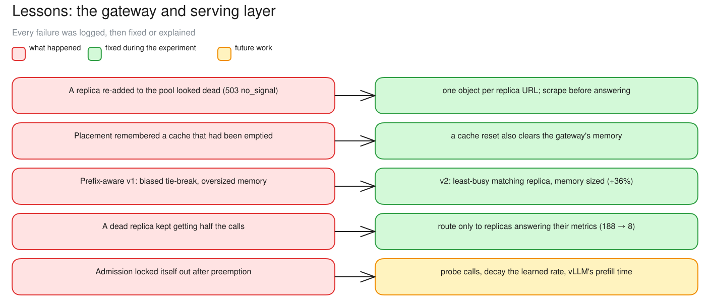
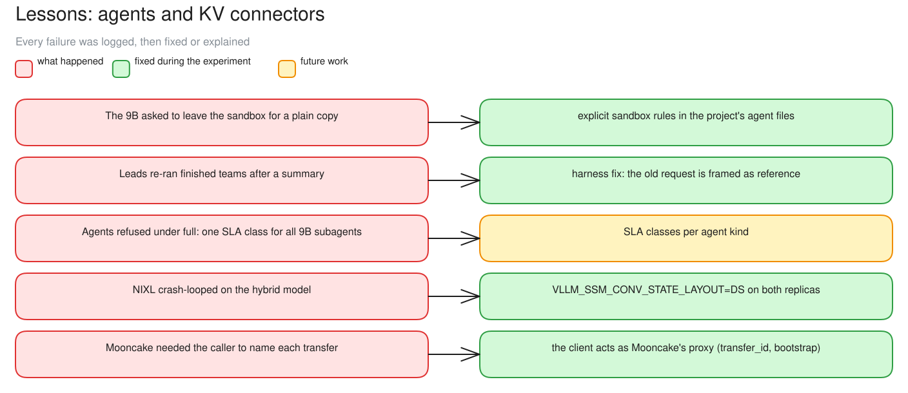

# c15 · What went wrong, and what we learned from it

[← all experiments](../../README.md#experiments) · all numbers: [RESULTS.md](../RESULTS.md) · how to run it: [README](../../README.md#run-the-experiments-on-lambda)

## What we're doing

This page gathers the important failures from all earlier cases into one incident review. For each event it follows the same chain: visible symptom, user impact, root cause, correction and evidence from a later run. It covers serving-control errors, agent-harness mistakes and KV-transfer setup problems, and clearly separates verified fixes from proposed future work.

## Why

A clean final benchmark can hide the most valuable systems knowledge: what failed, which layer caused it and whether the fix actually survived the same scenario. Reviewing the incidents together reveals a common theme—routing and admission are only as reliable as the gateway's information about replica health, likely cache contents and request-processing time—and prevents a workaround from being presented as a proven correction.

## At a glance

| | Plain-language summary |
|---|---|
| **Changed** | not applicable—this page consolidates incidents from multiple cases |
| **Baseline** | the expected contract for liveness, cache state, agent behavior and KV transfer |
| **Success rule** | a fix counts as verified only when a later run reproduces the scenario without the original failure |
| **Result** | nine issues were fixed and verified; agent-specific admission and learned-rate recovery remain open |

## Scope

This is a cross-case incident review, not one additional experiment. The normal fleet was two Qwen3.5-9B vLLM replicas on one H100, each capped at 38 GiB by HAMi, with 8 slots, a 4.5 GiB KV cache and no connector. The incidents also include three deliberate exceptions:

| Exception | Parameters | Why it is included here |
|---|---|---|
| P/D with NIXL | two roles, NIXL/UCX over TCP, gateway bypassed | exposed the hybrid-model state-layout requirement and a slow transfer path |
| P/D with Mooncake | two roles, Mooncake over TCP, gateway bypassed | exposed the caller/proxy contract and bootstrap-address requirement |
| memory pressure | KV reduced to 1.25 GiB per replica; route then full | exposed preemption and an admission-controller feedback loop |

## What to expect, and what to look at

- Read each row as **symptom → user impact → root cause → correction → verification**. A workaround that merely made the run continue is not counted as a verified fix.

## How to read the numbers

- Each row is one issue, named by what failed. “Fixed” means exercised successfully later; “future work” means the cause is supported by evidence but the proposed correction has not been rerun.
- Control-plane errors make decisions from stale or misleading state; data-plane errors affect model execution or KV movement; harness errors affect what the agents do. The same user symptom can originate in any of the three.

## How it works

Most lessons are about the control plane being right about the engines: a replica's liveness, what is really cached, and how long prefill really takes. The rest are about agents on a smaller model and about KV connectors.

**How to read this diagram:** Each row maps a serving-layer symptom on the left to either a verified correction in the middle or unfinished work on the right. Use it as an incident index; the detailed evidence lives in c02, c06 and c14.

**How to read this diagram:** Use the same left-to-right incident map for agent and connector failures. Items in the middle were exercised successfully in later runs; the SLA-class item remains future work.

## Results

### The data

| Issue | Symptom and impact | Root cause | Correction | Verification / status |
|---|---|---|---|---|
| replica state after re-entry | a replica returned to the pool but calls received 503 `no_signal` | replica state was keyed incorrectly and had no fresh scrape | keep one state object per replica URL and scrape before answering | fixed before the final runs |
| placement memory after a cache reset | placement routed toward prefixes that had just been reset | the gateway's placement memory outlived vLLM's real cache | clear placement memory whenever the engine cache is reset | fixed before the final runs |
| cache-aware v1 (c02, c11) | cache-aware v1 favored replica a and often remembered evicted prefixes | ties selected the first holder; remembered prefix capacity was much larger than the actual KV cache | v2 selects the least-busy valid holder and caps remembered blocks to the real cache | verified at saturation: goodput +36%, cache share 47% → 66% |
| dead-replica routing (c06) | after replica b died, round robin kept sending it about half the new calls | placement ignored stale/unhealthy engine metrics | route only to replicas with fresh metrics; mark connection refusal down immediately | verified: failures 188 → 8; the remaining 8 were already streaming at the kill |
| agent sandbox and team re-runs (c07, c08) | agents asked to leave the sandbox or lead agents re-ran completed teams | task instructions and harness completion state were not strict enough for the 9B lead | tighten sandbox rules and persist completed-team state across compaction | verified in the live rerun: no sandbox prompts and no team reruns |
| agent admission classes (c08) | 47 agent calls were refused while `full` was briefly enabled | generic SLA classes did not match long, tool-using agent calls | define SLA/admission classes by agent role and workload | future work; the rerun completed after returning to `route` |
| NIXL state layout (c12) | NIXL attempt crash-looped at startup | the hybrid GDN/Mamba model requires `VLLM_SSM_CONV_STATE_LAYOUT=DS` for the three-read conv-state transfer | set the variable on both P/D roles; always restore the fleet on script exit | fixed; the next probe transferred KV for all four documents |
| Mooncake transfer contract (c13) | Mooncake first returned no transfer parameters, then rejected a bootstrap URL | Mooncake expects the caller to name the transfer and both engines; the bootstrap address also needs an `http://` scheme | make the probe act as the proxy and send the complete transfer metadata | fixed on the third attempt; four transfers completed |
| admission lockout (c14) | after the small-cache route run, `full` refused all 2,158 calls with 429 while KV stayed empty | admission learned “prefill speed” from dispatch-to-first-token time, including queueing and preemption; the config change to `full` kept the poisoned estimate; refusing every call prevented it from recovering | admit probe calls, decay the estimate toward a prior when idle, learn from vLLM's own prefill time, and reset learned rates on a config change | root cause measured; correction is future work |

### What we observed

- Implemented and verified during the experiment: replica state after re-entry, placement memory after a cache reset, cache-aware v2, liveness-aware routing, the agent sandbox and team re-run fixes, the NIXL state layout and the Mooncake transfer contract.
- Still open: agent-specific admission classes and recovery for a poisoned learned rate.
- The largest reliability improvement was liveness-aware routing: 188 failures before the fix versus 8 unavoidable in-flight stream cuts after it.
- The most important control-plane lesson was that every estimate needs a freshness rule and a recovery path: liveness can go stale, cache memory can become a ghost, and an adaptive rate can lock itself out.

### Timing and evidence

| Incident | When / comparison | Evidence |
|---|---|---|
| replica death | pod deleted at 03:06:02 UTC before the fix and 03:13:36 after it; restart took 132 / 131 s | c06 error timeline and replay clips |
| NIXL startup and probe | failed attempt at 05:03; successful hand-offs at 05:17:55–05:18:15 | c12 Grafana clip and P/D chart |
| Mooncake setup | failed attempts at 05:24 and 05:34; successful hand-offs at 05:46:53–05:47:05 | c13 Grafana clip and P/D chart |
| admission lockout | 06:01:37 onward: every document refused; learned rate stayed 2,670 tok/s | c14 full-mode clip and memory-lockout chart |

### Why it came out this way

Most failures were the control plane being wrong about the engines: whether a replica was alive, what it still had cached, or how long actual prefill took. The P/D failures were interface and transport assumptions; the agent failures were workload-contract assumptions. In every category, the durable fix was to make the assumption explicit, expose it as evidence, and test the recovery path.

### What we learned

- Most failures were the gateway being wrong about the engines: whether a replica was alive, what it still had cached, or how long prefill really took.
- Every estimate needs a freshness rule and a recovery path; liveness, cache memory and learned rates each went stale here.
- The largest reliability gain was liveness-aware routing: 188 failed calls before the fix, 8 unavoidable in-flight stream cuts after it.
- A fix counts only after a later run reproduces the scenario without the failure; agent-specific admission classes and learned-rate recovery are still unverified.

### What this result does and does not show

- It shows which failures were reproduced, explained and verified in this experiment, rather than presenting a clean final run and hiding the debugging work.
- It does not claim the future fixes for agent admission classes and the admission lockout are complete. They are proposed mechanisms and need new runs with predeclared success rules.

## Run data

- `results/exp4/exp4r2-20261004-032308`
- `results/exp4/exp4pd-20261004-050259`
- `results/exp4/exp4pd-mooncake-20261004-052401`
- `results/exp4/exp4pd-mooncake-20261004-053402`

Run folders are in the shared Drive folder (`results/`); `bash experiments/replay.sh <run>/replay.jsonl` replays one in the UI, `bash observability/local/replay.sh <run>/prometheus` in Grafana.
