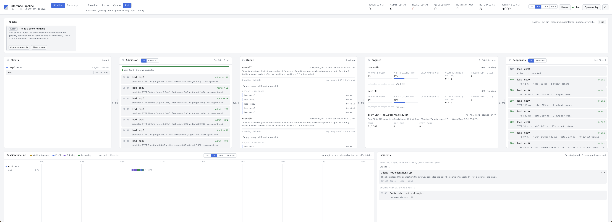
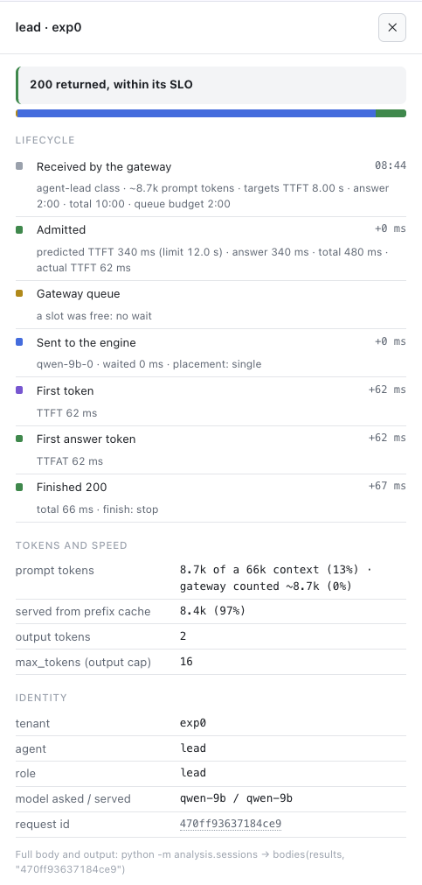
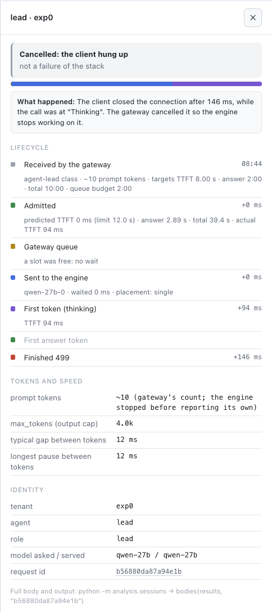

[← all experiments](../../README.md#experiments) · all numbers: [RESULTS.md](../RESULTS.md) · models and memory: [MODELS_AND_MEMORY.md](../MODELS_AND_MEMORY.md)

# exp0 · The gate: is the stack correct before any experiment?

## What we're doing

One script checks, end to end, that every part of Setup A works as the later experiments assume: the gateway
counts tokens like the engine, each model answers on the engine it was sent to, tool calls and reasoning stream
correctly, the prefix cache hits, a client hanging up frees the engine, and HAMi gives each vLLM exactly its memory
slice. It runs before every experiment (and after every redeploy), and every figure the UI shows was checked once
against the raw request log and vLLM's own counters.

## Why

Every later result is a comparison of latencies, token counts and cache shares. If the gateway miscounted tokens,
if HAMi leaked memory between pods, or if a cancelled agent call kept generating, those comparisons would be wrong
in ways no later experiment could detect. The gate makes "the stack is correct" a checked fact, not an assumption.

## At a glance

| | |
|---|---|
| **Changed** | nothing: a correctness check of the deployed stack |
| **Baseline** | the boot bars written before bring-up: ≥ 300K KV tokens per engine; ≥ 4× max concurrency at 64K for the 27B, ≥ 5× for the 9B |
| **Success rule** | every check PASS |
| **Result** | first run 18 PASS / 4 FAIL (all four a bug in the check, not the stack); after the fix **ALL PASS, 23/23**, three runs agree |

## Setup

| Setting | This experiment |
|---|---|
| Models | Qwen3.8-27B-FP8 (`vllm-27b`) and Qwen3.5-9B BF16 (`vllm-9b`) |
| GPU | one NVIDIA H100 80 GB SXM5, shared by both engines |
| HAMi slices | 47,104 MiB (27B), 31,232 MiB (9B); compute shared |
| Slots | 8 per engine (`--max-num-seqs 8`) |
| KV cache | 361,813 tokens (27B), 585,075 tokens (9B) |
| Context | 65,536 tokens |
| Mode | any (the check sends its own calls) |
| Workload | the check's probes: one-line prompts, a tool call, a repeated ~8.7K-token prompt, a cancelled stream |
| Tenants | one (the check) |

## How to run it

```bash
FLEET=27b-9b bash setup/demo_cluster.sh            # fresh box: k3s, HAMi, models, both engines, gateway
FLEET=27b-9b bash experiments/redeploy.sh fleet    # or: switch an existing box to Setup A
bash experiments/exp0_check.sh                     # the gate; it detects the fleet from the gateway's /v1/models
```

The results land in `results/exp0/<timestamp>/checks.json`.

## Results

### The data

| Check | Result |
|---|---|
| Harness build that sends session headers | PASS |
| Gateway up, counting tokens with the exact Qwen tokenizer | PASS |
| Both models listed with a 65,536-token context | PASS |
| Each request answered by the engine it was sent to | PASS (27B, 9B) |
| Streamed tool call parsed into `tool_calls` | PASS: 27B TTFT 0.165 s, 9B 0.118 s |
| 27B streams reasoning; 9B thinking off per request | PASS (0 reasoning tokens on the 9B) |
| Prefix-cache hit on a repeated ~8.7K-token prompt | PASS: 27B TTFT **0.685 → 0.185 s** (7,840 tokens cached); 9B **0.366 → 0.127 s** (8,448 cached) |
| Client leaving mid-stream frees the engine, recorded as 499 | PASS: vLLM's running count back to 0 after **0.1 s** |
| Prefix-cache reset on both engines | PASS |
| HAMi: the pod's `nvidia-smi` shows its slice, not 80 GB | PASS after the fix: 27B **47,104 MiB** total / 44,263 used; 9B **31,232** / 29,433 |
| KV cache and concurrency above the bars | PASS: 361,813 tokens / 5.52× (27B); 585,075 / 8.93× (9B) |

Repeatability across three runs: 27B cache-hit TTFT 0.612–0.685 s → 0.175–0.185 s; 9B 0.314–0.366 s →
0.125–0.127 s; cancellation 0.1 s every time.

**The UI checked against the raw log** (18 calls over two gate runs, nearest-rank percentiles):

| | UI | Raw log |
|---|---|---|
| Received / admitted / rejected / returned 200 | 18 / 18 / 0 / 16 | 18 / 18 / 0 / 16 (+2 × 499) |
| TTFT p50 / p95 | 96 / 549 ms | 96 / 549 ms |
| First answer p50 / p95 | 301 / 607 ms | 301 / 607 ms |
| 27B prompt:output, uncached:output, from cache | 182.8 : 1, 102.0 : 1, 44% | 182.8, 102.0, 44% |
| 9B the same | 64.2 : 1, 33.5 : 1, 48% | 64.2, 33.5, 48% |
| Tokens in / out | 71k / 744 | 70,796 / 744 |

Against vLLM's own `/metrics`: the 9B matched the gateway exactly (52,965 prompt, 25,344 cached, 830 output
tokens); the 27B differed only by the 3 cancelled calls (53,385 vs 53,199 prompt tokens, 312 vs 297 output),
because a cancelled stream never delivers vLLM's final usage chunk.

**The gateway's prompt estimate before and after the chat-template fix** (below):

| Call | Before (estimate vs engine) | After |
|---|---|---|
| 27B tool call | 53 vs 315 | 313 vs 315 |
| 9B tool call | 53 vs 277 | 275 vs 277 |
| 27B one-line prompt | 10 vs 62 | 62 vs 62 |
| 8.7K prompts | 8,662 vs 8,678 | 8,678–8,720 vs 8,678 (≤ 0.5%) |


*The pipeline view after a gate run: Findings shows `1 × 499 client hung up` (the deliberate cancel), the queues are empty (every call found a free slot), and the engines show prefix-cache hits of 44% / 48%.*


*One call's details: the repeated 8.7K-token prompt on the 9B, 8.4K tokens (97%) served from the prefix cache, TTFT 62 ms.*


*The cancelled call: first thinking token at +94 ms, client closed at +146 ms, recorded as 499 at the client layer, not as a failure of the stack.*

### What we observed

- Prefix caching cut TTFT 3.7× (27B) and 2.9× (9B) on an 8.7K-token prompt: the saving an agent gets every turn it
  re-sends its history.
- Cache reuse comes in whole KV blocks: 7,840 = 5 × 1,568 tokens on the 27B and 8,448 = 8 × 1,056 on the 9B, of an
  8,678-token prompt.
- Cancellation reaches the engine: 0.1 s after the client leaves, vLLM has stopped generating, so an abandoned
  agent call does not hold a slot and KV memory.
- HAMi's memory isolation works: each vLLM sees only its slice, so `--gpu-memory-utilization 0.95` is 95% of the
  slice, not of the card.

### Why it came out this way

The hybrid models' KV block (1,568 / 1,056 tokens, set by the Gated DeltaNet state size) is the unit of prefix
reuse, so a hit is always a whole number of blocks. The cancel works because the gateway closes its upstream
stream when the client goes, which aborts the vLLM request.

### Errors and surprises: what, why, how to fix

| What happened | Why | How it was fixed |
|---|---|---|
| 4 FAILs on the first run: HAMi "total" read as 1,340 MiB, "used" as 127,078,508,357,440 | Under HAMi every CUDA process (including `nvidia-smi`) prints `[HAMI-core Msg(<pid>:<thread id>:...)]` on exit; the check read stdout and stderr together and took the last line: a PID and a thread id | `experiments/exp0_check.py` parses only the `total, used` row and prints the raw text on failure. HAMi was right all along |
| The gateway's prompt estimate was 53 tokens for a call the engine counted as 315 (−83%), yet within 0.2% on the 8.7K prompt | A tokenizer-exact count of the messages still misses the **chat template**: role markers on every message, ~210 tokens of tool instructions, and on the 27B a system line Qwen3.8's template injects on every call ("Reasoning effort is set to xhigh…") | At startup the gateway asks each engine's `/tokenize` for three probes and keeps `base`, `per_message` and `tools`: 27B 52 / 6 / 208, 9B 10 / 4 / 212. Estimates now within 0.5% |
| Every 27B call silently ran at the maximum reasoning effort | Nothing in the config set `reasoning_effort`; the template's default is `xhigh` | Set explicitly in the harness config (later changed to `medium` for every thinking role after exp1a) |
| A cancelled call's prompt count said "the engine never saw it", though it had streamed thinking | UI wording | Now "the engine stopped before reporting its own" when the call was placed |

Found and left to watch: admission's first-answer prediction is conservative (4.27 s predicted with an 800-token
thinking prior; the model thought for 0.34 s), and its TTFT prediction ignores the prefix cache (340 ms predicted,
62 ms actual for the 97%-cached prompt). Both matter in [exp2](exp2.md).

### What we learned

- On these hybrid models, prefix-cache reuse is block-granular (~1K-token steps); a shared prefix shorter than
  one block gets nothing.
- Count tokens the way the engine does: the chat template is part of the prompt, and it has to be measured on the
  engine (`/tokenize`), not assumed.
- Read the chat template before measuring anything: a default in a Jinja file decided how long the main model
  thinks.
- Read tool output, not just pass/fail: the HAMi "failure" was the check parsing HAMi's own log lines.
- Check the UI against the raw log and the engine's counters before trusting it; here every figure matched, and
  the only gap (cancelled calls' tokens) is explained by what a cancelled stream cannot report.

## What this result does and does not show

- It shows the stack is correct for the properties the experiments rely on: token counts, routing, streaming
  parsers, cache hits, cancellation and memory isolation.
- It does not test anything under load: one or two calls at a time, so no queueing, admission refusals or compute
  contention. Those are [exp2](exp2.md) and [exp2c](exp2c.md).

## Run data

- `results/experiments/exp0/` (with `checks/`, every gate run's `checks.json`)
- Gate runs: `results/exp0/20261003-095448/` (18 PASS / 4 FAIL), `results/exp0/20261003-095927/` and
  `results/exp0/20261003-100015/` (ALL PASS), `results/exp0/20261003-101247/` (ALL PASS after the template fix)

Run folders, agent transcripts and reports are in the shared Drive folder (see the README, "Recordings and run data").
