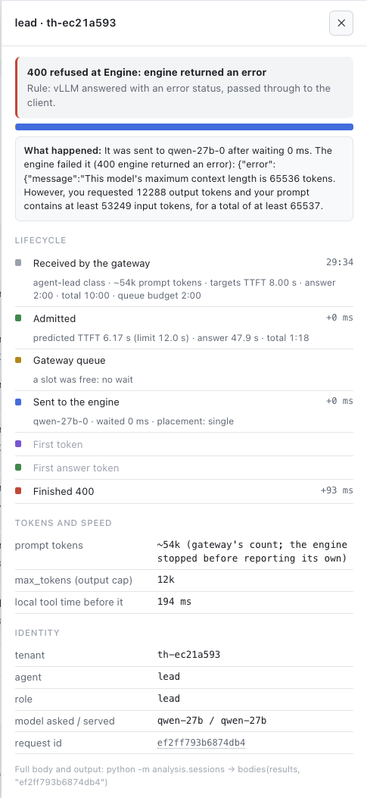
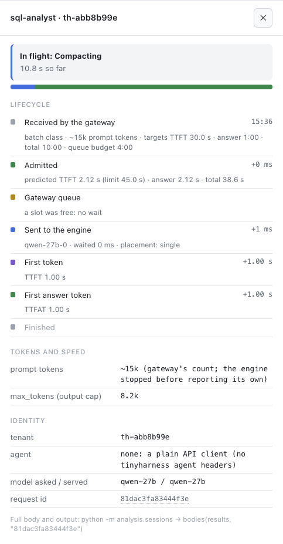
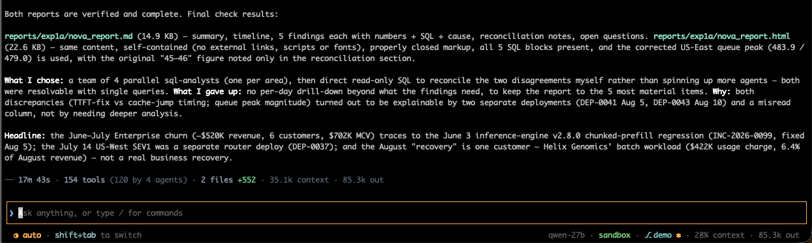

[← all experiments](../../README.md#experiments) · all numbers: [RESULTS.md](../RESULTS.md) · models and memory: [MODELS_AND_MEMORY.md](../MODELS_AND_MEMORY.md)

# exp1a · The SQL team alone on the 27B: agents on a 64K window, four attempts

## What we're doing

One agent team, alone on the GPU: a lead on the 27B starts 4 SQL-analyst agents in parallel (revenue and churn,
usage and latency, incidents and deploys, tickets and feedback), each querying a SQLite database of a fictional AI
company (`data/nova_ai.db`). The lead reconciles their findings and writes a report as Markdown and HTML. The report
is graded by fact recall against 25 facts in 8 stories planted in the data.

## Why

This is tenant A's "alone" baseline: before two teams share the GPU, each must be measured on its own, so that any
slowdown later can be attributed to sharing. It also characterizes the SQL workload: many short-to-medium turns
that re-send a growing history and then think and write SQL, a decode-heavy shape. It took four attempts, because
an agent harness tuned for a 200K window failed on a 64K one, one threshold at a time.

## At a glance

| | |
|---|---|
| **Changed** | nothing between tenants: one team alone (the four attempts changed the harness and gateway limits) |
| **Baseline** | the prediction written before any run: 5 agents, 40–80 calls, ~15 min, admission doesn't hurt an uncontended run |
| **Success rule** | none fixed before the run (judged afterwards; from exp1c on, the verdict is written first) |
| **Result** | attempt 4: **done in 17.7 min, 103 calls, all 200, 0 refused, 0 cut off, fact recall 64% (16/25), 6/8 planted stories** (attempt 3: 18.0 min, 40%) |

## Setup

| Setting | This experiment |
|---|---|
| Models | Qwen3.8-27B-FP8 for every call (lead, analysts, summaries) |
| GPU | one H100 80 GB; the 9B engine idle beside it |
| HAMi slices | 47,104 MiB (27B), 31,232 MiB (9B) |
| Slots | 8 on the 27B |
| KV cache | 361,813 tokens on the 27B |
| Context | 65,536 tokens |
| Mode | `full` (admission, gateway queue, priorities), variant `default` |
| Workload | `workspace/tasks/sql.md`: lead + 4 sql-analysts (Team, Bash with sqlite3, Read, Glob) |
| Tenants | one |
| Thinking | attempts 1–2: `xhigh`; attempts 3–4: `medium` for every thinking role, summaries with thinking off |

## How to run it

```bash
bash experiments/exp0_check.sh          # the gate first
bash experiments/mode.sh full
cd workspace && ./th sql exp1a          # paste the printed task prompt (it is on the clipboard), Enter
cd .. && bash experiments/finish.sh exp1a
.venv/bin/python -m analysis.grade results    # fact recall against the planted facts
```

`./th` picks the Setup A harness config automatically (lead on the 27B) when the gateway lists `qwen-27b`.

## Results

### The data

**Prediction vs result (attempt 4):**

| Predicted | Result | |
|---|---|---|
| 5 agents, 40–80 LLM calls, all on the 27B | 5 agents, **103 calls** (74 analyst, 22 lead, 7 summaries) | more calls: the summaries and the lead's own SQL checks were not in the estimate |
| ~15 min (`max_steps: 15`) | **17.7 min** (`max_steps: 20`, raised after attempt 1) | over |
| admission doesn't hurt an uncontended run | **0 refused**, 0 queued, 102/103 calls within targets | as predicted |
| quality by fact recall | **64% (16/25)**, 6/8 planted stories | no target was set |

**The four attempts:**

| Attempt | Time | Calls | Outcome |
|---|---|---|---|
| 1 | 11 min | 92 (90 × 200, 2 × 400) | analysts finished; the lead hit the 64K context; no report |
| 2 | 33 min | 115 (114 × 200, 1 × 499) | 5 analyst + 1 lead answers cut off at `max_tokens`; stopped, no report |
| 3 | **18.0 min** | 106 | done, 8 summaries, fact recall **40%** (4/8 stories) |
| 4 | **17.7 min** | 103 | done, 7 summaries, fact recall **64%** (6/8 stories) |

**Per role, attempt 4:**

| | Lead (22 calls) | Analysts (74 calls) | Compaction summaries (7) |
|---|---|---|---|
| TTFT p50 / p95 | 0.32 / 1.15 s | 0.30 / 0.84 s | 0.74 / 1.00 s |
| First answer p50 / p95 | 3.0 / 51.0 s | 2.5 / 12.9 s | (no thinking) |
| Whole call p50 / p95 | 12.0 / 73.9 s | 6.7 / 31.4 s | 45.8 / 93.7 s |
| From prefix cache | 72.7% | 85.8% | 0% |
| Output tokens; cut off | 39,201; 0 | 46,074; 0 | 28,969; 0 |
| `max_tokens` lowered to fit the context | 0 | 4 | 0 |

The analysts finished in ~4 min instead of ~6 (attempt 3), with lower tails. The lead reconciled with its own SQL
instead of a 5th reconciler agent and found a real contradiction: an analyst's "US-East queue 45–46" against
**483.9** in the raw hourly data (a daily batch window), which the report states as corrected.


*Attempt 1: the lead's reconcile call, ~54K prompt tokens plus 12,288 reserved for the answer, one token over 65,536: vLLM returns 400 and the gateway passes it through.*


*Attempt 4: an analyst's summary call in flight ("Compacting"), ~15K prompt tokens, thinking off, 8.2K output cap.*


*Attempt 4 done in 17m 43s: both reports written, the corrected US-East queue peak (483.9) used, and the lead's headline linking the July churn to a June deploy regression.*

### What we observed

- The lead, not the analysts, is the bottleneck: analysts run with 80–90% of their prompt from the prefix cache and
  sub-second TTFT, while single lead turns think for thousands of tokens (attempt 1: first answer p95 108.5 s alone
  on the GPU).
- Summaries are a real cost: in attempt 4 the lead's four summaries grew 3,635 → 6,557 → 7,098 → 7,381 tokens and
  took 5.2 of the 17.7 minutes (a summary prompt is new text, so 0% from the cache).
- The same prompt gave a different team in attempts 3 and 4 (a reconciler agent, then none), so per-role numbers
  compare across attempts only roughly; gateway-level numbers (TTFT, cache share, cut-offs) are the steadier
  comparison.

### Why it came out this way

The harness's context management was designed for a 200K window. On a 64K window the answer reservation is 19% of
the window instead of a few percent, so every threshold that is sane at 200K sits on the wrong side of the hard
limit at 64K. Each attempt exposed the next such threshold.

### Errors and surprises: what, why, how to fix

| Attempt | What broke | Why | How it was fixed |
|---|---|---|---|
| 1 | The lead's reconcile call got vLLM 400: 53,249 prompt + 12,288 output = 65,537, one token over | The harness compacted at 90% of the window (58,982 tokens) on the prompt alone; with 12,288 reserved for the answer the real ceiling was 53,248, so between the two every call failed and nothing compacted. Its overflow recovery kept the last 12 messages (the heavy ones) and saved only ~2,300 tokens. A 40K protection on recent tool output was 61% of the window | The gateway fits `max_tokens` to the context (lowers it to the room left, or refuses with 400 `context_full` under 1,024 tokens of room); the harness compacts at window − max output |
| 2 | 4 analyst calls spent all 8,192 output tokens thinking (`finish_reason: length`), 5 analyst + 1 lead answers cut off; the run stopped after 33 min with no report | Each was the first call after that analyst compacted: with only a summary and `reasoning_effort = xhigh`, the model re-derived everything. The summary request itself went out as an ordinary analyst call at xhigh, thought for all its tokens and wrote nothing, and the harness accepted the empty summary and dropped the history | Per-role thinking budgets at the gateway (`reasoning_by_role`): one `max_tokens` of 32,768, thinking capped at 16,384 (lead) / 12,288 (subagents) with room kept for the answer; vLLM's `--reasoning-config` ends thinking with Qwen's hand-off phrase; summaries tagged `compaction` with thinking off; an empty summary keeps the history; effort `medium` |
| 3 | Done, but the summarizer had **continued the conversation** ("I'll continue the investigation…", 37 tokens) in a live check, and the kept tail was 1.2–2.1× its budget | The summary instructions were only in the system prompt and the transcript ended in the agent's own words; the tail was sized by characters ÷ 4 | Summary request built with the history inside `<conversation>` tags and instructions after it; token counts from the model's own tokenizer (matches vLLM's `/tokenize` exactly) |
| 4 | Old tool output was never trimmed; the lead's summaries of summaries grew 3.6K → 7.4K | Three cleanup thresholds were still fixed at 200K-window values (60% of the window, results over 6K tokens, free at least 20K): all past the 33.5K summary trigger | Every limit sized from the usable window (75% of usable, min(6K, 3.6%), min(20K, 15%)); growing summaries left open |

Also found: attempt 3's turn ended on an error *after* both reports were written, because the lead read a
screenshot of its HTML and the text-only 27B (`--language-model-only`) rejected the image. The harness now sends a
note in place of an image to a model that takes none.

### What we learned

- Agent-harness defaults tuned for a 200K window fail on 64K, one threshold at a time; size every limit from the
  usable window and check each against the compaction trigger.
- A gateway that knows the engine's context and the exact prompt size can turn a doomed request into a working one
  (shrink `max_tokens`); a pass-through proxy relays the 400.
- Thinking must always leave room for the answer: a budget per role, enforced where the request leaves for the
  engine.
- Repeated summaries cost time, not just fidelity (5.2 of 17.7 min), and summaries of summaries only grow.

## What this result does and does not show

- It shows the SQL team completing on a 64K window with no refusals, no cut-offs and 64% fact recall, and it gives
  tenant A's solo numbers used to set the SLA targets in [exp2](exp2.md).
- It does not show a stable per-role baseline: the team's shape changed between attempts (same prompt), and each
  attempt is one run. It does not test contention: the GPU was otherwise idle.

## Run data

- `results/experiments/exp1a-attempt1/`, `exp1a-attempt2/`, `exp1a-attempt3/`, `exp1a-attempt4/` (the result)
- Tenants: attempt 1 `th-ec21a593`, attempt 2 `th-1f4c0b7d`, attempt 4 `th-abb8b99e`

Run folders, agent transcripts and reports are in the shared Drive folder (see the README, "Recordings and run data").
