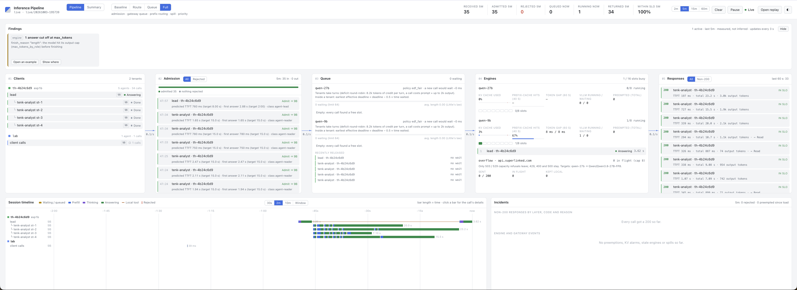
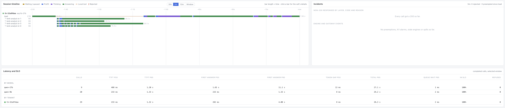

[← all experiments](../../README.md#experiments) · all numbers: [RESULTS.md](../RESULTS.md) · models and memory: [MODELS_AND_MEMORY.md](../MODELS_AND_MEMORY.md)

# exp1b · The 10-K team alone: a 9B lead, then a 27B lead

## What we're doing

A lead runs a team of 4 `tenk-analyst` readers on the 9B (thinking off), one per annual-report (10-K) excerpt of
NVIDIA, AMD, Intel and Broadcom, then writes a comparison as Markdown and HTML, with a source anchor on every claim.
We run it twice, alone on the GPU: first with the lead on the 9B (`exp1b`: every call on the 9B), then with the
lead on the 27B (`exp1b-27b`), the same task.

## Why

This is tenant B's "alone" baseline, and the document-reading shape of the workload: four readers each read a
~10K-token filing at almost the same moment (a prefill burst), then answer briefly. The second run exists because
[exp2](exp2.md) gives tenant B a 27B lead: without a solo 27B-lead run, "alone vs shared" for tenant B would change
two things at once (contention and the lead's model). It also answers a quality question: does a bigger lead catch
the 9B's errors?

## At a glance

| | |
|---|---|
| **Changed** | the lead's model: 9B (`exp1b`) → 27B (`exp1b-27b`) |
| **Baseline** | the prediction written before any run: 9B only, 3–4 whole-filing analysts, quality by citation precision |
| **Success rule** | none fixed before the run (judged afterwards) |
| **Result** | 9B lead: **3.1 min, 82/82 citations real, table 25/28 right (1 wrong, 2 missing)**. 27B lead: **9.0 min, 113/113 citations real, every dollar figure verbatim, no wrong number** (2 values wrongly called "not in excerpt") |

## Setup

| Setting | `exp1b` | `exp1b-27b` |
|---|---|---|
| Lead | Qwen3.5-9B (thinking at `medium`) | Qwen3.8-27B-FP8 (thinking at `medium`) |
| Readers | 4 × Qwen3.5-9B, thinking off | the same |
| Summaries | on the 9B | on the 27B |
| GPU | one H100 80 GB | the same |
| HAMi slices | 47,104 MiB (27B), 31,232 MiB (9B) | the same |
| Slots | 8 per engine | the same |
| KV cache | 361,813 (27B) / 585,075 (9B) tokens | the same |
| Context | 65,536 | 65,536 |
| Mode | `full`, permission mode `auto` | the same |
| Workload | `workspace/tasks/10k.md`: 4 excerpts of 9.0–9.9K tokens each | the same, after a harness fix (whole reads up to 16K) |
| Tenants | one | one |

## How to run it

```bash
bash experiments/exp0_check.sh
bash experiments/mode.sh full
cd workspace && ./th 10k exp1b --model gw:qwen-9b    # lead on the 9B
cd .. && bash experiments/finish.sh exp1b
cd workspace && ./th 10k exp1b-27b                   # lead on the 27B (the Setup A default)
cd .. && bash experiments/finish.sh exp1b-27b
.venv/bin/python -m analysis.grade results           # citation checks
```

## Results

### The data

**9B lead (`exp1b`): 3.1 min, 53 calls, all 200, all on the 9B, none cut off.**

| | Lead (11 calls) | Readers (40 calls) | Summaries (2) |
|---|---|---|---|
| TTFT p50 / p95 | 0.21 / 0.40 s | 0.31 / 1.04 s | 0.34 s |
| First answer p50 / p95 | 0.40 / 1.09 s | 0.39 / 1.04 s | (no thinking) |
| Whole call p50 / p95 | 2.4 / 49.7 s | 1.05 / 23.2 s | 9.1 / 10.0 s |
| From prefix cache | 79.2% | 71.3% | 0% |
| Output tokens; cut off | 12,851; 0 | 15,603; 0 | 2,379; 0 |

**The two leads side by side:**

| | `exp1b` (9B lead) | `exp1b-27b` (27B lead) |
|---|---|---|
| Time | 3.1 min | **9.0 min** |
| Calls | 53 | 48 |
| Lead calls | 11 | 25 (+1 permission check) |
| Lead first answer p50 / p95 | 0.4 / 1.1 s | 2.2 / 34.8 s |
| Lead's two report-writing calls | 25 s + 50 s | **101 s + 115 s** (7.7K and 8.9K tokens) |
| Readers (9B) | 40 calls, paged their filings; one task re-run | **20 calls, 1–7 tool calls each, no re-run** |
| Summaries | 2 (9B, 10 s) | 2 (27B, 37 s each) |
| Citations real | 82/82 (md) | **113/113 (md), 112/112 (html)** |
| Table numbers | 25/28 right: Broadcom cash wrong ($21.3B; the balance sheet says $16.2B), NVIDIA cash and debt "Not specified" (the filing has $10.6B, $7.5B) | **all 23 dollar figures verbatim in the filings, every computed % right**; 2 wrong "not in excerpt" (AMD and Broadcom net income are there) |

Against [exp1a](exp1a.md) (17.7 min on the 27B), the 9B-led team is 5.7× faster end to end, with a first-answer
p95 of ~1 s instead of 13–51 s.


*The 9B-led run: the four readers' calls admitted to the 9B with predicted TTFTs of 0.8–2.5 s, the 27B idle (0/8 slots), and every response within its SLO.*


*The 27B-led run: readers finish in 15–29 s, then the lead's long stretch of thinking (purple) and answering (green): verifying the readers' numbers and writing the two reports.*

### What we observed

- For document reading, the 9B with thinking off is fast and grounded: 3.1 min and every citation real.
- The 27B lead spent the extra time **checking the readers' numbers against the filings itself** (greps and small
  scripts over the excerpts, e.g. "Broadcom's $65,136M = short-term $3,152M + long-term $61,984M"), which the 9B lead
  never did, and then on two long writing calls (3.6 of the 9.0 minutes at ~13 ms a token).
- The readers were faster in the second run because a harness fix let each read its filing whole.

### Why it came out this way

The 9B lead trusts what the readers return, so a reader's error or omission goes straight into the report. The
27B lead verifies before writing, and decodes each token more slowly (~13 ms vs ~8.6 ms): correctness costs about 3× the
time. The 27B's advantage here is verification behaviour, not reading.

### Errors and surprises: what, why, how to fix

| What happened | Why | How it was fixed |
|---|---|---|
| The readers paged through their filings with offset Reads and Greps (the Intel reader made 8 tool calls) | Each excerpt is 9.0–9.9K tokens, just over the 8,384-token single-message cap that exp1a's fix had set (25% of usable), so the first Read showed only the start and end | Cap raised to half of usable (16K on a 64K window); in `exp1b-27b` each reader read its filing whole |
| The 9B lead re-ran the Intel task for nothing (9 calls) | Team saved a member's result to a file only when it was too long to show inline: three results came with paths, Intel's without; the 9B guessed a fourth path, got "file not found", and re-ran the task | Every team result is now saved and named the same way, short ones too |
| 1 wrong number and 2 missing in the 9B-led report | The NVIDIA reader's report had no balance-sheet finding and the lead didn't look; the Broadcom cash figure appears nowhere in the excerpt | Not a code fix: a 27B lead that verifies removed the wrong number, at ~3× the time |
| The harness's permission classifier went out as a "lead" call on the 9B, with thinking on (478 tokens, 3.3 s against a 5 s timeout) | It was tagged with the lead's identity | Tagged as its own role, `classifier`: thinking off, 1,024 max tokens |
| A `/model` check (`max_tokens: 1`) counted as "an answer cut off" in the UI | UI rule | Calls with `max_tokens` ≤ 16 no longer count |

### What we learned

- A limit right for one window can be wrong for one workload: 25% of usable was fine for 1–2K SQL results and too
  small for 10K-token documents.
- Consistency helps a small model more than cleverness: three results with paths and one without made the 9B
  invent the fourth path.
- Verification is what a bigger lead buys; it costs time, and it still allowed errors of omission.

## What this result does and does not show

- It shows the two lead models trading speed for numeric accuracy on the same reading task, and gives tenant B's
  solo baseline for [exp2](exp2.md).
- It does not separate model size from behaviour cleanly: the readers also changed (whole reads after the cap fix)
  between the two runs. One run each; four filings.

## Run data

- `results/experiments/exp1b/` (tenant `th-4b24c6d9`)
- `results/experiments/exp1b-27b/` (tenant `th-32a9fdaa`)

Run folders, agent transcripts and reports are in the shared Drive folder (see the README, "Recordings and run data").
