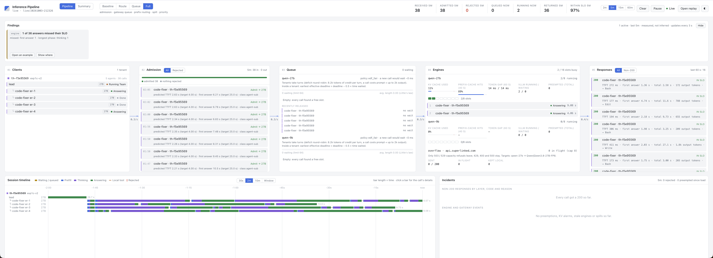

[← all experiments](../../README.md#experiments) · all numbers: [RESULTS.md](../RESULTS.md) · models and memory: [MODELS_AND_MEMORY.md](../MODELS_AND_MEMORY.md)

# exp1c · The coding team alone on the 27B

## What we're doing

A lead on the 27B runs a team of 4 `code-fixer` agents (27B, thinking at `medium`; Read, Grep, Glob, Edit, Bash),
one per module of a small billing library (`workspace/code/ledger`: pricing, tax, discounts, invoices). The team
works on its own copy, the lead runs the whole test suite, reviews each fix against the module's documented rules,
and writes `fix_report.md`. A grader runs the original tests against the team's code plus hidden tests with other
values per bug (a fix that only special-cases the visible test fails them), and flags any edited test.

Two versions: **v1** has 2 planted bugs per module, each pointed at by a failing test. **v2** adds, per module, a
bug no visible test catches, an unfinished feature specified in the docstring, and a test file the coder must
write: 16 graded items, 33 hidden checks.

## Why

[exp2](exp2.md) with two teams never exceeded the 27B's 8 slots, so nothing failed. A third tenant (coding, 5 more
agents on the 27B) was added to push demand past capacity. This run is that tenant's "alone" baseline, so later
runs compare it with itself, one variable at a time.

## At a glance

| | |
|---|---|
| **Changed** | nothing: one team alone (v2 changed the task) |
| **Baseline** | the prediction written before each run (committed before v1) |
| **Success rule** | v1: ≥ 7/8 bugs fixed by the hidden tests, no test edited, all 48 visible tests pass, no cut-off answer, ≤ 1 in 20 calls past target. v2: ≥ 12/16, no original test edited, all visible tests pass, no cut-offs, **and the run lasts ≥ 6 min** (long enough to overlap with the other tenants) |
| **Result** | v1: **8/8 in 1.7 min** (quality pass, too short). v2: **16/16 in 3.7 min, 45 calls** (quality pass, duration fail) |

## Setup

| Setting | This experiment |
|---|---|
| Models | Qwen3.8-27B-FP8 for every call |
| GPU | one H100 80 GB; the 9B engine idle |
| HAMi slices | 47,104 MiB (27B), 31,232 MiB (9B) |
| Slots | 8 on the 27B |
| KV cache | 361,813 tokens on the 27B |
| Context | 65,536 |
| Mode | `full` |
| Workload | `workspace/tasks/code.md` on `workspace/code/ledger` (v1: 13 of 48 tests failing; v2: 21 failing, 0/16 on the buggy copy, 56/56 and 16/16 on the reference) |
| Tenants | one |

## How to run it

```bash
bash experiments/exp0_check.sh
bash experiments/mode.sh full
cd workspace && ./th code exp1c-v2
cd .. && bash experiments/finish.sh exp1c-v2
.venv/bin/python -m analysis.grade_code exp1c-v2    # visible + hidden tests, edited/added test files
```

## Results

### The data

**v1, prediction vs result** (1.7 min, 27 calls: 7 lead, 20 coders, all 200):

| Predicted | Result | |
|---|---|---|
| 6–12 min | **1.7 min** | 4–7× too long |
| peak 5 agents on the 27B, no queueing | 5, none | as predicted |
| prompts 10–25K, little compaction | ≤ 23K, no summaries | as predicted |
| 7–8/8 bugs; D2 (coupon order) and T1 (rounding) at risk | **8/8**, D2 and T1 fixed properly | better |

**v2, prediction vs result** (3.7 min, 45 calls: 10 lead, 35 coders, all 200, none cut off, no summaries):

| Predicted | Result | |
|---|---|---|
| 6–15 min | **3.7 min** | too long again |
| hidden bugs 1–3/4 (D3, T3 likely missed) | **4/4** | the model is better than predicted |
| features 3–4/4 | 4/4 | as predicted |
| prompts 25–40K, a summary or two | ≤ 29K (lead), 22K (coder); none | smaller |

v2 quality: **16/16** (all 8 visible bugs, all 4 bugs no test catches, all 4 features; 33/33 hidden checks), 56/56
visible tests, no original test edited, 4 test files added (one per coder). Coders ran 74–117 s each (8–12 tool
calls); 34K output tokens in all. As the N = 1 point in [exp2c](exp2c.md): 151 output tokens/s on the 27B, 98% of
calls within target, TTFT p50 / p95 0.3 / 0.7 s, token gap 14 ms, vLLM running mean 2.1 (peak 4), never waiting.


*v2 in flight: the lead "Running Team", four code-fixers on the 27B, 2/8 slots busy, nothing waiting, token gap 14 ms, 89% of prompt tokens from the prefix cache.*

### What we observed

- The 27B at `medium` thinking is a strong coder on a small, well-specified library: it read each docstring as the
  spec and found the untested bugs too.
- The team never came near the 8 slots: a peak of 4 running calls, a mean of 2.1.

### Why it came out this way

In v1 every bug was named by a failing test (`test_a_coupon_is_valid_on_its_expiry_day`), so each fix was read →
run → one edit → run; the lead had already "spotted the likely bugs" from reading the modules. In v2 the docstrings
specify every rule, so a careful reader finds the untested bugs as easily as the tested ones. Making the puzzle
harder did not make the load bigger.

### Errors and surprises: what, why, how to fix

| What happened | Why | How it was fixed |
|---|---|---|
| v1 finished in 1.7 min against a 6–12 min prediction: useless as a load generator next to tenants of ~10–14 min | A task's difficulty is in what it doesn't tell you; failing tests that name the rule make bug-fixing a lookup | v2: bugs no test catches, features to build, tests to write |
| v2 still finished in 3.7 min (rule: ≥ 6 min) | The model handled the harder task too | Load has to come from **concurrency**, not one longer session: several coding sessions at once ([exp2c](exp2c.md)) |

### What we learned

- Write the prediction and the verdict before the run: both versions failed their duration prediction, and that
  failure is what redirected the next experiment to concurrency.
- A harder task for a capable model does not mean more load; more sessions do.
- Hidden tests with other values are what distinguish a real fix from one that special-cases the visible test.

## What this result does and does not show

- It shows the coding task is solvable at 16/16 by the 27B alone, so any quality loss under load in
  [exp2c](exp2c.md) is the load's.
- It does not measure contention: the team used at most 4 of 8 slots. One run per version.

## Run data

- `results/experiments/exp1c/` (v1, tenant `th-02d088bf`)
- `results/experiments/exp1c-v2/` (v2, tenant `th-f5e95569`)

Run folders, agent transcripts and reports are in the shared Drive folder (see the README, "Recordings and run data").
