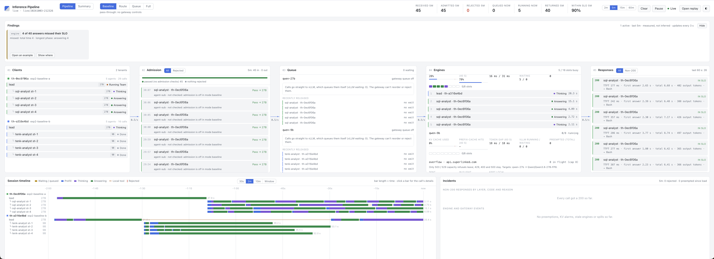

[← all experiments](../../README.md#experiments) · all numbers: [RESULTS.md](../RESULTS.md) · models and memory: [MODELS_AND_MEMORY.md](../MODELS_AND_MEMORY.md)

# exp2 · Two agent teams at once on one GPU

## What we're doing

The two tasks from exp1, started at the same moment as two tenants: **A**, the SQL team (27B lead, 4 SQL analysts
on the 27B), and **B**, the 10-K team with a **27B lead** (4 readers on the 9B). Both leads share the 27B. Before
the run, the gateway's SLA targets are derived from the solo runs; the run itself is the `baseline` pass (the
gateway only forwards, and vLLM copes with the crowd).

## Why

This is the case the gateway exists for: several tenants sharing one engine. The question was whether one team's
calls would wait behind the other's inside vLLM, invisible and unordered, and whether the gateway's controls
(fair deadline queue, admission against SLA predictions, priorities) keep both inside their targets. Admission and
"within target" both need targets measured on this workload, which is why deriving them is part of this
experiment.

## At a glance

| | |
|---|---|
| **Changed** | sharing: each team alone (exp1a attempt 4, `exp1b-27b`) → both at once |
| **Baseline** | each tenant's solo run |
| **Success rule** | the prediction written before any run: in `baseline`, B's calls wait behind A's inside vLLM and tail latency blows up; in `full`, the 27B lane is shared fairly and both reports complete |
| **Result** | **nothing waited in vLLM**: peak 6 agents on the 27B for 8 slots. Both reports completed (A 13.6 min, B 9.9 min). The only harm was compute sharing: A's lead whole-call p95 74 → 172 s, the 9B's token gap 8.6 → 17.8 ms, 4 late 9B calls. The `full` pass was not run |

## Setup

| Setting | This experiment |
|---|---|
| Models | 27B: A's lead and 4 analysts, B's lead, all summaries. 9B: B's 4 readers |
| GPU | one H100 80 GB, compute time-shared by the two engines |
| HAMi slices | 47,104 MiB (27B), 31,232 MiB (9B) |
| Slots | 8 per engine |
| KV cache | 361,813 (27B) / 585,075 (9B) tokens |
| Context | 65,536 |
| Mode | `baseline` (no admission, no gateway queue) |
| Workload | `workspace/tasks/sql.md` (tenant A) and `workspace/tasks/10k.md` with a 27B lead (tenant B) |
| Tenants | 2 |

## How to run it

```bash
bash experiments/exp0_check.sh
bash experiments/mode.sh baseline
# two terminals, started together
cd workspace && ./th sql exp2-baseline-a
cd workspace && ./th 10k exp2-baseline-b
# afterwards
bash experiments/finish.sh exp2-baseline-a
bash experiments/finish.sh exp2-baseline-b
.venv/bin/python -m analysis.grade results
```

## Deriving the SLA targets (before the run)

The gateway judges every call against its class's three targets: **TTFT** (first token), **first answer token**
(after thinking) and **deadline** (whole call). In `full`, admission refuses a call with 429 when its *estimate*
exceeds 1.5 × the target (`estimate_slack`). The rule: target ≈ 1.5 × each role's p95 when its team ran alone.
Applying it went wrong four times before the run:

| # | What went wrong | How it was found | Why | Fix |
|---|---|---|---|---|
| 1 | The suggested targets were computed from the wrong runs: 350 analyst calls with first-answer p95 31.5 s and lead whole-call p95 124 s (2–2.5× too high) | asking which runs they came from | The collector pooled all four exp1a attempts, including attempts 1–2 (xhigh thinking, answers cut off) | Recomputed from the runs that count (exp1a attempt 4, exp1b): analysts 12.9 s and 31.4 s, lead 51 s and 74 s |
| 2 | 1.5 × solo TTFT p95 (~1.5–2 s) would have refused big prompts on an idle GPU | replaying the solo runs through admission's formula | Admission estimates TTFT as queue wait + prompt ÷ prefill rate, **with no credit for the prefix cache**: a 33K-token agent prompt, ~95% cached, really starts in ~1 s, but is estimated at 33,000 ÷ 10,489 tok/s = **3.2 s**. With a 2 s target, any prompt over ~31K tokens would get 429 `ttft_unmeetable` | TTFT target ≥ the prefill time of the largest prompt the role sends: 4 s on the 27B, 3 s on the 9B |
| 3 | After a gateway restart, analysts would have been refused on deadline | a gateway test returning 429 | The deadline estimate is first answer + 2,000 output tokens × token gap, and admission starts from config rates until it learns live ones: 27B 35 ms per token (measured: 13 ms), 800 reasoning tokens → 0.8K × 35 ms + 2K × 35 ms ≈ 98 s, over 1.5 × 50 s | Start from the rates exp1 measured: 27B 10,000 tok/s prefill, 13 ms, 400 reasoning tokens; 9B 17,000 tok/s, 9 ms |
| 4 | Tenant B changed two things at once (contention and its lead's model, 9B → 27B) | asking "what are we proving?" | exp1b ran all on the 9B; exp2 gives B a 27B lead so both leads share the 27B lane (the gateway's controls act per engine: with a 9B lead the two tenants would share no lane) | A solo run with the 27B lead, `exp1b-27b` ([exp1b](exp1b.md)), so each tenant has a matching baseline |

Check: every call of exp1a attempt 4 and exp1b, with its real prompt size, run through admission's formula at the
learned rates with zero queue wait: **no call refused** with the final targets.

**The targets:**

| Class (role @ model) | Solo p95: TTFT / first answer / whole call | Target: TTFT / first answer / deadline |
|---|---|---|
| `agent-lead` (lead, 27B) | 1.2 / 51 / 74 s | **4 / 80 / 120 s** |
| `agent-sub` (SQL analysts and coders, 27B) | 0.8 / 13 / 31 s | **4 / 25 / 60 s** |
| `agent-reader` (10-K readers, 9B, thinking off) | 1.0 / 1.0 / 23 s | **3 / 3 / 35 s** |
| `agent-compaction` (summaries) | 1.0 / – / 94 s | **4 / 4 / 150 s** |

Queue budgets and priorities: lead 120 s / priority 1, analysts and readers 120–150 s / 2, summaries 240 s / 3. By
construction about 1–5% of solo calls exceed these targets, so "within target" means "as good as alone, with 50%
headroom".

## Results

### The data

| Predicted (baseline) | Result | |
|---|---|---|
| B's calls wait behind A's inside vLLM | **0 waiting in vLLM** at any time: peak 6 agents on the 27B, 8 slots | wrong |
| tail latency blows up | moderately up: A's lead whole-call p95 **74 → 172 s**; B's readers 4 late (9B token gap **8.6 → 17.8 ms**) | partly |
| both reports complete | both completed: **A 13.6 min** (solo 17.7), **B 9.9 min** (solo 9.0) | as predicted |


*Both teams running in `baseline`: the 27B shows 5/8 slots busy and 0 waiting in vLLM, so nothing queues; the 9B's token gap reads 18 ms while the 27B is busy.*

### What we observed

- Two teams never filled the 27B: at most 6 sequences on an engine that runs 8, so no call ever waited for a slot.
- The cost of sharing was **compute**, not slots: the two engines time-share the GPU, so the 9B decoded at about
  half its solo speed while the 27B was busy.
- The `full` pass was not run: with nothing to arbitrate it would only have repeated the baseline.

### Why it came out this way

The prediction assumed demand above capacity. Two teams put at most 6 calls on 8 slots, so queueing, admission
and fair ordering had nothing to do. HAMi isolates memory, not compute, and no gateway control sees GPU
time-sharing between engines.

### Errors and surprises: what, why, how to fix

| What happened | Why | How it was fixed |
|---|---|---|
| The experiment's premise failed: nothing waited | 6 agents for 8 slots | A third tenant (coding, 5 more agents on the 27B, [exp1c](exp1c.md)) so demand exceeds the slots; then several coding sessions at once ([exp2c](exp2c.md)) and three larger teams ([exp2m](exp2m.md)) |
| Two teams' sub-agent transcripts were saved into each other's folders | Transcripts were matched by time | Sub-agent transcripts now record their session |
| The four SLA-target failures above | See the table | See the table |

### What we learned

- A target must be measured the way the enforcer predicts it: a target derived from actual latency, enforced
  against a cache-blind estimate, refuses good traffic.
- Cold-start estimates are part of the SLA: a redeploy mid-experiment would otherwise look like an overload.
- A baseline is only as good as the runs it comes from; keep failed attempts out of it.
- Write down, before each run, which comparison it is for and what changes between the two sides.
- Agent teams alone did not overload one engine: failures need demand above the slots.

## What this result does and does not show

- It shows that two agent teams fit in the 27B's 8 slots, and that the measurable cost of sharing one GPU between
  two engines is slower decoding, which the gateway cannot see or fix.
- It does not test the gateway's controls (no `full` pass, nothing to arbitrate). One run.

## Run data

- `results/experiments/exp2-baseline-a/` (tenant A, `th-0ec6f06a`), `results/experiments/exp2-baseline-b/`
  (tenant B, `th-a316e4bd`)
- Solo baselines: `results/experiments/exp1a-attempt4/`, `results/experiments/exp1b-27b/`

Run folders, agent transcripts and reports are in the shared Drive folder (see the README, "Recordings and run data").
