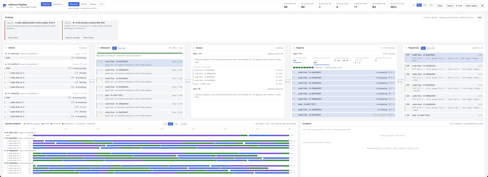
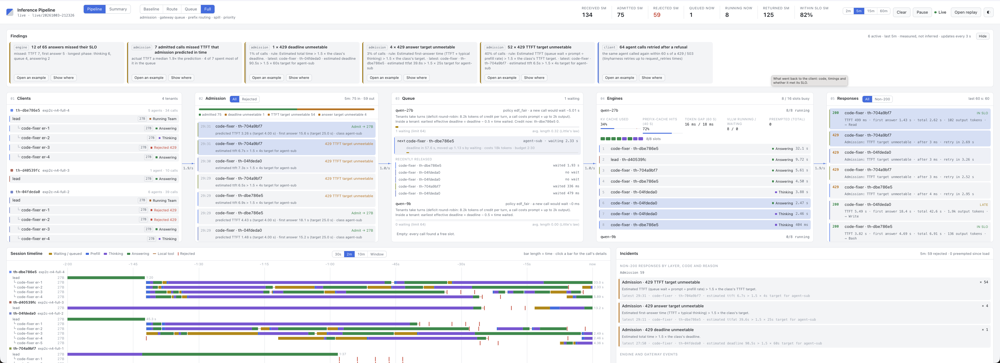
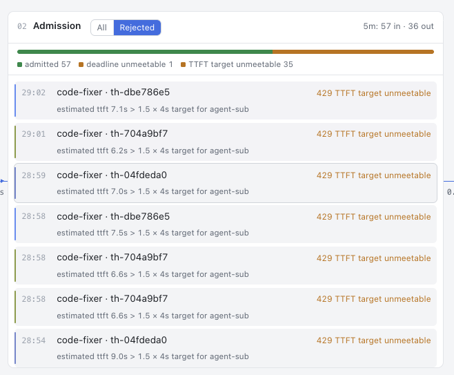

[← all experiments](../../README.md#experiments) · all numbers: [RESULTS.md](../RESULTS.md) · models and memory: [MODELS_AND_MEMORY.md](../MODELS_AND_MEMORY.md)

# exp2c · Four coding sessions at once: baseline vs full

## What we're doing

The coding task from [exp1c](exp1c.md) (v2: solo 3.7 min, 16/16), run as **N = 4 sessions at once**, as 4
tenants: load is the only variable. Each session puts a lead and 4 coders on the 27B, up to 20 agents for 8 slots.
We run it twice, identical except for the gateway mode: `baseline` (the gateway forwards; overflow waits inside
vLLM) and `full` (gateway queue with deadline order and fair turns between tenants, admission against SLA
predictions, priorities).

## Why

Two teams did not overload the engine ([exp2](exp2.md)), and one harder coding session did not either. Several
sessions of the same task push demand past the 8 slots while keeping everything else fixed, which is the clean
test of the gateway's controls: does `full` move the waiting out of vLLM, keep more calls within target, and
leave the agents' work intact?

## At a glance

| | |
|---|---|
| **Changed** | gateway mode: `baseline` → `full` (same task, N = 4, same harness, caches reset) |
| **Baseline** | the `baseline` pass, and the solo run (N = 1) |
| **Success rule** (written before the runs) | baseline expected to **fail**: vLLM waiting > 0 and ≥ 30% of calls past a target. `full` **passes** if all 4 sessions finish with ≥ 12/16, vLLM waiting stays 0, the share within target beats baseline's, and no agent fails from refusals |
| **Result** | baseline failed as expected (63% within target, vLLM waiting peak 5). `full` **failed its own rule**: 81% within target among served calls but **50% among all attempts**, 140 of 365 calls refused, **14 coder runs died after 5 refusals each**, sessions **47% slower** (11.2 vs 7.6 min mean); quality held at 16/16 only because the work was redone |

## Setup

| Setting | This experiment |
|---|---|
| Models | Qwen3.8-27B-FP8 for every call |
| GPU | one H100 80 GB; the 9B engine idle |
| HAMi slices | 47,104 MiB (27B), 31,232 MiB (9B) |
| Slots | 8 on the 27B |
| KV cache | 361,813 tokens on the 27B |
| Context | 65,536 |
| Mode | `baseline`, then `full` |
| Workload | `workspace/tasks/code.md` (v2), 4 sessions started together |
| Tenants | 4 (one per session) |
| Targets (`agent-sub`) | TTFT 4 s, first answer 25 s, deadline 60 s; admission refuses past 1.5 × target |

## How to run it

```bash
bash experiments/exp0_check.sh
bash experiments/mode.sh baseline
# four terminals, started together
cd workspace && ./th code exp2c-n4-baseline-1
cd workspace && ./th code exp2c-n4-baseline-2
cd workspace && ./th code exp2c-n4-baseline-3
cd workspace && ./th code exp2c-n4-baseline-4
# afterwards, for i in 1..4
bash experiments/finish.sh exp2c-n4-baseline-$i
.venv/bin/python -m analysis.grade_code exp2c-n4-baseline-$i

# the same with: bash experiments/mode.sh full  and labels exp2c-n4-full-1 … exp2c-n4-full-4
.venv/bin/python -m analysis.knee        # the table below (every point found under results/experiments/)
```

## Results

### The data

From `analysis.knee`, N = 1 is the solo run (`exp1c-v2`):

| N | mode | makespan | session mean / max | 27B tok/s | tasks/h | goodput/min | within target | TTFT p50 / p95 | 1st answer p95 | token gap | vLLM running mean / peak | vLLM waiting mean / peak |
|---|---|---|---|---|---|---|---|---|---|---|---|---|
| 1 | solo | 3.7 min | 3.7 / 3.7 | 151 | 16 | 11.7 | 98% | 0.3 / 0.7 s | 19.9 s | 14 ms | 2.1 / 4 | 0 / 0 |
| 4 | baseline | 9.5 min | 7.6 / 9.5 | 289 | 25 | 13.0 | **63%** | 0.7 / **17.3 s** | 39.2 s | 17 ms | 5.1 / 8 | 1.5 / 5 |

**Baseline vs full (N = 4):**

| | baseline | full |
|---|---|---|
| quality | 15, 16, 16, 16 of 16 | **16/16 × 4** |
| calls | 197, all 200 | 365, **140 refused** (all 429: ~135 `ttft_unmeetable`, 4 `ttfat_unmeetable`, 1 `deadline_unmeetable`) |
| vLLM waiting mean / peak | 1.5 / 5 | **0.0 / 2** (the wait moved to the gateway queue: p95 7.2 s) |
| TTFT p95 | 17.3 s | **7.5 s** |
| within target, among answers served | 63% | **81%** |
| within target, among all attempts (a refusal is a miss) | 63% | **50%** |
| goodput (on-time calls / min) | 13.0 | **15.5 (+19%)** |
| 27B output tokens / s | 289 | 304 |
| **session time mean / max** | 7.6 / 9.5 min | **11.2 / 11.8 min (+47%)** |
| tasks / hour | 25 | 20 |

**How sharing slowed each baseline session** (35–49K output tokens per session vs 34K alone):

| Session | Time | Σ waiting for the first token | Σ model time | token gap | lead's longest think |
|---|---|---|---|---|---|
| solo | 3.7 min | 16 s | 492 s | 13.9 ms | 12 s |
| 1 | 6.5 min | 317 s | 960 s | 16.8 ms | 29 s |
| 2 | 5.8 min | 249 s | 903 s | 16.8 ms | 13 s |
| 3 | 8.6 min | 319 s | 1,105 s | 16.3 ms | 39 s |
| 4 | 9.5 min | **34 s** | 861 s | 16.1 ms | **171 s** |

vLLM's own counters for the baseline window: 197 requests waited **845 s** in vLLM's queue in all (mean 4.3 s),
prefill took 59 s, decode 2,911 s; **0 preemptions**; 80% of prompt tokens from the prefix cache (2.51M of 3.15M).
Of 34,288 engine steps, 98.7% carried ≤ 8 tokens (pure decode).


*Baseline, 4 minutes in: calls waiting inside vLLM (3 at this moment), where the gateway can neither see their order nor change it; 30% within SLO at that instant (the final share was 63%).*


*Full: vLLM runs 8/8 with 0 waiting and the excess sits in the gateway queue, but admission has refused 59 of 134 calls (54 `TTFT target unmeetable`), the timeline shows red refusal ticks and replacement coders, and the header's "82% within SLO" counts only the calls it served.*


*The refusal reason: admission predicts a TTFT of 6–9 s (the expected wait in the queue plus prefill) against 1.5 × the 4 s target, and returns 429.*

### What we observed

- **4× the load gave 1.9× the tokens, 1.6× the tasks and 1.1× the goodput**, and the share within target fell from
  98% to 63%: past the knee. The limit was the slots, never KV (0 preemptions in baseline; KV at most 54% in the full run).
- Sharing cost each baseline session in two ways: **waiting for a slot** (sessions 1–3: 15–20× the solo wait) and
  **slower decoding** (every running call shares each step: +20% per token). Session 4 shows a third: its lead
  thought for 171 s before starting its team, at the shared slower rate, so its coders arrived as the others
  finished; it hardly waited for slots and still finished last. In baseline nothing favours a lead, whose delay
  holds up its whole team.
- In `full` the gateway did what it was designed to do for the calls it served: vLLM waiting near 0, TTFT p95
  17.3 → 7.5 s, 81% within target, goodput +19%.
- **And it broke agents doing the work.** A refused call is retried after `Retry-After` (2–4 s for TTFT refusals,
  14 s for first-answer, 30 s for deadline), up to 4 times; a call still refused then ends its agent with
  `LLMError 429 ttft_unmeetable`. 14 coder runs died that way (sessions 1–4: 6, 4, 1, 3). The team re-ran each with
  a fresh coder; in session 1 two tasks failed even after that and the lead did those two modules itself. Leads
  were refused too: priority orders the queue, but admission's time checks don't look at priority.

### Why it came out this way

Admission's TTFT check refused any call whose *predicted* first token was past 1.5 × 4 s = 6 s, which held the
gateway queue to about 6 s of wait. That check was designed for chat, where a refused request can go elsewhere or
the user gives up. **An agent has nowhere else to go:** its next step is the work. Refusing it does not remove
demand, it adds round trips and delay (97 retries in the first 5 minutes), so the sessions finished 47% later while
the served calls looked better than ever. The UI's "within SLO" counts served calls and hides this; the fair
measures are within target among all attempts, and session time.

### Errors and surprises: what, why, how to fix

| What happened | Why | How to fix |
|---|---|---|
| `full` refused 38% of calls and 14 agents died; the verdict was first written as "no agent failed" | The verdict was read from the final scores (16/16 × 4) instead of the transcripts; Team and the leads had redone the lost work | Read the transcripts, not just the grades; count refused calls as misses ("within target among all attempts") |
| Admission refused calls from sessions already running | Time checks (TTFT, first answer, deadline) apply to every call; only the KV check distinguishes new sessions (`new_session_shed`) | **Session-aware admission** (not yet built): calls from running sessions queue within their queue budget instead of being refused; only new sessions are turned away under overload |
| Leads were refused despite priority 1 | Priority orders the queue; admission runs before it and ignores priority | Exempt or relax time checks for high-priority roles, or queue them |
| The vLLM waiting peak in baseline was 5, not the predicted ~12 | Sessions finished at different times, so the 20 agents were never all active | — (a prediction error, recorded) |

Not measured: where the knee sits in sessions. Each workload's solo busy fraction (mean calls running on the 27B)
was 1.5 for SQL, 1.9 for coding, 0.9 for 10-K with a 27B lead, with bursts of 4; so 2 sessions already overflow 8
slots at their peaks, and the average fills 8 at ~4 coding sessions. N = 2 and 3 were planned to locate it and not
run.

### What we learned

- Moving the queue from vLLM to the gateway works: vLLM waiting 1.5 → 0.0 mean, TTFT p95 17.3 → 7.5 s.
- Refusing an agent's next call does not shed load; it adds retries and kills agents. Admission for agents has to
  be session-aware: admit or refuse a session, then queue its calls.
- "Within SLO among served calls" flatters any system that refuses; measure within target among all attempts, and
  end-to-end task time.
- Read the transcripts: a perfect final score can hide failed and redone work.
- Past 8 concurrent calls this workload is slot-bound and decode-bound (decode 2,911 s vs prefill 59 s), not
  memory-bound.

## What this result does and does not show

- It shows, at N = 4, that the gateway queue moves the waiting out of the engine and improves latency for served
  calls, and that SLA-based refusal hurts closed-loop agent workloads: sessions slower, agents killed, work redone.
- It does not locate the knee (N = 2, 3 not run), and it is one run per mode. It does not test session-aware
  admission, which is the proposed fix.

## Run data

- `results/experiments/exp2c-n4-baseline-1/` … `exp2c-n4-baseline-4/`
- `results/experiments/exp2c-n4-full-1/` … `exp2c-n4-full-4/`
- N = 1: `results/experiments/exp1c-v2/`

Run folders, agent transcripts and reports are in the shared Drive folder (see the README, "Recordings and run data").
